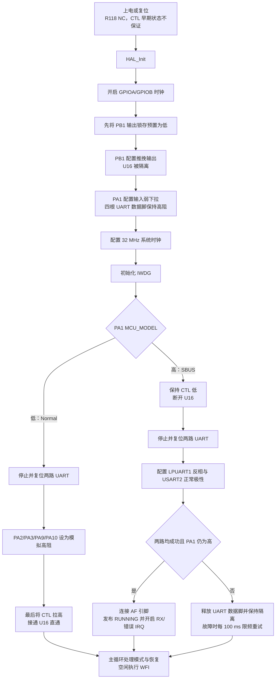
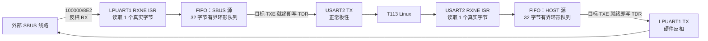

# LinkG MCU V2.0 构建与代码审查入口

本文面向固件构建、代码会审和实板复测。目标芯片为 STM32L031G6U6。MCU 只负责 Normal 直通与 SBUS 桥接通路切换，以及两路 UART 之间的透明字节转发；SBUS 帧识别、校验、通道解析、补帧、重同步和周期调度均由 T113 Linux 负责。

## 1. 当前验证结论

| 项目 | 状态 | 已取得的证据与边界 |
|---|---|---|
| ARM GCC 编译、链接及 BIN/HEX/ELF 生成 | **实际通过** | 2026-10-14 使用 GCC ARM Embedded 8.3.1 全量重编译；Flash 7,956 B，普通静态 RAM 504 B，另预留 1,024 B 栈 |
| 固件镜像结构检查 | **实际通过** | ARMv6-M Thumb、48 项向量、初始 SP、IRQ 入口、data/BSS/栈边界均通过脚本检查 |
| 主机桥接单元测试 | **实际通过** | 7 组 ASan/UBSan 测试，双向 20,000 字节有序比对，并覆盖 FIFO 溢出、UART 错误、切换、重试和喂狗逻辑 |
| C/H 格式与工程独立性检查 | **实际通过** | 15 个应用/测试 C/H 文件、64 个函数说明、22 个 Keil 输入和独立路径通过检查；946 个官方 Drivers 文件保持不变 |
| Keil 工程 | **仅静态检查通过** | `soft.uvprojx` 的 XML、目标芯片、源文件和包含路径已检查；当前机器未找到可调用的 Keil/ARMCC，因此没有执行 Keil 编译 |
| 单板 Normal/SBUS 自环与模式切换 | **实板通过** | Normal 5,060 字节；SBUS 2,087 帧/52,175 字节；8 次类型切换；有效测试窗口内逐字节一致，错误和丢弃为 0 |
| 双板极性矩阵 | **实板通过** | 2026-10-15 在 100000/8E2 下完成 N/N、S/N、N/S、S/S、N/N；匹配状态双向通过 224 帧/5,600 字节，错配状态注入 24 帧/600 字节且 0 个完整原帧通过 |
| 交付镜像与板上 Flash 一致性 | **尚未验证** | 用户已完成烧录，但测试机没有 SWD 回读能力；实板结果以实际烧入文件确为交付 BIN 为前提 |
| 绝对电平、波形、CTL 物理无争用、UART 错误注入、IWDG 复位 | **需要实板仪器验证** | 双板矩阵证明相对极性和路径选择，不能替代示波器、逻辑分析仪或 SWD 的电气与内部状态测量 |

交付镜像的 SHA256：

```text
linkg_mcu_v2.bin  36ab48c1ea86e09091571495fc50ed227474ff6da6d2204ef88ff124d4b867c4
linkg_mcu_v2.elf  af2b828d58c226d980f8a569e32e86862646eb0155a156d1ac755c7d2dda1416
linkg_mcu_v2.hex  31e9642d00218f4d9f4a769d908899f56262e3285d8fc926c6cf03937d517d00
```

## 2. 目录与模块职责

```text
linkg-mcu/
├── Core/
│   ├── Inc/                       # main、HAL 配置、中断声明
│   └── Src/                       # HAL/时钟初始化、异常与 IRQ 入口
├── Drivers/                       # STM32 官方 CMSIS/HAL；业务代码不修改
├── bsp/
│   ├── bsp_gpio.c/.h              # PA1 MCU_MODEL 与 PB1 CTL
│   └── bsp_uart.c/.h              # 两路 UART 生命周期、寄存器收发和错误清除
├── service/
│   └── sbus_bridge.c/.h           # 模式状态机、双向 FIFO、统计、恢复和 IWDG
├── GCC/
│   ├── startup_stm32l031xx.s      # GNU 启动和向量表
│   └── stm32l031g6.ld             # 32 KiB Flash、8 KiB SRAM 链接布局
├── MDK-ARM/
│   ├── soft.uvprojx               # Keil 工程
│   └── startup_stm32l031xx.s      # Keil 启动文件
├── tests/
│   ├── test_bridge.c              # 主机单元测试
│   ├── check_project.py           # 格式、Keil 输入和独立性检查
│   ├── check_firmware.py          # ELF/向量表/内存布局检查
│   └── hardware/                  # 单板自环、持续负载、双板极性脚本
├── validation/                    # 构建日志、检查结果和实板原始证据
├── Makefile                       # ARM GCC 独立构建；没有烧录目标
└── README.md                      # 设计和交付总说明
```

会审时应保持下列边界：

- `Core` 只负责 HAL、系统时钟、异常/中断入口和应用启动。
- `bsp_gpio` 只负责 MCU_MODEL 读取、CTL 输出及安全初值。
- `bsp_uart` 只负责 LPUART1/USART2 配置、启停、单字节寄存器访问和硬件错误清除。
- `sbus_bridge` 只负责模式状态机、两个方向各自的 FIFO、错误统计、恢复请求和 IWDG。
- MCU 不识别 25 字节帧，不检查帧头/帧尾，不解码通道，不修改、补发或重复任何字节，也不实现 7.6 ms 定时发送。
- 工程没有 RTOS、动态内存或旧电源、充电、电池、蜂鸣器、LED、按键业务，也不依赖 `mcu_soft/` 源文件。

## 3. 硬件映射与串口参数

| 逻辑侧 | 外设 | TX | RX | 物理参数 | 极性 |
|---|---|---|---|---|---|
| 外部 SBUS | LPUART1 | PA2 / AF6 | PA3 / AF6 | 100000 baud，8E2，无流控 | TXINV=1，RXINV=1 |
| T113 Host | USART2 | PA9 / AF4 | PA10 / AF4 | 100000 baud，8E2，无流控 | TXINV=0，RXINV=0 |

GPIO：

| 信号 | 引脚 | 含义 |
|---|---|---|
| MCU_MODEL | PA1 输入，内部弱下拉 | 高：请求 MCU SBUS 桥接；低：请求 Normal 直通 |
| CTL | PB1 推挽输出 | 低：断开 U16 直通通路；高：接通 U16 直通通路 |

HAL 的 8E2 配置使用 `UART_WORDLENGTH_9B + UART_PARITY_EVEN + UART_STOPBITS_2`。9 位字长包含校验位，实际数据仍为 8 位。两侧均为 100000 baud，一个字符包含 1 个起始位、8 个数据位、1 个校验位和 2 个停止位，占线时间约 120 μs。

原理图网名与本次逻辑分工容易造成误读：PA2/PA3 沿实际连线属于外部 UART0/SBUS 侧，PA9/PA10 属于 T113 Host 侧。会审应以引脚和实际连线为准。

## 4. 上电与模式切换

R118 标注为 NC，不能假定 MCU 复位期间 CTL 有可靠外部上拉。PB1 在 MCU 进入 `main()` 并完成 GPIO 初始化前可能浮空，因此 U16 在上电、掉电、烧录和复位早期的状态不由本固件保证。若产品要求该窗口也具有确定状态，必须增加硬件偏置或门控并验证供电时序。

### 4.1 启动与稳态选择



### 4.2 Normal → SBUS

1. Linux 应先停止业务流量，避免切换边界截断字节。
2. 主循环检测 PA1 变高，先把 CTL 拉低，断开 U16。
3. `bsp_uart_start()` 先停止旧 UART：禁用 IRQ，关闭 UE/TE/RE，把四根数据脚设为模拟高阻，DeInit 并复位外设。
4. 以 100000/8E2 初始化 LPUART1 和 USART2；LPUART1 开启 TX/RX 硬件反相，USART2 保持正常极性。
5. 两路初始化均成功后才把四根数据脚连接到 AF，随后发布 `RUNNING` 状态并开启 RXNE、PE、EIE 中断。
6. 初始化结束前再次读取 PA1；若请求已撤销，立即停止 UART、释放数据脚，再把 CTL 拉高。

### 4.3 SBUS → Normal

1. Linux 应先停止业务流量。
2. 主循环检测 PA1 变低，在短临界区内停止桥接。
3. 记录两个软件 FIFO 中尚未发送的字节数；若硬件 TC 尚未完成，只记录一次 `tx_abort_events`，不猜测硬件内部的精确丢失量。
4. 禁用 UART IRQ，关闭 UE/TE/RE，将 PA2/PA3/PA9/PA10 设为模拟输入无上下拉，DeInit 并复位 UART。
5. 最后把 CTL 拉高，接通 U16 Normal 直通路径。

退出流程不等待队列和移位寄存器排空，因此切换边界可能截断在途字节；旧字节不会留到下一次桥接后重发。先隔离 U16 再启动 UART、先释放 UART 再导通 U16，是防止两条路径同时驱动的关键顺序。

## 5. 双向透明转发

两个方向拥有相互独立的 32 字节有界环形 FIFO，按**源 UART**索引：

- `direction[BSP_UART_SBUS]`：外部 LPUART1 → T113 USART2。
- `direction[BSP_UART_HOST]`：T113 USART2 → 外部 LPUART1。



每次 RX IRQ 最多读取一个硬件字节。收到有效字节后立即尝试把队首写入目标 TDR；目标 TXE 忙时才把待发字节保留在本方向 FIFO 并开启目标 TXE IRQ。只有 TDR 真正接受一个字节后才推进 `tail`、减少 `queued_bytes` 并增加 `tx_bytes`。队列清空后立即关闭 TXE IRQ。

STM32L031 的 UART 没有把 25 字节作为一个整体交付给应用的硬件帧 FIFO。即使 Linux 某次 `read()` 得到 25 字节，MCU 仍是逐字节 IRQ 转发；若源端只送 10 字节，MCU 就按原顺序转发这 10 字节，不等待凑满 25 字节。空队列时首字节不等待整帧，也不存在固定抖动缓冲。

32 字节满队列对应约 3.84 ms 的目标占线时间，只用于吸收中断调度差异。连续满带宽且两侧时钟存在偏差时，有界 FIFO 不能保证无限期无丢失。

## 6. 错误、溢出与恢复

| 条件 | 固件动作 | 可审查的统计 |
|---|---|---|
| 目标 TXE 未就绪 | 保留队首并等待 TXE IRQ，不重复提交 | `queued_bytes`、`high_water_bytes` |
| FIFO 已满 | 先尝试向目标 TDR 腾出一格；仍满则丢弃新收到的字节，旧数据顺序保持不变 | `overflow_bytes` |
| PE / FE / NE | BSP 清 ICR 并读 RDR；Bridge 记录硬件错误并丢弃这个不可信字节 | `parity_errors`、`frame_errors`、`noise_errors`、`bad_rx_bytes` |
| ORE | 清 ORE 并继续接收；若 RDR 字节没有 PE/FE/NE，仍按原样转发 | `overrun_errors` 只记录事件，不虚构未知丢失量 |
| 错误标志但没有 RXNE | 只记录错误，不生成任何字节 | 对应错误计数 |
| 非忙 TX 错误 | 保留队首，ISR 设置恢复请求，由主循环停止并重启 UART | `tx_failures`、`last_error` |
| UART 初始化失败 | CTL 保持低、数据脚高阻，进入故障隔离；每 100 ms 至多重试一次 | `start_failures`、`last_error` |
| 模式退出或恢复重启 | 记录软件 FIFO 的精确丢弃量；TC 未完成只记录事件 | `discarded_bytes`、`tx_abort_events` |

中断中没有阻塞等待、日志打印、HAL 阻塞发送、协议解析或定时发帧。HAL UART 句柄只用于 Init/DeInit，应用不修改 `gState`、`RxState`，也不混用 HAL 的异步收发状态机。两路 UART IRQ 同为优先级 1，互不抢占；统计快照和模式切换使用短 PRIMASK 临界区。

统计为复位后累计的 32 位无符号数，会自然回绕。`rx_bytes` 包括从 RDR 读出的硬件标错字节，`tx_bytes` 只表示已提交给目标 TDR 的字节，二者都不能单独证明远端已完整收到。内部统计可通过 SWD 查看 `g_bridge.stats`，代码接口为 `sbus_bridge_get_stats()`。

## 7. 独立看门狗

IWDG 使用 LSI、256 分频、Reload=249、关闭窗口功能；按 37 kHz 标称 LSI 计算，超时约 1.73 s。主循环每 100 ms 喂狗，中断不喂狗，因此主循环卡死或持续中断风暴会停止喂狗并触发复位。

需要保留以下边界：

- IWDG 在系统时钟配置完成后才启动，早期时钟初始化故障不受保护。
- LSI 存在器件、电压和温度偏差，1.73 s 是计算值，不是实测复位周期。
- 故障路径会先释放 UART 数据脚并保持 CTL 低隔离，之后等待已启动的 IWDG 复位。
- 本次只通过主机测试覆盖了喂狗调用逻辑，尚未在 STM32 实板上阻塞主循环并测量真实复位。

## 8. Ubuntu GCC 构建

### 8.1 本次实际执行且通过的命令

本机没有已安装的 Keil 或 `arm-none-eabi-gcc`。经用户明确允许，将 Tina SDK 中已有的 GCC ARM Embedded 8.3.1 压缩包临时解压到任务目录；没有下载软件、使用 `sudo` 或修改系统 PATH。实际全量构建命令为：

```sh
cd /home/dawn/project/linkg_v3/linkg-mcu
set -o pipefail
make -B -j4 CROSS_COMPILE=/home/dawn/project/.codex-mcu-backups/20261014-v2/toolchain/gcc-arm-none-eabi-8-2019-q3-update/bin/arm-none-eabi- 2>&1 | tee validation/gcc-build.log
make test check 2>&1 | tee validation/checks.log
python3 tests/check_firmware.py /home/dawn/project/.codex-mcu-backups/20261014-v2/toolchain/gcc-arm-none-eabi-8-2019-q3-update/bin/arm-none-eabi- > validation/firmware.log
```

构建结果：

```text
FLASH: 7956 / 32768 B
data:  12 B
BSS:   492 B
stack: 1024 B reserved
heap:  0 B
```

GNU ld 显示 RAM 100% 是因为 `.stack` 被固定在 SRAM 顶部，表示地址跨度，不表示静态数据已占满。普通静态数据为 504 B，普通 BSS 与栈之间仍有 6,664 B 间隔。

### 8.2 复用任意已安装 ARM GCC

`CROSS_COMPILE` 必须是包含尾部 `arm-none-eabi-` 的工具前缀：

```sh
cd /home/dawn/project/linkg_v3/linkg-mcu
make -B -j4 CROSS_COMPILE=/absolute/path/to/bin/arm-none-eabi-
make test check
python3 tests/check_firmware.py /absolute/path/to/bin/arm-none-eabi-
```

产物位于：

```text
build/gcc/linkg_mcu_v2.elf
build/gcc/linkg_mcu_v2.hex
build/gcc/linkg_mcu_v2.bin
build/gcc/linkg_mcu_v2.map
```

`Makefile` 没有下载、安装或烧录目标。应用源码使用 `-Wall -Wextra -Werror`；官方 HAL 编译单元只额外关闭 `unused-parameter`，不修改厂商源码。

## 9. Keil 构建边界

在装有 Keil MDK/ARM Compiler 5 的 Windows 上，可打开 `MDK-ARM/soft.uvprojx`，选择目标 `soft` 后构建。预期命令形式为：

```bat
cd MDK-ARM
"C:\Keil_v5\UV4\UV4.exe" -b soft.uvprojx -t soft -o build.log
```

工程目标为 `STM32L031G6Ux`，使用 ARM Compiler 5、C99 和 microlib。以上命令**本次未执行**，因为 Windows 和 Ubuntu 均未找到可调用的 Keil/ARMCC；不能把 XML/路径检查写成“Keil 编译通过”。工程已关闭自动下载/运行，也没有构建后烧录命令。

## 10. 静态检查与主机测试

从 `linkg-mcu` 根目录执行：

```sh
# ASan/UBSan 主机桥接测试
make test
# 代码格式、函数说明、Keil 输入、工程独立性
make check
# 已构建 ELF 的目标架构、向量表和内存布局
python3 tests/check_firmware.py /absolute/path/to/bin/arm-none-eabi-
# 从上级 linkg_v3 仓库检查补丁空白错误
cd /home/dawn/project/linkg_v3
git diff --check
```

已保存证据：

| 文件 | 内容 |
|---|---|
| `validation/gcc-build.log` | 最终 ARM GCC 全量编译、链接、size 和镜像生成日志 |
| `validation/checks.log` | 7 组主机测试与 `check_project.py` 结果 |
| `validation/firmware.log` | ELF 架构、向量、内存边界和产物 SHA256 |
| `validation/final-audit.log` | 最终格式、Drivers 完整性、独立重建和 diff 检查摘要 |
| `validation/standalone-build.log` | 独立交付目录重建日志；BIN 与工作区产物逐字节相同 |
| `validation/REPORT.md` | 完整交付清单、命令、结果和未验证边界 |

## 11. 实板验证结论

2026-10-15 已完成单板 Normal/SBUS 自环、持续负载、模式切换和双板极性矩阵。双板固定使用 100000/8E2，按 N/N、S/N、N/S、S/S、N/N 顺序验证：两个匹配状态双向逐字节精确通过，两个错配状态均没有完整原帧通过，最终 N/N 恢复再次通过。两块板的原始 UART 配置均已恢复，服务、Worker 和设备保持运行。

该结果证明相对极性翻转、Normal/SBUS 功能路径选择和双向透明传输成功，可以作为本版 MCU 的功能定版依据。本次不向仓库新增极性测试脚本、JSON 或专项测试报告；测试结论只在本文保留一段状态说明。

## 12. 仍需示波器、逻辑分析仪或 SWD 验证

双板矩阵可作为相对极性和功能路径的定版依据，但以下项目不能标记为已成功：

1. 示波器测量 Normal 外部 TX 空闲高电平、SBUS 外部 TX 空闲低电平，以及真实 100000/8E2 位宽、偶校验和 2 停止位。
2. 同时探测 PA2/PA3 和 PA9/PA10，确认 LPUART1 外部侧绝对极性反相、USART2 Host 侧绝对极性正常。
3. 切换 PA1 时探测 PB1/CTL 和两组 TX，确认 SBUS 模式 CTL 实际为低、Normal 模式实际为高，并确认 U16 物理断开、UART 高阻释放和无双路争用。
4. 覆盖上电、NRST、烧录、IWDG 复位及 MCU/T113 分别掉电，测量 R118 NC 导致的 CTL 浮空窗口。
5. 注入 PE、FE、NE、ORE、长 BREAK 和 FIFO 压力，确认错误计数、丢字节语义和后续恢复。
6. 通过 SWD 查看 `g_bridge.stats`，验证两个方向的 `rx_bytes`、`tx_bytes`、`overflow_bytes`、`high_water_bytes`、`discarded_bytes` 和 `tx_abort_events`。
7. 阻塞主循环并制造中断负载，实测 IWDG 复位周期；在电压、温度变化下检查 HSI/LSI 偏差。
8. 使用栈水位填充或 SWD 观测验证 1 KiB 预留栈的真实余量。
9. 通过 SWD 回读 Flash 或读取设备镜像校验值，建立“板上运行固件”和本目录 `linkg_mcu_v2.bin` 的一一对应关系。

代码审查结论应始终区分四类状态：**实际编译通过、仅静态检查、尚未验证、需要 STM32 实板仪器测试**。任何没有对应日志、JSON、波形或 SWD 证据的项目，都不应写成“已验证成功”。
