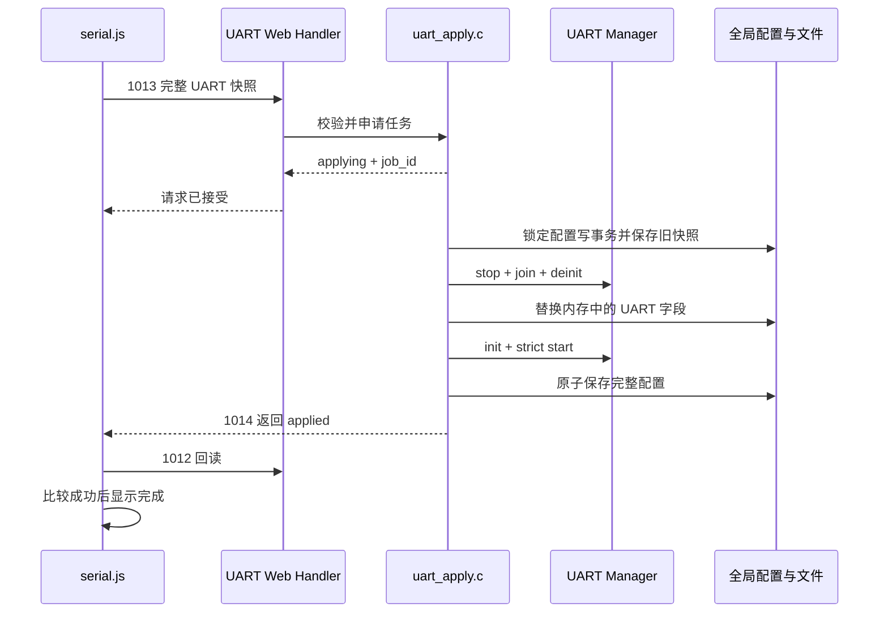
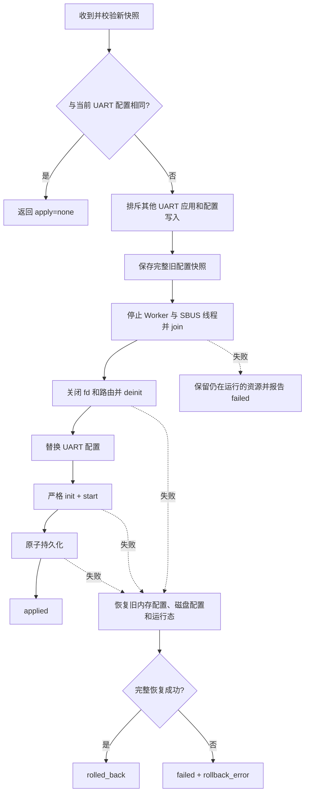

# LinkG UART 配置、热重载与验证说明

本文供代码审查、联调和后续维护使用。Web 页面修改的是完整 UART 配置快照，运行时只停止并重建 UART Manager。该流程不会调用 LinkG 全局重启，也不会重启 Wi-Fi、5G、Switch、TUN、Network 或 Web 模块。

## 模块边界

| 模块 | 职责 |
|---|---|
| `infra/config/linkg_uart_config.c` | JSON 解析、序列化、字段完整性、物理参数、IP、端口和监听冲突校验 |
| `platform/uart/linkg_uart.c` | termios、标准波特率、自定义分频、回读校验和非阻塞收发 |
| `service/uart/` | 串口、路由、Worker、SBUS、状态采样及 UART 独立热重载 |
| `service/web/handlers/web_handler_uart.c` | Web 协议适配，不直接访问 UART 私有上下文 |
| `app/linkg_main.c` | 正式进程中的 UART 初始化、启动、停止和反初始化生命周期接线 |
| `www/js/api/serial.js` | 1012、1013、1014 指令封装 |
| `www/js/pages/serial.js` | 页面生命周期、渲染、前端校验和应用结果确认 |

逻辑串口与板级设备节点由系统资源定义提供：

| 逻辑串口 | 设备节点 | SBUS |
|---|---|---|
| UART 0 | `/dev/ttyS4` | 支持，固定 100000 baud、8E2 |
| UART 1 | `/dev/ttyS3` | 不支持 |
| UART 2 | `/dev/ttyS5` | 不支持 |

配置项存在只表示物理参数已经保存。仅当配置项至少包含一条网络路由时，UART Manager 才创建活动端口上下文并打开设备。

## Web 协议

请求统一使用 `POST /cgi-bin/cmain` 和既有 LinkG JSON 响应格式。

| cmd | 请求参数 | 成功响应重点 |
|---|---|---|
| 1012 | 无 | `uart`、设备能力、波特率、SBUS 固定值、保留端口、接口广播地址 |
| 1013 | `{ "uart": [...] }` | `apply=none`，或 `apply=applying` 与 `job_id` |
| 1014 | 无 | 服务、活动端口、路由、统计和最后一次应用任务状态 |

1013 采用完整 UART 快照替换语义。配置未变化时返回 `apply=none`，不会重启 UART。接受变更只表示后台任务已经建立；页面继续轮询 1014，只有状态为 `applied` 且 1012 回读与提交值一致时才显示成功。



## 启停和回滚顺序

启动时先关闭板级 UART RX 门控，再切换 MCU 的 SBUS/普通 UART 模式。预留 5 ms 给 MCU 采样模式后，打开物理设备和本地 Socket；全部严格启动检查通过后打开 RX 门控、启动 Worker 和 SBUS 线程。

如果应用请求发生在 UART 服务原本已停止的状态，新配置仍执行一次严格启动检查，并在持久化前立即停止，以验证设备、分频和本地监听端口，同时保持最终生命周期为停止状态。

停止时先确认 Worker 和每个 SBUS 线程已经退出，再关闭 Socket 与 UART fd。随后关闭 RX 门控，最后退出 SBUS 模式。线程退出失败时保留其引用的配置、FIFO 和 fd，状态进入故障，不释放仍可能被线程访问的对象。GPIO 安全输出任一步失败时同样保留 `STOPPING`，后续停止操作会重试；只有 RX 门控和 SBUS 模式都关闭成功才进入 `STOPPED` 并允许反初始化。



SBUS 串口重开时先在 I/O 锁内清空旧 FIFO，再发布新 fd 和新的设备代次。SBUS 定时线程为待发帧记录设备代次；若物理设备已重开，未完成的旧帧会计为丢弃，绝不会续写到新设备。

## 波特率依据

软件能力列表只有一份，位于 `linkg_uart_config_baudrates()`：

```text
1200, 2400, 4800, 9600, 19200, 38400, 57600, 100000,
115200, 150000, 187500, 250000, 300000, 375000, 500000,
750000, 1500000
```

标准 termios 值走标准速度标志，其他值使用 `TIOCGSERIAL`/`TIOCSSERIAL` 的 `ASYNC_SPD_CUST` 路径。打开设备时以驱动返回的 `baud_base` 计算整数分频，拒绝无效分频和绝对误差超过 2% 的配置，并回读串口参数。Web 状态中的 `actual` 和 `error_pct` 是驱动分频计算值，不包含晶振误差，也不是示波器实测值。

T113 的 sunxi UART 驱动从实际 UART 时钟计算分频，板级设备树中的 UART3/4/5 时钟来自 APB1。不能把其他项目的固定 24 MHz 公式当成该板运行时证据。100000 baud 和全部白名单档位仍需在目标硬件运行后读取 `baud_base`，并用逻辑分析仪确认最终电气波形。

## 构建命令

在 Ubuntu 仓库根目录执行 T113 ARM Linux 应用构建：

```bash
cd /home/dawn/project/linkg_v3
STAGING_DIR=/home/dawn/t113_tina5.0_v1.2/prebuilt/rootfsbuilt/arm/toolchain-sunxi-glibc-gcc-830/toolchain \
cmake --build build/arm --target linkg --parallel 4
```

该命令只构建 LinkG 用户态程序，输出为 `output/bin/arm/linkg`。不要使用 STM32 MCU 工具链构建此目录。

## 隔离测试命令

主机测试使用 PTY 代替 `/dev/ttyS*`，使用真实 UART Worker、SBUS 线程、TCP/UDP Socket、配置解析、Web 分发和原子保存代码，并启用 ASan/UBSan：

```bash
cd /home/dawn/project/linkg_v3
python3 test/uart/build_tests.py
python3 test/uart/test_api.py
```

浏览器测试需要先启动测试网关，再在装有 Playwright 的主机运行测试：

```bash
python3 test/uart/web_test_gateway.py
node test/uart/test_browser.cjs http://127.0.0.1:18080 build/uart-test/browser
```

隔离测试覆盖配置边界、真实 UDP/PTY 与 TCP/PTY 双向字节流、TCP 关闭前尾包、端口占用、无变化应用、初始化/启动/打开/保存/GPIO 停机故障回滚、停止状态下严格预检、重复请求排斥、24 次普通/SBUS 重载、线程与 fd 泄漏以及失败回滚状态。PTY 不能证明 T113 UART 引脚、电平、奇偶校验、时钟误差或 MCU 模式切换时序，这些项目必须在实板完成。
