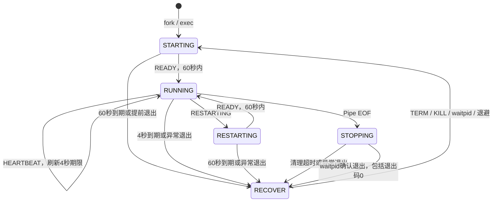

# LinkG Supervisor V0.1

独立守护 `/app/current/bin/linkg`，负责启动、READY、RUN心跳、进程内服务重启识别和故障后重新拉起。

Supervisor初始化成功后常驻。LinkG退出码0、非零退出和信号终止均会触发回收与退避重启，不会导致Supervisor随之退出。停止守护必须明确向Supervisor发送TERM/INT/QUIT，或由系统关机终止它。

本版不安装升级包，不读取版本JSON，不选择A/B版本，不操作Kernel、U-Boot ENV或硬件看门狗。现有 `supervisor_boot.*`、`supervisor_version.*` 和版本JSON夹具仍是后续阶段的空框架，不参与编译。

## 编译

在仓库根目录执行。独立目标只依赖C17、POSIX/Linux接口和项目公共协议头，不链接LinkG业务模块。

```bash
# x86独立构建和测试，测试参数与产品可执行文件相互隔离
cmake -S supervisor -B /tmp/linkg-supervisor-v01-build -DLINKG_SUPERVISOR_BUILD_TESTS=ON
cmake --build /tmp/linkg-supervisor-v01-build -j4
ctest --test-dir /tmp/linkg-supervisor-v01-build --output-on-failure -j2

# 完整x86 LinkG及Supervisor构建
cmake -S . -B /tmp/linkg-supervisor-v01-x86 -DARCHITECTURE=x86
cmake --build /tmp/linkg-supervisor-v01-x86 --target linkg linkg-supervisor -j4

# ARM独立交叉构建；沿用项目工具链所需的STAGING_DIR
export T113_TOOLCHAIN_DIR=/home/dawn/t113_tina5.0_v1.2/prebuilt/rootfsbuilt/arm/toolchain-sunxi-glibc-gcc-830/toolchain
export STAGING_DIR="$T113_TOOLCHAIN_DIR"
cmake -S supervisor -B /tmp/linkg-supervisor-v01-arm-only -DCMAKE_TOOLCHAIN_FILE="$PWD/toolchains/arm.cmake"
cmake --build /tmp/linkg-supervisor-v01-arm-only -j4

# 常规项目构建也会生成Supervisor
./build.sh x86
./build.sh arm
```

根工程产物为 `output/bin/x86/linkg-supervisor` 或 `output/bin/arm/linkg-supervisor`；独立构建的产物位于对应CMake构建目录。独立工程安装前缀设为 `/usr` 时，对应部署位置为 `/usr/sbin/linkg-supervisor`。本次没有执行安装或接管开机服务。

## 通信和状态

Supervisor以 `pipe2(O_NONBLOCK | O_CLOEXEC)` 创建匿名管道。fork之后父进程关闭写端，子进程关闭读端；仅初次exec前清除写端CLOEXEC，并通过 `LINKG_SUPERVISOR_FD` 传给LinkG。客户端校验写端是FIFO，重新设置CLOEXEC并移除环境变量，避免后续exec程序继承通知通道。

每个消息恰好一个字节，无结构体填充和字节序问题；常量定义在 `include/linkg/base/linkg_supervisor_protocol.h`。

| 字节值 | 消息 | 使用时机 |
|---|---|---|
| 1 | READY | 首次或服务重启后的 `_linkg_app_start()` 成功 |
| 2 | HEARTBEAT | 仅RUN阶段，每1秒发送 |
| 3 | RESTARTING | 确认服务重启动作后、cleanup之前发送 |



所有期限使用 `CLOCK_MONOTONIC`。STARTING中的心跳无效；RESTARTING中的心跳无效，重复RESTARTING不延长60秒窗口；RUNNING中的重复READY不刷新心跳期限。

客户端只创建一个心跳线程，跨所有进程内服务重启复用。RESTARTING通知与心跳由同一互斥锁串行化，保证通知之后不会再出现RUN心跳。READY或RESTARTING发生EAGAIN/EINTR时立即返回错误，主入口结束本轮进程并由Supervisor恢复；周期心跳发生EAGAIN/EINTR时跳过本次，不阻塞业务。EPIPE通过调用线程临时屏蔽并消费本次生成的SIGPIPE处理，不修改进程全局SIGPIPE处理器。

正常EXIT和REBOOT_SYSTEM路径在业务cleanup前停止心跳线程并关闭管道，Supervisor观察到EOF后进入最长60秒的STOPPING清理窗口。EOF只代表通知结束，不代表进程退出：必须由waitpid确认。STARTING/RESTARTING中的EOF保留原有期限，不延长窗口。

LinkG的任何退出都触发恢复，包括首次READY前退出、退出码0、非零退出码和信号终止。管道EOF仅允许旧进程完成有上限的清理，不表示停止守护。Supervisor自身接收TERM/INT/QUIT时停止恢复，清理子进程后退出；系统reboot由LinkG原有路径执行。维护或关机需要先停止Supervisor，单独停止LinkG会被重新拉起。

## 恢复和所有权

故障后只向自身fork得到的PID发送SIGTERM，最多等待2秒，再发送SIGKILL，最终由waitpid回收。回收失败时Supervisor保持常驻，按退避继续清理旧PID，不启动第二个LinkG；若进程处于不可中断内核等待，SIGKILL后的waitpid可能仍需等待，期间也不会启动第二个实例。

连续故障退避为1、2、4、8、16、30、30秒；连续RUN满60秒后清零。服务重启窗口不计入稳定运行时间。每轮均关闭管道，退出时关闭进程锁；锁文件保留，避免unlink后不同进程锁到不同inode。

默认锁路径 `/run/linkg-supervisor.lock`。测试可通过 `--lock-file` 指定独立路径，可执行文件路径和参数放在其后：

```bash
/tmp/linkg-supervisor-v01-build/linkg-supervisor \
    --lock-file /tmp/linkg-supervisor-demo.lock \
    /tmp/linkg-supervisor-v01-build/supervisor-mock-production healthy
```

模拟程序不修改网络或系统密码。正式LinkG本身具有业务和系统初始化副作用，不能用模拟程序的测试结果宣称完整业务在x86运行通过。

Supervisor不按进程名扫描或清理其他实例，也不管理LinkG启动的第三方守护进程。PDEATHSIG在Supervisor异常消失时给直接子进程发送TERM；不承诺Supervisor被SIGKILL后，对拒绝或阻塞TERM的子进程完成回收。

## 与现有启动脚本的关系

当前SDK的 `openwrt/openwrt/files/etc/rc.local` 启动 `/app/current/bin/linkg_watchdog.sh`。该脚本每秒使用 `pidof linkg` 判断是否重新启动，不能与新Supervisor同时负责正式LinkG。

本次只实现和测试，不修改SDK、rc.local、procd或板上进程。后续部署需要在同一次受控维护中停止并撤销旧脚本启动入口，确认旧LinkG退出，再由唯一的init/procd入口启动Supervisor。init/procd将来只守护Supervisor；Supervisor负责LinkG，避免两层同时拉起LinkG。boa等现有业务入口本次不调整。

## 验收边界

可执行模拟测试覆盖进程及通知协议基本活性；独立心跳线程不能检测所有业务线程死锁、无线失联或业务功能失效。正常清理窗口、启动窗口、服务重启窗口都有上限；硬件掉电、Kernel卡死和Supervisor自身故障恢复不属于本版本。

测试清单与复现说明见 [tests/README.md](tests/README.md)，代码职责见 [docs/MODULES.md](docs/MODULES.md)。
