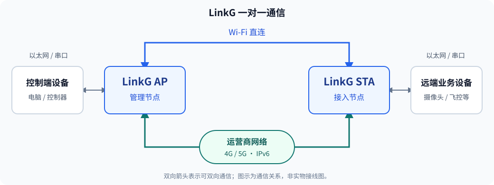

# 产品概述

LinkG 是铂升机器人推出的一款集成 Wi-Fi 与 4G/5G 蜂窝通信的图数传设备，用于在控制端与远端设备之间双向传输视频、控制指令和业务数据，同时通过蜂窝网络为以太网接入设备提供公网访问能力。设备通过以太网或串口接入电脑、网络摄像头、飞控等设备，适用于无人机、无人车和机器人等远程通信场景。

## 主要特点

- **公网访问**：通过 4G/5G 蜂窝网络为以太网接入设备提供互联网出口，支持接入设备访问云平台和公网服务。
- **双链路通信**：支持 Wi-Fi 直连与蜂窝网络传输，根据链路状态和业务情况自动切换传输路径。
- **业务分类传输**：按 TCP/UDP 端口区分实时、视频和普通数据业务，分别管理各类业务的传输路径。
- **宽窄带模式**：Wi-Fi 支持宽带与窄带模式，可配置带宽及速率控制方式。
- **组网方式**：采用 AP/STA 星型组网；宽带支持一对一、一对多，窄带默认按一对一使用，自适应模式仅支持一对一。
- **Web 管理**：通过浏览器配置网络、无线和串口参数，查看链路状态，执行诊断测试与固件升级。

## 通信方式

- **AP（管理节点）**：作为星型网络的中心，连接一个或多个 STA。
- **STA（接入节点）**：连接 AP，并接入本地业务设备。宽带一对多组网时，将多个 STA 及其业务设备接入同一个 AP。

> **窄带组网限制**：自适应模式仅支持一对一。固定档位下，用户可自行调整参数尝试一对多，但该方式不属于默认支持范围；可用节点数与通信效果需在实际业务和环境中自行测试，不承诺接入数量。

设备间蜂窝组网需两端具备可互通的全局 IPv6 地址。接入设备上网需本机蜂窝网络可用，并正确配置接入设备的默认网关和 DNS。使用蜂窝网络会产生移动数据流量。

完整规格参数见[技术规格](04-技术规格.md)。
