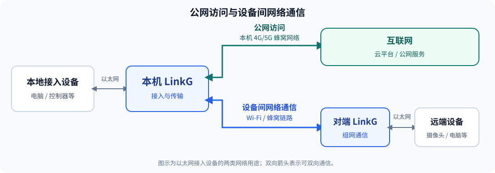

# 主要功能

## 1. 公网访问

LinkG 可通过 4G/5G 蜂窝网络，为以太网接入的电脑、控制器等设备提供互联网出口，用于访问云平台、上传业务数据和连接公网服务。

接入设备需正确配置 IP 地址、默认网关和 DNS。使用 LinkG DHCP 服务时，可自动分配地址，并按配置下发默认网关和 DNS。上网流量使用本机蜂窝网络，产生的流量费用由 SIM 卡套餐决定。

## 2. 设备间网络通信

将电脑、网络摄像头等设备接入 LinkG 以太网口后，可通过 LinkG 组网与远端设备交换网络数据，用于视频传输、远程控制和设备访问。

组网通过虚拟地址访问不同节点及其接入设备。同一组网中的节点 ID 必须唯一，虚拟网络配置必须一致；客户端需具备到虚拟网络的路由，可通过 LinkG DHCP 服务自动获取。

## 3. Wi-Fi 无线组网

LinkG 采用 AP/STA 星型组网，由一个 AP 连接一个或多个 STA。Wi-Fi 支持宽带与窄带模式。

| 模式 | 支持范围 |
|---|---|
| 宽带 | 支持一对一、一对多，可配置 20/40/80 MHz 信道带宽 |
| 窄带自适应 | 10 MHz 带宽，驱动自动调整速率档位；**仅支持一对一** |
| 窄带固定档位 | 10 MHz 带宽，可选档位 0～5；默认按一对一使用 |

窄带固定档位下，用户可自行调整参数尝试一对多，但该方式不属于默认支持范围；可用节点数与通信效果需在实际业务和环境中自行测试，不承诺接入数量。

## 4. 4G/5G 蜂窝通信

LinkG 支持自动选择 4G/5G、仅 4G LTE、仅 5G NR SA 三种网络模式，可配置 APN 和 SIM PIN，并查看 SIM 状态、网络注册、信号质量及 IP 地址。

蜂窝网络既可用于本地接入设备上网，也可作为 LinkG 设备间的传输链路。**设备间蜂窝组网需要两端具备可互通的全局 IPv6 地址**；除启用蜂窝模块外，还需启用 LinkG 蜂窝链路。

## 5. 多链路协同与业务分类

LinkG 将组网流量分为实时、视频和普通数据三类，分别管理传输路径。分类依据为配置的 TCP/UDP 协议和端口范围。

| 业务类型 | 分类方式 | 典型用途 |
|---|---|---|
| 实时 | 匹配实时业务规则 | 控制指令、飞控遥测 |
| 视频 | 匹配视频业务规则 | 网络视频流 |
| 普通数据 | 未匹配实时或视频规则 | 文件传输、其他网络数据 |

当 Wi-Fi 与蜂窝链路可用时，系统根据链路状态和业务情况自动调整各类业务的传输路径，支持单链路发送和冗余发送。用户可在 Web 中查看各类业务当前的发送模式、主链路及备用或冗余链路。

## 6. 串口与 SBUS 传输

- **普通串口**：支持串口数据与 TCP/UDP 网络之间的转发，可配置串口参数、目标端点及单向或双向转发，用于飞控遥测、传感器数据和串口控制指令等业务。
- **SBUS**：UART0 支持 SBUS 控制数据传输，串口格式固定为 100000 baud、8 位数据位、偶校验、2 位停止位（8E2）。

串口需配置至少一条有效的网络转发规则才会启动转发；仅保存串口物理参数不会启动数据传输。

## 7. 状态查看与诊断

通过 Web 查看本机、对端与链路状态，并使用诊断工具检查串口和网络通信。

| 功能 | 可查看或测试的内容 |
|---|---|
| 状态查看 | 设备角色与版本、网络地址、对端节点、Wi-Fi 信号与速率、蜂窝信号、业务链路时延及发送计划 |
| 串口诊断 | 普通串口回环、UART0 SBUS 桥接回环，支持单串口或全部串口测试 |
| 链路性能测试 | TCP/UDP 上下行测试，支持公共服务器或自定义服务器，也可将远端 LinkG 作为测试服务端 |

串口诊断需连接对应回环线路或测试治具，期间会暂停串口转发业务。链路性能测试结果取决于所选服务器和实际传输路径。

## 8. 设备管理与维护

通过 Web 配置 AP/STA 角色、网络、Wi-Fi、蜂窝和串口参数，并执行以下维护操作：

- **固件升级**：上传升级包，查看校验、安装及升级状态。
- **设备重启**：通过 Web 发起设备重启。
- **恢复出厂设置**：恢复默认配置，重新设置设备。

硬件与通信规格见[技术规格](04-技术规格.md)。
