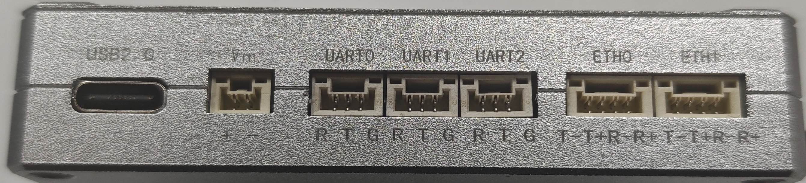
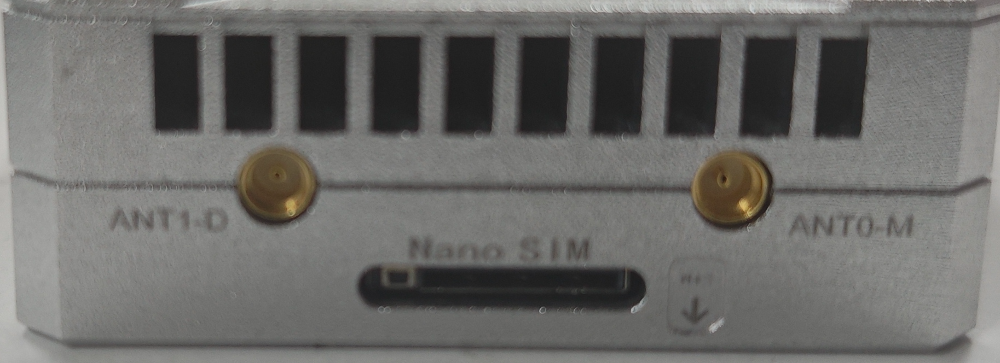
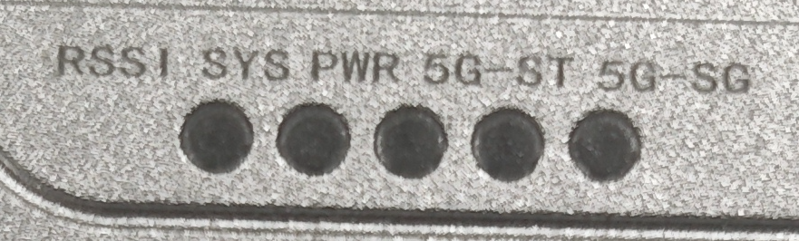
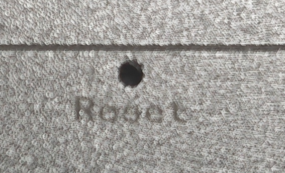

# 硬件与接口

## 1. 外观与接口位置

LinkG 提供 **3 个串口（UART0～UART2）和 2 个网口（ETH0、ETH1）**，面板设有 RSSI、SYS、PWR、5G_ST、5G_SG 五个指示灯，侧面设有 Reset 按键孔。

**接线面**

**天线与卡槽侧面**

## 2. 接口说明

| 面板标识或部件 | 数量 | 用途与说明 |
|---|---|---|
| Vin | 1 | 电源输入，支持 9～15 V；接线按面板正负极标识对应 |
| UART0 | 1 | 普通串口或 SBUS，按业务配置选择工作方式 |
| UART1、UART2 | 2 | 普通串口，用于飞控遥测、传感器数据等串口业务 |
| ETH0、ETH1 | 2 | 100 Mbps 以太网接口，用于接入电脑、网络摄像头等设备 |
| 天线接口 | 待确认 | 连接对应的无线天线；接口型号和 Wi-Fi / 蜂窝对应关系待确认 |
| 卡槽 | 待确认 | 卡型、用途标识及插入方向待确认 |
| 散热风扇与开孔 | — | 用于设备散热，安装时预留通风空间 |

### 串口接线

串口接口按面板的 **R、T、G** 标识识别信号，普通串口连接关系如下：

| LinkG 标识 | 信号含义 | 连接外部设备 |
|---|---|---|
| R | RX，接收 | 外部设备 TX |
| T | TX，发送 | 外部设备 RX |
| G | GND，信号地 | 外部设备 GND |

UART0 使用 SBUS 时，串口格式固定为 **100000 baud、8E2**。SBUS 接线需按对应引脚定义连接。

> **待补充的接线参数**：串口电平、连接器型号与间距、UART0 的 SBUS 引脚定义、ETH0/ETH1 引脚及两口使用关系、电源引脚方向图。以上内容确认后补入本节。

## 3. 指示灯说明

### 指示灯速查

| 面板标识 | 名称 | 表现与含义 |
|---|---|---|
| RSSI | Wi-Fi 信号灯 | 根据 Wi-Fi 信号显示白、蓝、绿、黄、红色；异常时可红色快闪，详见下表 |
| SYS | 系统运行灯 | 按 AP / STA 角色周期闪烁；恢复出厂配置操作期间快速闪烁 |
| PWR | 电源灯 | 系统上电后绿色常亮 |
| 5G_ST | 蜂窝注册状态灯 | 由蜂窝模块直接驱动；未注册网络时熄灭，注册网络后红色常亮 |
| 5G_SG | 蜂窝信号灯 | 根据蜂窝信号显示白、蓝、绿、黄、红色；异常时可红色快闪，详见下表 |

### SYS 系统运行灯

| 表现 | 含义 |
|---|---|
| 亮 1.5 秒、灭 0.5 秒循环 | AP 角色运行 |
| 亮 0.3 秒、灭 0.7 秒循环 | STA 角色运行 |
| 快速闪烁，约每 0.1 秒切换亮灭 | Reset 按住达到约 5 秒、尚未满 10 秒，此时松手可触发恢复出厂配置 |

### RSSI 与 5G_SG 信号颜色

两种信号灯采用相同的颜色顺序，**白 → 蓝 → 绿 → 黄 → 红表示信号由强到弱**。Wi-Fi 使用 RSSI，蜂窝使用 RSRP，阈值不同。

| 常亮颜色 | Wi-Fi 宽带 RSSI | Wi-Fi 窄带 RSSI | 蜂窝 RSRP |
|---|---|---|---|
| 白 | ≥ -50 dBm | ≥ -60 dBm | ≥ -80 dBm |
| 蓝 | -60～低于 -50 dBm | -75～低于 -60 dBm | -90～低于 -80 dBm |
| 绿 | -75～低于 -60 dBm | -85～低于 -75 dBm | -100～低于 -90 dBm |
| 黄 | -85～低于 -75 dBm | -95～低于 -85 dBm | -110～低于 -100 dBm |
| 红 | < -85 dBm | < -95 dBm | < -110 dBm |

上表适用于信号数据有效、相应前置状态正常的情况。其他灯语如下：

| 表现 | RSSI（Wi-Fi） | 5G_SG（蜂窝） |
|---|---|---|
| 红色快闪 | 没有在线对端、未关联或无线状态获取异常 | 蜂窝数据服务未就绪，或 IPv6 互联网不可用 |
| 红色常亮 | 信号弱，也可能是信号数据无效或状态异常 | 信号弱，也可能是信号数据无效或状态异常 |
| 熄灭 | Wi-Fi 功能关闭或相应指示灯服务停止 | 蜂窝功能关闭或相应指示灯服务停止 |

AP 的 RSSI 灯按已关联且具有有效信号数据的 STA 中，信号最弱的一台显示；STA 显示其 AP 的信号。5G_SG 正常显示信号等级时，还要求蜂窝数据服务及 IPv6 互联网可用。

**PWR 亮起表示已上电，5G_ST 红色常亮表示已注册蜂窝网络；两者均不能单独证明业务通信正常。** 信号灯颜色也不直接代表吞吐量或通信时延。

## 4. Reset 按键

Reset 用于恢复出厂配置，按键位于侧面的标识孔内。

1. 设备正常启动后，按住 Reset。
2. 持续约 5 秒，观察 SYS 灯进入快速闪烁。
3. **在达到 10 秒之前松开按键**，触发恢复出厂配置。
4. 恢复成功后设备重启，按默认配置重新连接。

按住不足 5 秒松开不执行恢复；按住达到 10 秒或更久，本次按压失效。恢复出厂配置会重置用户配置，不是重新刷写固件。

产品尺寸、重量、供电和工作环境参数见[技术规格](04-技术规格.md)。
