# 一对一配置

本章从两台 LinkG 的出厂配置开始，通过 Web 页面将一台设置为 **AP（管理节点）**，另一台保持为 **STA（接入节点）**，建立一对一 Wi-Fi 连接。完成后，先观察面板 RSSI 指示灯，再在 Web 页面检查配对状态，最后通过电脑 Ping 对端设备，确认通信正常。

本例使用宽带 Wi-Fi，不需要 SIM 卡，也不需要开启蜂窝通信。首次配置时，两台设备均为 STA、节点 ID 均为 2，尚未相互连接。

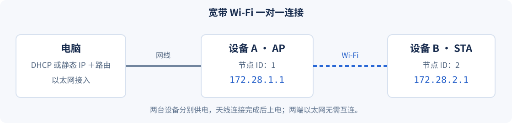

## 1. 准备设备并接线

准备两台 LinkG、一台带网口的电脑、网线及配套转接线，为两台设备连接好天线和 9～15 V 电源。以下将准备设置为 AP 的设备称为 **设备 A**，另一台称为 **设备 B**。

先用网线将电脑连接到设备 A，两台 LinkG 之间通过无线通信，无需网线互连。

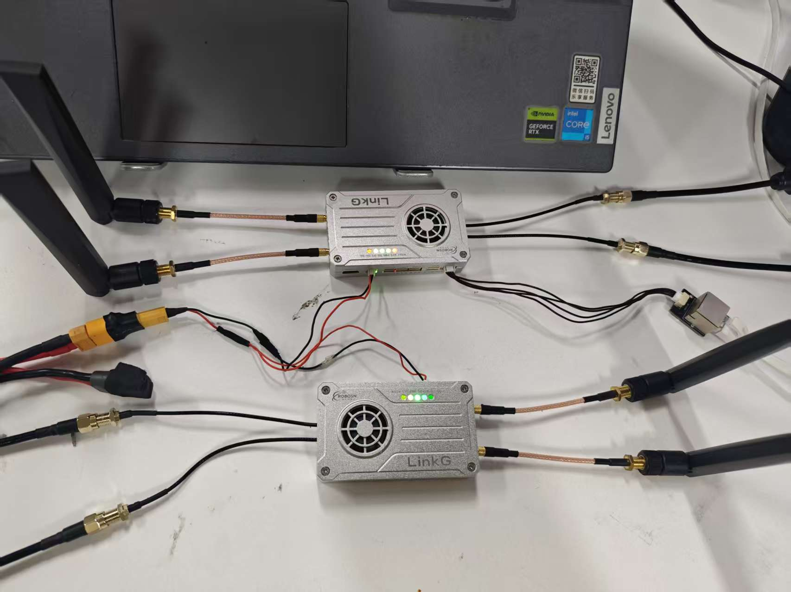

接口位置可参考下图；详细供电与接口说明见[硬件与接口](../01-产品介绍与规格/03-硬件与接口.md)。本例只需使用电源和以太网接口。

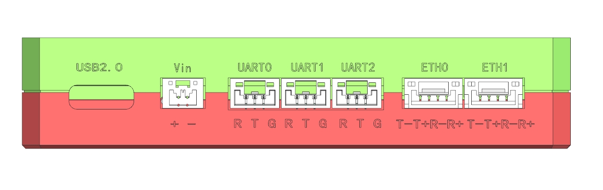

> 两台设备的默认以太网地址都是 `192.168.1.1`，并且都开启 DHCP。首次配置时，请用电脑逐台直连，或由两台电脑分别连接各自的 LinkG；不要把两个 LinkG 的以太网接口接入同一个交换机网络。

已经修改过配置的设备，可先按[Reset 按键说明](../01-产品介绍与规格/03-硬件与接口.md#4-reset-按键)恢复出厂配置。恢复会清除用户配置；新设备或已恢复出厂的设备可直接继续。

## 2. 配置电脑网络

下面两种方式任选一种，推荐使用 **DHCP 自动获取**。只修改连接 LinkG 的以太网适配器。

### 方式一：DHCP 自动获取（推荐）

以 Windows 为例：

1. 打开所用以太网适配器的“属性”，选择“Internet 协议版本 4（TCP/IPv4）”。
2. 选择“自动获得 IP 地址”和“自动获得 DNS 服务器地址”，保存设置。
3. 重新插拔电脑与 LinkG 之间的网线，等待电脑获取网络配置。

LinkG 会向电脑分配 `192.168.1.2～192.168.1.254` 范围内的地址，并下发访问 `172.28.0.0/16` 的路由。**Windows 正常获取 DHCP 配置后，不需要手动设置 IP 或添加路由。**

可在命令提示符中执行以下命令检查：

```bat
ipconfig
route print -4
```

确认所用网卡取得 `192.168.1.x` 地址、子网掩码为 `255.255.255.0`，并存在目标为 `172.28.0.0`、掩码为 `255.255.0.0`、网关为 `192.168.1.1` 的路由。默认配置不下发 Internet 默认网关，电脑的默认网关为空不影响本章组网访问。

若电脑保留了旧租约，可在命令提示符中重新获取，将“以太网”替换为实际网卡名称：

```bat
ipconfig /release "以太网"
ipconfig /renew "以太网"
```

### 方式二：静态 IP ＋手动路由

在所用以太网适配器的 IPv4 属性中手动设置：

| 项目 | 设置值 |
|---|---|
| IP 地址 | `192.168.1.100`，示例地址，使用前确认未被其他设备占用 |
| 子网掩码 | `255.255.255.0` |
| 默认网关 | 留空 |
| DNS 服务器 | 本例使用 IP 地址访问，可留空 |

然后**以管理员身份打开命令提示符**，添加虚拟网段路由。将“以太网”替换为实际网卡名称：

```bat
netsh interface ipv4 add route prefix=172.28.0.0/16 interface="以太网" nexthop=192.168.1.1 store=persistent
```

这条路由表示：访问 LinkG 虚拟组网地址时，通过所选以太网适配器交给本地 `192.168.1.1`，保存后重启电脑仍然有效。**只设置静态 IP、没有添加路由时，通常只能访问本地 `192.168.1.1`，不能直接使用虚拟组网地址。**

添加后用 `route print -4` 核对。若提示“对象已存在”，先确认已有路由的网段、网关和网卡是否正确。LinkG 默认 DHCP 地址池没有预留静态地址，接入多台电脑时需避免地址冲突。

Linux 用户同样需要设置以太网静态地址及虚拟网段路由；可在 Web 的“网络配置 → 基础网络 → Windows / Linux 客户端接入与验证”中，按实际网卡和连接名称获取命令。使用不支持 DHCP 路由选项的客户端时，也需手动补充虚拟网段路由。

## 3. 打开出厂配置的 Web 页面

电脑网络配置完成后，在浏览器打开 LinkG V1.0.0 的默认管理入口：

**[http://172.28.2.1/?v=LinkG-v1.0.0#/overview](http://172.28.2.1/?v=LinkG-v1.0.0#/overview)**

此地址适用于出厂节点 ID 为 2 的设备。直连时，也可通过 **[http://192.168.1.1/?v=LinkG-v1.0.0#/overview](http://192.168.1.1/?v=LinkG-v1.0.0#/overview)** 访问当前接在网线上的设备。

出厂状态下，概览显示角色为 **STA**、本机节点为 **2**，组网节点列表只有本机，共 **1 个节点**，表示尚未建立一对一连接。

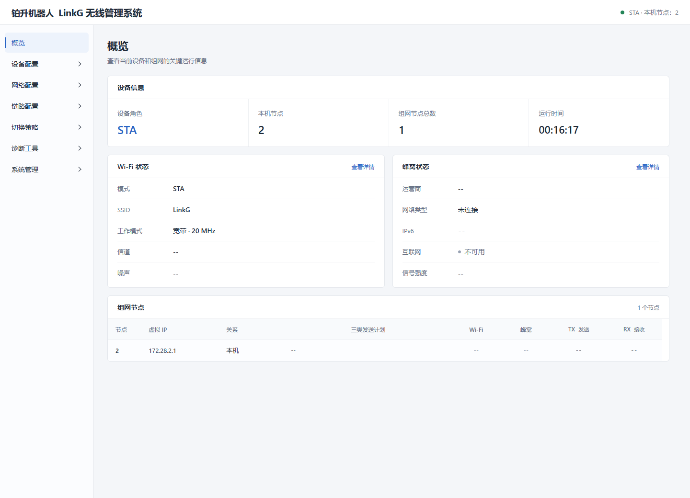

本例配置前后的主要参数如下：

| 项目 | 两台设备的出厂值 | 设备 A：AP | 设备 B：STA |
|---|---|---|---|
| 设备角色 | STA | **改为 AP** | 保持 STA |
| 节点 ID | 2 | **改为 1** | 保持 2 |
| 本机虚拟 IP | `172.28.2.1` | `172.28.1.1` | `172.28.2.1` |
| 虚拟网络 | `172.28.0.0/16` | 保持默认 | 保持默认 |
| 本机以太网 IP | `192.168.1.1` | 保持默认 | 保持默认 |
| Wi-Fi 名称（SSID） | `LinkG` | `LinkG` | `LinkG` |
| Wi-Fi 密码 | `12345678` | `12345678` | `12345678` |
| 安全模式 | WPA2-Personal | 保持默认 | 保持默认 |
| 无线工作模式 | 宽带 | 保持宽带 | 保持宽带 |
| AP 信道 / 带宽 / 协议 | 157 / 40 MHz / Wi-Fi 6 | 保持默认 | 连接 AP 后协商，无需手动设置信道 |

节点 ID 必须不同，虚拟网络、SSID、密码及无线工作模式需要匹配。本章按默认 SSID 和密码演示；使用其他名称或密码时，两端应同步修改。

## 4. 将设备 A 配置为 AP

### 4.1 将节点 ID 改为 1

保持电脑网线连接设备 A，打开左侧 **“网络配置 → 基础网络”**。

1. 将“本机节点 ID”从 **2** 改为 **1**。
2. 虚拟网络、以太网网段、DHCP 服务及默认网关选项保持默认。
3. 点击“保存配置”，在提示中确认重启 LinkG 服务。

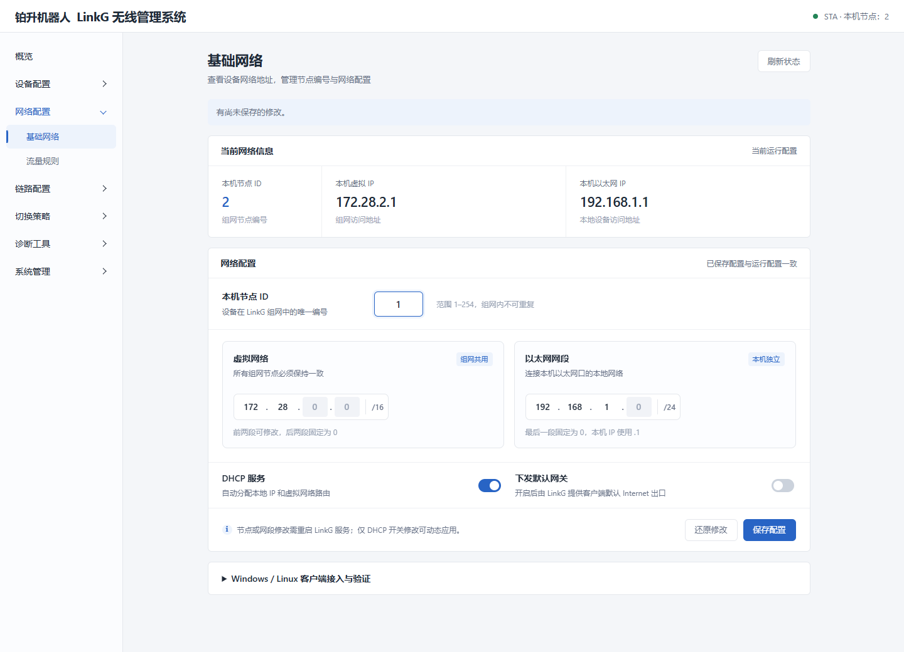

等待服务恢复后，设备 A 的虚拟地址变为 `172.28.1.1`，改用以下地址继续操作：

**[http://172.28.1.1/?v=LinkG-v1.0.0#/overview](http://172.28.1.1/?v=LinkG-v1.0.0#/overview)**

旧地址页面可能提示连接中断，这是节点地址改变后的表现。也可使用本地以太网地址 `192.168.1.1` 继续访问设备 A。

### 4.2 将设备角色改为 AP

打开 **“设备配置 → 基础配置”**：

1. 将“运行角色”选择为 **“AP — 管理节点”**。
2. 点击“保存角色”，确认重启服务。
3. 等待服务恢复，确认“当前运行角色”和“已保存角色”均为 **“AP · 管理节点”**。


### 4.3 检查 AP 无线配置

打开 **“链路配置 → Wi-Fi”**，确认下方配置为：启用链路、SSID `LinkG`、密码 `12345678`、WPA2-Personal、宽带、信道 **157**、AP 带宽 **40 MHz**、协议模式 **Wi-Fi 6（802.11ax）**。

保持出厂值时无需再次应用；如修改过参数，点击“应用配置”，等待无线链路恢复。

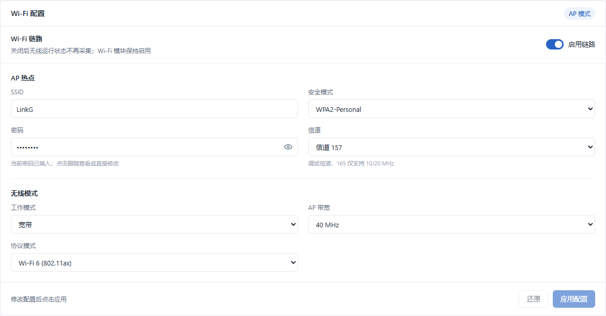

## 5. 检查设备 B 的 STA 配置

将电脑网线从设备 A 移到设备 B，或使用另一台电脑直连设备 B。DHCP 模式等待重新获取网络配置；静态模式继续使用第 2 节的地址和路由。

访问默认入口 **[http://172.28.2.1/?v=LinkG-v1.0.0#/overview](http://172.28.2.1/?v=LinkG-v1.0.0#/overview)**，确认：

- “设备配置 → 基础配置”：角色为 **STA**。
- “网络配置 → 基础网络”：节点 ID 为 **2**，虚拟网络为 `172.28.0.0/16`。
- “链路配置 → Wi-Fi”：启用链路，目标 AP 的 SSID 为 `LinkG`、密码为 `12345678`，安全模式为 WPA2-Personal，工作模式为宽带。

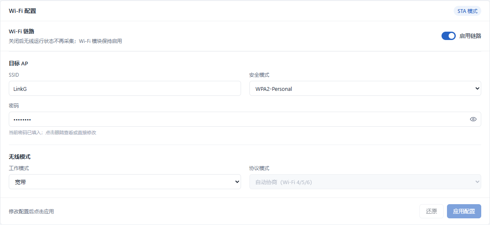

设备 B 保持出厂配置时无需修改，设备 A 启动 AP 后，B 会自动尝试连接。若更改了 AP 的 SSID 或密码，在这里填入相同参数，再点击“应用配置”。STA 的信道和宽带带宽由连接的 AP 决定，无需手动填写。

## 6. 检查是否配对成功

### 6.1 先观察 RSSI 指示灯

设备面板上标有 **RSSI** 的指示灯用于显示 Wi-Fi 连接与信号状态。配对完成后，先观察两台设备的 RSSI 灯：**正常连接并取得有效信号数据后，RSSI 灯会由红色快闪转为相应信号颜色常亮。**

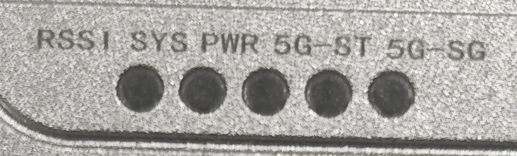

| RSSI 灯表现 | 含义与判断 |
|---|---|
| 红色快闪 | 通常表示没有在线对端或 Wi-Fi 尚未关联；持续快闪时，检查 AP/STA 角色及无线配置 |
| 白色、蓝色或绿色常亮 | 正常情况下表示已连接且信号有效，信号由强到中等，可继续检查页面及 Ping |
| 黄色常亮 | 正常情况下表示已连接，但信号偏弱，可调整天线或缩短距离后再验证通信 |
| 红色常亮 | 可能是信号很弱，也可能是信号数据无效；结合 Web 的关联状态和 RSSI 数值确认 |
| 熄灭 | Wi-Fi 功能关闭或相关服务停止，需检查设备配置和运行状态 |

信号颜色按 **白 → 蓝 → 绿 → 黄 → 红** 表示由强到弱。一对一连接时，AP 的 RSSI 灯反映 STA 的信号，STA 的 RSSI 灯反映 AP 的信号，两端颜色可能不同。注意区分**红色常亮**与**红色快闪**。

观察到正常连接灯态后，继续核对 Web 页面，并在第 7 节通过 Ping 验证实际通信。完整灯语和宽窄带信号阈值见[硬件与接口](../01-产品介绍与规格/03-硬件与接口.md#3-指示灯说明)。

### 6.2 再检查 Web 页面

将电脑网线接回设备 A，在浏览器打开它的概览页。连接正常时应看到：

| 检查位置 | 正常表现 |
|---|---|
| AP 概览 → 设备信息 | 角色 AP、本机节点 1、组网节点总数 2 |
| AP 概览 → 组网节点 | 除本机外，有节点 2、虚拟 IP `172.28.2.1`，关系为“直连”，Wi-Fi 为“可用” |
| STA 概览 → 组网节点 | 除本机外，有节点 1、虚拟 IP `172.28.1.1`，关系为“直连 AP”，Wi-Fi 为“可用” |
| STA → 链路配置 → Wi-Fi | 接口状态“已连接”，关联 AP“已关联”，显示对端 BSSID、RSSI 等信息 |

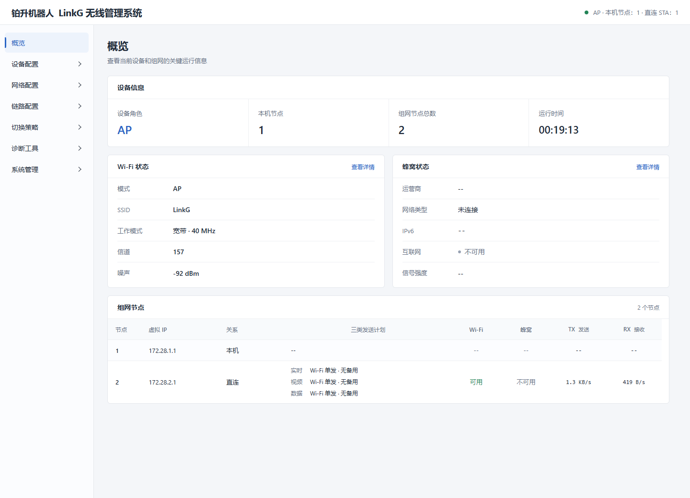

配对成功后，从 AP 侧电脑也可以打开 **[STA 的 Web 页面](http://172.28.2.1/?v=LinkG-v1.0.0#/overview)**，查看远端状态：

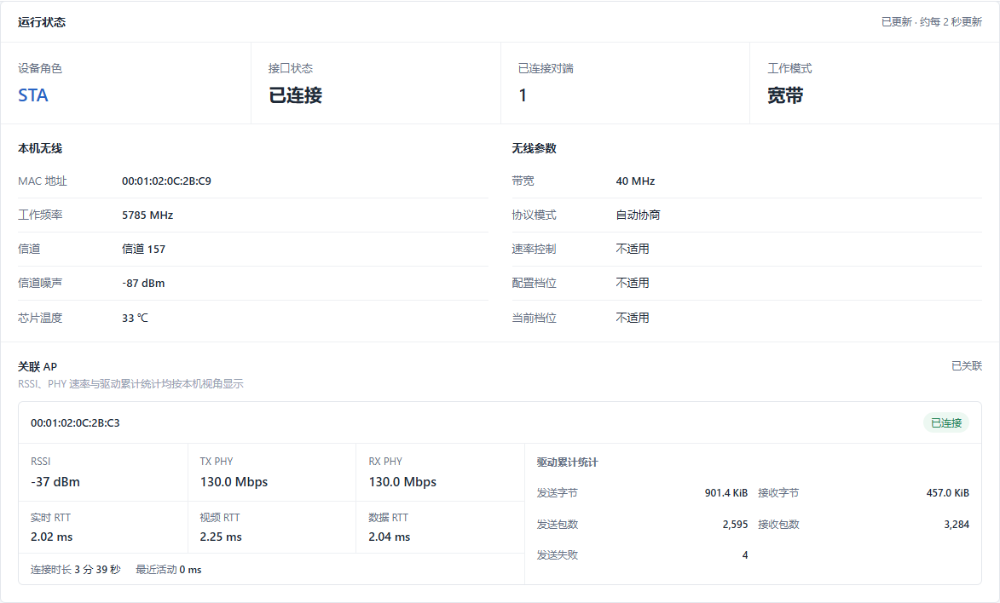

本例关闭蜂窝通信，蜂窝状态显示“未连接”或“不可用”是正常现象。判断本次配对是否成功，应查看对端节点及 **Wi-Fi** 状态。

## 7. 通过 Ping 验证通信

保持电脑通过网线连接设备 A，打开 Windows 命令提示符，依次执行：

```bat
ping -n 4 172.28.1.1
ping -n 4 172.28.2.1
```

第一条检查电脑到本地 AP 的通信，第二条检查电脑经 AP 和 Wi-Fi 到远端 STA 的通信。两条命令均收到回复、统计为 **发送 4、接收 4、丢失 0**，即可确认本例的一对一组网通信已连通。

下图整理展示本次 Windows 电脑实际执行的 Ping 命令和原始输出；电脑通过网线连接 AP，远端 STA 经 Wi-Fi 接入。实际时延随环境变化，以是否正常回复和丢包情况判断。

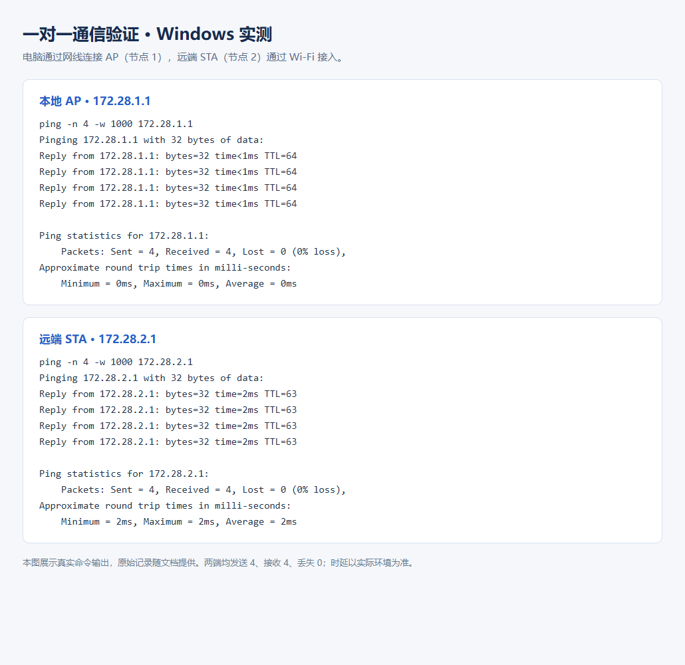

[查看本次电脑配置、路由及 Ping 原始输出](../../assets/02-快速入门/one-to-one/windows-ping-output.txt)。后续可在两端连接业务设备，并按对应章节配置网络数据或串口业务。

## 8. 常见问题

| 现象 | 检查方法 |
|---|---|
| 无法打开默认 `172.28.2.1` 页面 | 先确认网线及电脑 IP，再检查 `172.28.0.0/16` 路由；可尝试本地 `192.168.1.1`。节点 ID 改为 1 后，应改用 `172.28.1.1` |
| 两台设备始终没有互相连接 | 确认一台为 AP、另一台为 STA；节点 ID 不重复；SSID、密码、安全模式及宽窄带模式匹配 |
| 页面显示“已保存”，运行状态未改变 | 角色和节点 ID 修改需要确认重启服务，检查当前运行配置是否已生效 |
| 可以 Ping 本地 AP，不能 Ping 远端 STA | 先在概览确认节点 2 在线、Wi-Fi 可用，再核对两端虚拟网络和节点 ID |
| DHCP 地址正常，但虚拟地址不可达 | 重新获取租约并检查路由；不支持 DHCP 路由选项的客户端需手动添加路由 |
