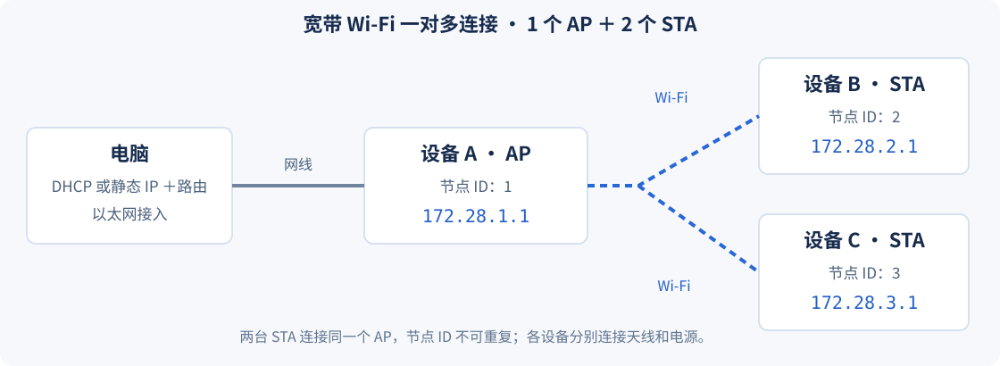
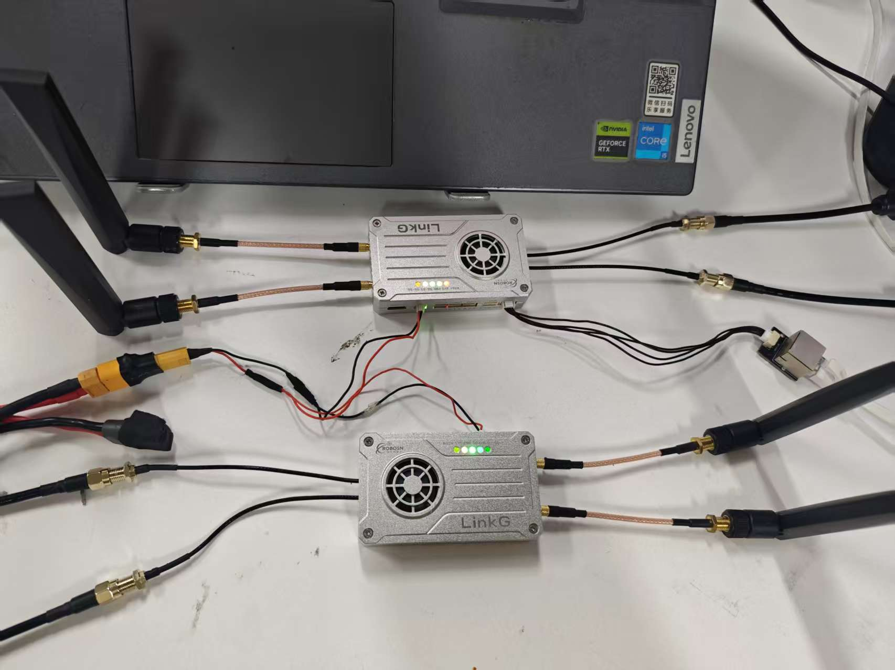
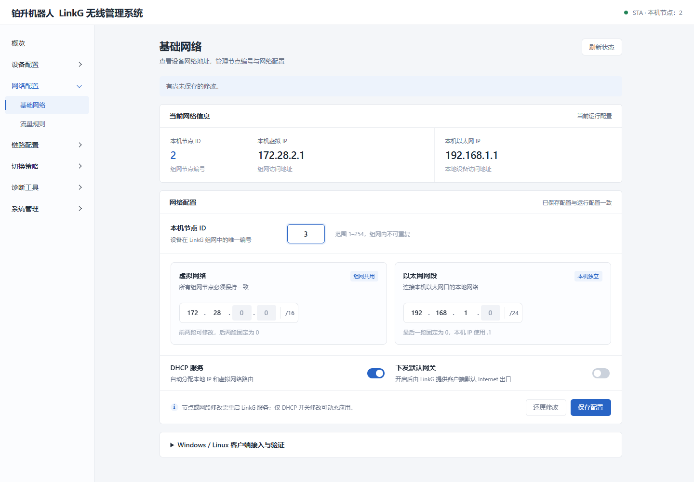
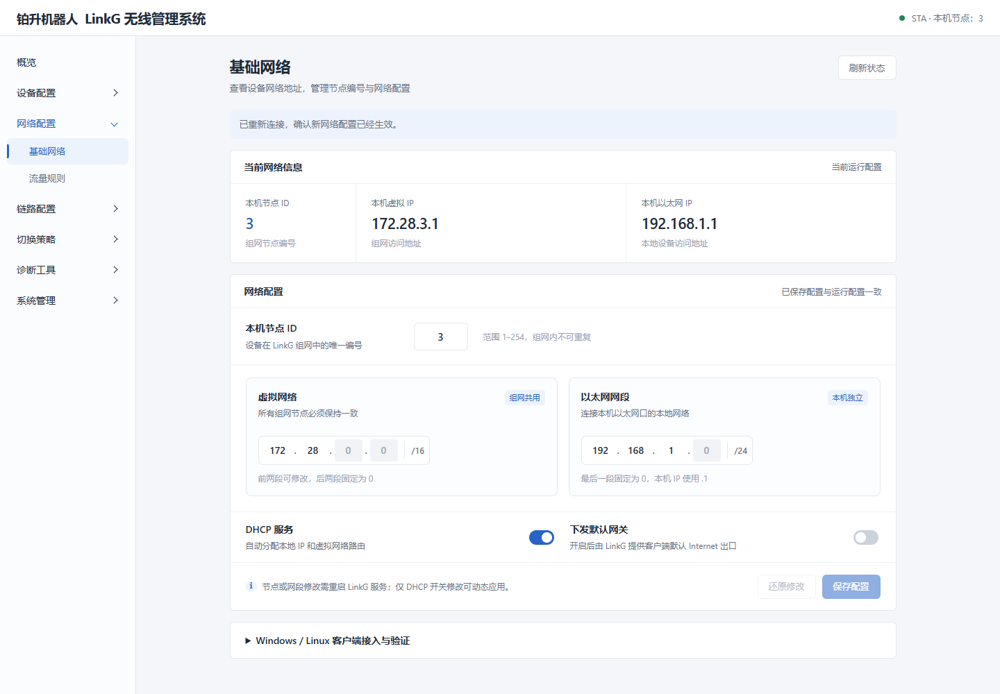
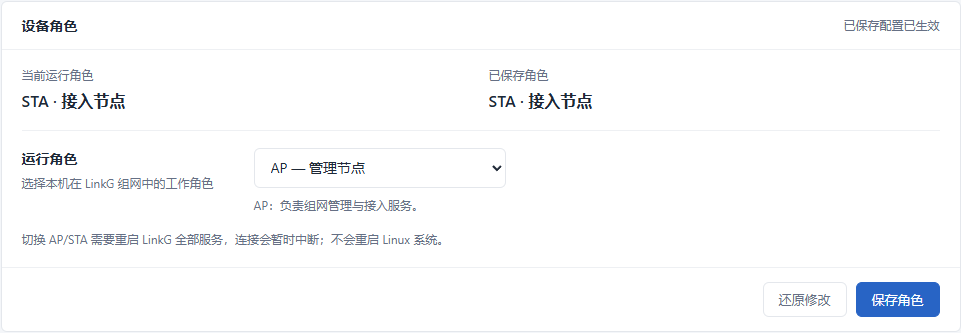
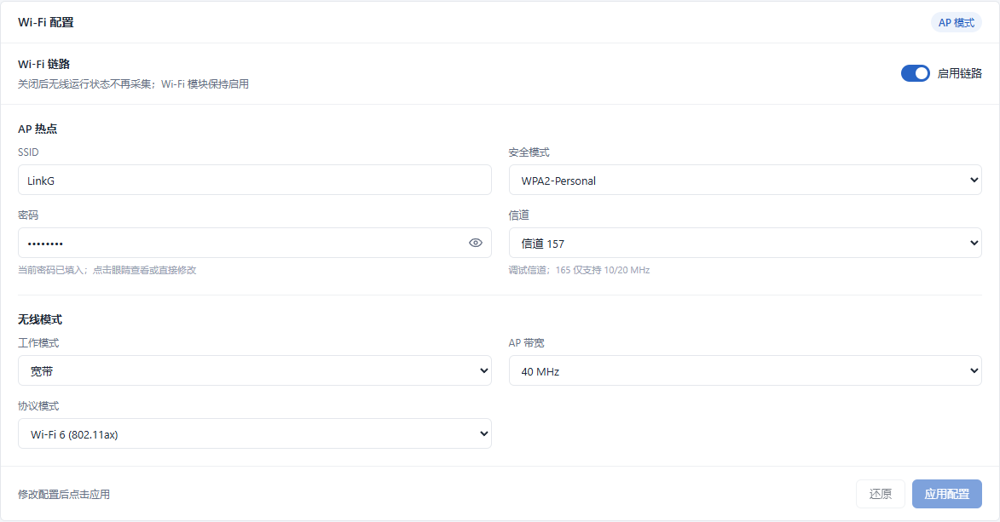
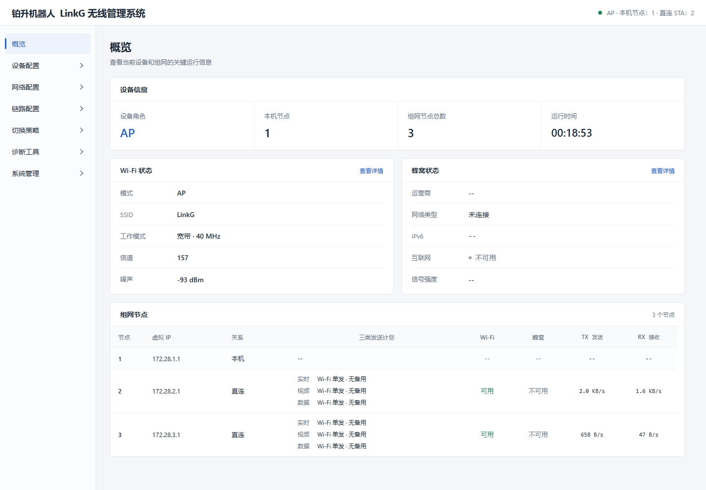
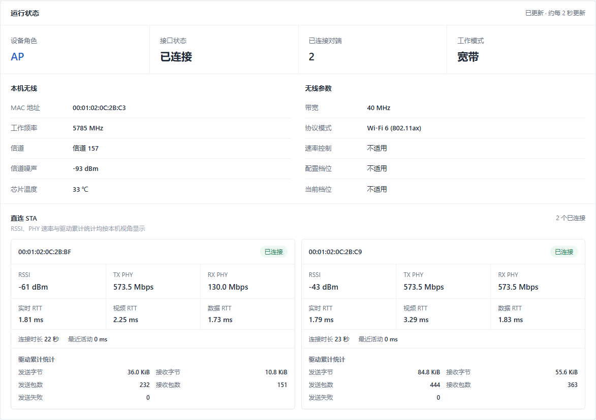
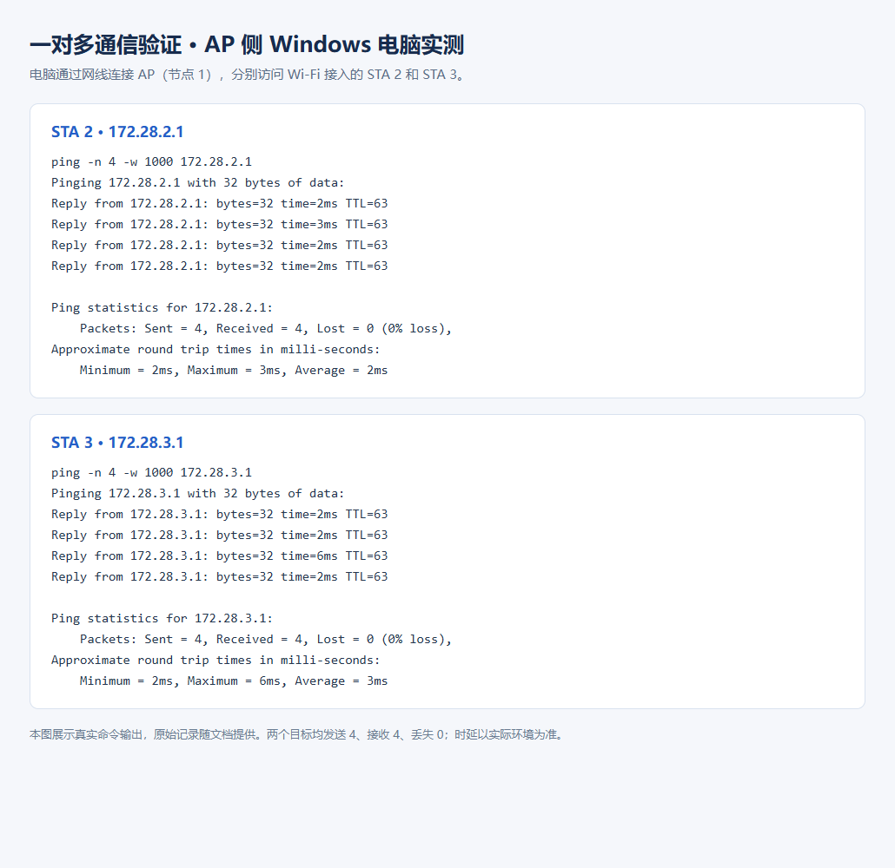

# 一对多配置

本章从三台 LinkG 的出厂配置开始，将一台设置为 **AP（管理节点）**，另外两台作为 **STA（接入节点）**，建立宽带 Wi-Fi 一对多连接。最终节点 ID 分别为 **1、2、3**：两个 STA 都连接同一个 AP。

电脑网络设置、Web 使用及单台设备接线方式与[一对一配置](01-一对一配置.md)相同。本章重点说明新增 STA 的节点配置、三台设备的连接状态及通信验证。



## 1. 准备三台设备

为三台 LinkG 分别连接好天线和 9～15 V 电源。本例不需要 SIM 卡，蜂窝通信保持关闭。

| 设备 | 最终角色 | 最终节点 ID | 最终虚拟管理地址 |
|---|---|---|---|
| 设备 A | AP | 1 | `172.28.1.1` |
| 设备 B | STA | 2 | `172.28.2.1` |
| 设备 C | STA | 3 | `172.28.3.1` |

单台设备的电源、天线和网口接法沿用一对一示例。下图为原两台设备的接线参考，**本章实际使用三台设备，连接关系以上方一对多拓扑为准**。



已经修改过配置的设备，可先按[硬件与接口中的 Reset 说明](../01-产品介绍与规格/03-硬件与接口.md#4-reset-按键)恢复出厂配置。恢复会清除用户配置；已恢复出厂的设备可直接继续。

> 三台设备出厂时都是 STA、节点 ID 都是 2。**先将设备 C 改为节点 3，再启动设备 A 的 AP**，避免两个 STA 以相同节点 ID 同时接入。设备 B 保持出厂配置即可。

## 2. 配置电脑并访问默认 Web

先将电脑的以太网线连接到 **设备 C**。后续配置另一台设备时，拔下当前设备上的网线，移接到目标设备；三台 LinkG 的以太网接口不要接到同一个交换机网络。

电脑网络接入方式任选一种：

| 接入方式 | 电脑需要完成的设置 |
|---|---|
| DHCP 自动获取（推荐） | IPv4 设置为自动获取；正常取得 `192.168.1.x` 地址和虚拟网段路由后，无需手工添加路由 |
| 手动静态 IP | 设置未被占用的 `192.168.1.x/24` 地址，并添加 `172.28.0.0/16` 经本地 `192.168.1.1` 的路由 |

详细操作、静态地址示例和路由命令见[一对一配置 → 配置电脑网络](01-一对一配置.md#2-配置电脑网络)。切换网线后，DHCP 电脑等待重新获取配置；静态 IP 电脑继续使用原来的地址及路由。

在浏览器打开出厂节点 2 的默认入口：

**[http://172.28.2.1/?v=LinkG-v1.0.0#/overview](http://172.28.2.1/?v=LinkG-v1.0.0#/overview)**

也可通过 **[http://192.168.1.1/?v=LinkG-v1.0.0#/overview](http://192.168.1.1/?v=LinkG-v1.0.0#/overview)** 访问当前网线直连的设备。

## 3. 先将设备 C 配置为 STA／节点 3

设备 C 保持 **STA** 角色，打开 **“网络配置 → 基础网络”**：

1. 将“本机节点 ID”从 **2** 改为 **3**。
2. 虚拟网络保持 `172.28.0.0/16`，以太网网段保持 `192.168.1.0/24`，DHCP 选项保持默认。
3. 点击“保存配置”，在提示中确认重启服务。



等待服务恢复后，设备 C 的虚拟地址变为 **`172.28.3.1`**。旧的 `172.28.2.1` 页面可能提示连接中断，改用以下地址继续访问：

**[http://172.28.3.1/?v=LinkG-v1.0.0#/overview](http://172.28.3.1/?v=LinkG-v1.0.0#/overview)**

通过本地 `192.168.1.1` 访问时，以太网地址不变。重新打开基础网络，确认当前运行的节点 ID 为 **3**、本机虚拟 IP 为 **`172.28.3.1`**；在“设备配置 → 基础配置”中确认角色仍为 **STA**。



此时 AP 尚未启动，STA 暂时未连接属于正常现象。

## 4. 将设备 A 配置为 AP／节点 1

将电脑网线从设备 C 移接到 **设备 A**。A 仍是出厂节点 2，使用默认入口 `172.28.2.1` 或本地 `192.168.1.1` 访问。

按以下顺序操作，具体页面用法与[一对一配置中的 AP 设置](01-一对一配置.md#4-将设备-a-配置为-ap)相同：

1. 在 **“网络配置 → 基础网络”**，将节点 ID 从 **2** 改为 **1**，保存并确认重启服务。
2. 等待恢复后，改用 **[设备 A 的新地址 `172.28.1.1`](http://172.28.1.1/?v=LinkG-v1.0.0#/overview)**，或继续通过本地 `192.168.1.1` 访问。
3. 在 **“设备配置 → 基础配置”**，将角色改为 **AP — 管理节点**，保存并确认重启服务。
4. 等待恢复，确认当前运行角色为 **AP**、当前节点 ID 为 **1**。



打开 **“链路配置 → Wi-Fi”**，确认 AP 采用以下参数。本例使用出厂无线参数，无需额外开启“一对多”开关。

| 项目 | AP 设置 |
|---|---|
| Wi-Fi 链路 | 启用 |
| SSID | `LinkG` |
| 密码 | `12345678` |
| 安全模式 | WPA2-Personal |
| 工作模式 | **宽带** |
| AP 信道 | 157 |
| AP 带宽 | 40 MHz |
| 协议模式 | Wi-Fi 6（802.11ax） |



保持默认值时无需再次应用；修改过参数时点击“应用配置”，等待无线恢复。本章以宽带一对多为例，窄带组网限制见[产品概述](../01-产品介绍与规格/01-产品概述.md#通信方式)。

## 5. 检查两个 STA 的连接配置

设备 B 保持出厂的 **STA／节点 2**，设备 C 已设置为 **STA／节点 3**。两台 STA 使用相同的目标 AP 参数，AP 启动后会自动尝试连接。

| 检查项 | 设备 B | 设备 C |
|---|---|---|
| 设备角色 | STA | STA |
| 节点 ID | **2** | **3** |
| 虚拟网络 | `172.28.0.0/16` | `172.28.0.0/16` |
| Wi-Fi 链路 | 启用 | 启用 |
| 目标 AP 的 SSID | `LinkG` | `LinkG` |
| 密码／安全模式 | `12345678`／WPA2-Personal | `12345678`／WPA2-Personal |
| 工作模式 | 宽带 | 宽带 |

若两台已经连接，可保持电脑网线接在 AP，分别打开 **[节点 2 的 Web](http://172.28.2.1/?v=LinkG-v1.0.0#/overview)** 和 **[节点 3 的 Web](http://172.28.3.1/?v=LinkG-v1.0.0#/overview)**，在“链路配置 → Wi-Fi”中检查状态。两个 STA 的关联 AP BSSID 应一致。

若某台尚未接入，无法从 AP 侧打开它的虚拟地址，将电脑网线直接接到该 STA，通过 `192.168.1.1` 核对角色、节点 ID 和目标 AP 参数。需要修改 SSID、密码或模式时，保存应用后再检查。

## 6. 检查一对多是否连接成功

### 6.1 先观察 RSSI 指示灯

正常建立连接并取得有效信号数据后，各设备的 **RSSI 灯由红色快闪转为相应信号颜色常亮**。信号颜色按 **白 → 蓝 → 绿 → 黄 → 红** 表示由强到弱；红色快闪通常表示没有在线对端或尚未关联，红色常亮还可能表示信号数据无效，需要结合 Web 状态确认。

一对多时，**AP 的 RSSI 灯按已关联且信号数据有效的 STA 中，信号最弱的一台显示**；每个 STA 显示其 AP 的信号。因此 AP 和两台 STA 的灯色可能不同，AP 灯常亮也不能单独证明两个 STA 都已连接，需要继续核对节点数量。

详细灯态及面板位置见[一对一配置 → 先观察 RSSI 指示灯](01-一对一配置.md#61-先观察-rssi-指示灯)。

### 6.2 再检查 AP 页面中的两个 STA

将电脑网线接到设备 A，打开 **[AP 概览](http://172.28.1.1/?v=LinkG-v1.0.0#/overview)**，确认：

| 检查位置 | 本例正常结果 |
|---|---|
| 设备信息 | 角色 AP、本机节点 1、组网节点总数 **3** |
| 组网节点 | 除本机节点 1 外，同时出现节点 **2** 和 **3** |
| 节点 2 | 虚拟 IP `172.28.2.1`，关系“直连”，Wi-Fi“可用” |
| 节点 3 | 虚拟 IP `172.28.3.1`，关系“直连”，Wi-Fi“可用” |



再进入 **“链路配置 → Wi-Fi”**，确认“已连接对端”为 **2**，“直连 STA”列表中有两个不同 BSSID 的 STA。可在这里分别查看信号、速率和连接状态。



两个 STA 的页面应各自显示节点 1 为“直连 AP”、Wi-Fi“可用”。本例蜂窝通信关闭，蜂窝显示“不可用”不影响 Wi-Fi 一对多连接。

## 7. 从 AP 侧分别 Ping 两个 STA

保持电脑通过网线连接设备 A，在 Windows 命令提示符中分别执行：

```bat
ping -n 4 172.28.2.1
ping -n 4 172.28.3.1
```

这两条命令分别验证 **电脑 → AP → STA 2** 和 **电脑 → AP → STA 3** 的通信。两个目标都正常回复、统计为 **发送 4、接收 4、丢失 0**，即可确认本例 AP 与两个 STA 的一对多通信已连通。



图中展示本次实际命令输出，原始记录见[一对多 Ping 验证输出](../../assets/02-快速入门/one-to-many/ping-output.txt)。

如已通过 SSH 或串口进入 AP 本机终端，也可直接执行以下命令，`-I 172.28.1.1` 指定本例 AP 的虚拟地址作为源地址：

```sh
ping -c 4 -I 172.28.1.1 172.28.2.1
ping -c 4 -I 172.28.1.1 172.28.3.1
```

本次 AP 本机对两个 STA 的测试也均为 4 发、4 收、0 丢包，结果一并保存在上述原始记录中。

## 8. 常见问题

| 现象 | 检查方法 |
|---|---|
| AP 只显示一个 STA | 确认两个 STA 的节点 ID 分别为 2、3，没有重复；再检查未连接设备的 SSID、密码、安全模式及宽带模式 |
| 修改节点 ID 后打不开旧地址 | 节点 3 生效后应使用 `172.28.3.1`；本地网线直连仍可使用 `192.168.1.1` |
| AP 的 RSSI 灯比其中一个 STA 信号弱 | AP 按有效关联 STA 中最弱信号显示，进入 AP 的 Wi-Fi 页面分别检查两个对端 |
| 只有一个目标 Ping 通 | 先核对 AP 概览中对应节点是否在线、Wi-Fi 是否可用，再核对该 STA 的虚拟网络与节点 ID |

两个 STA 共享 AP 所用无线信道及空口资源，增加节点不会使总可用带宽按节点数增加。接入视频等业务后，应按所有节点的合计流量安排使用。
