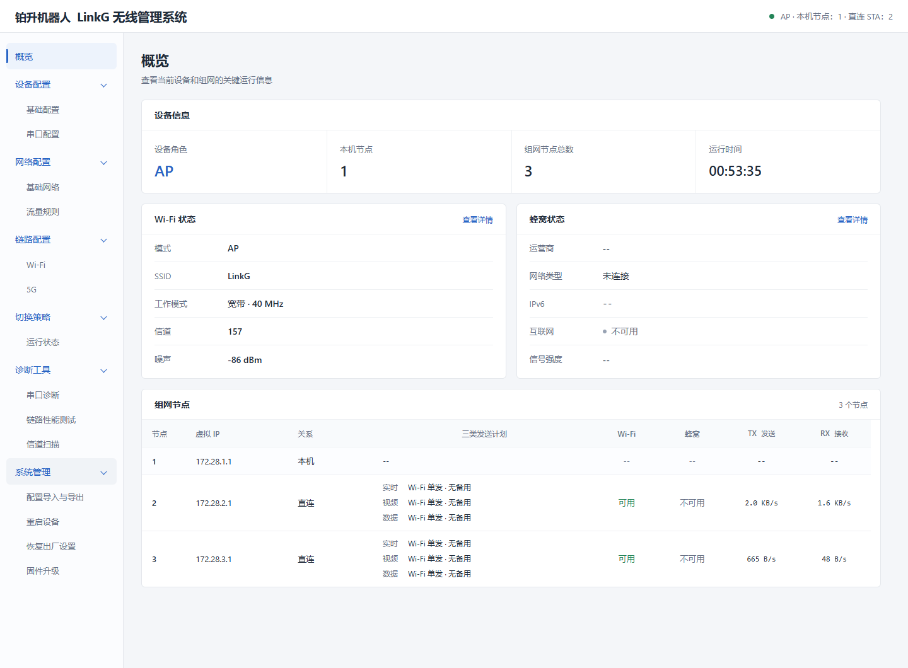
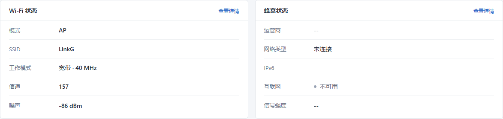
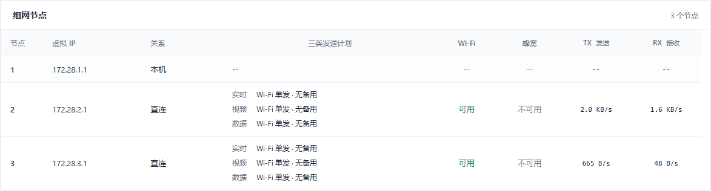
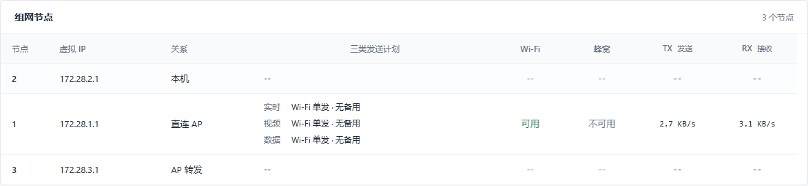

# 概览

概览是 LinkG Web 管理系统的状态首页，用于查看当前设备的角色、节点编号、Wi-Fi 与蜂窝状态，以及组网中的对端和业务收发情况。本页用于查看运行状态，参数设置通过左侧对应菜单进行。

本篇截图来自三台实际设备组成的宽带 Wi-Fi 网络：**AP 为节点 1，两个 STA 分别为节点 2、3，蜂窝通信关闭**。各项数值会随设备配置和运行环境变化。

## 1. 页面入口与布局

电脑完成网络接入后，在浏览器打开设备的管理地址，点击左侧 **“概览”**。

| 访问场景 | 本篇示例地址 |
|---|---|
| 出厂节点 2，或本例 STA 节点 2 | [http://172.28.2.1/?v=LinkG-v1.0.0#/overview](http://172.28.2.1/?v=LinkG-v1.0.0#/overview) |
| 本例 AP 节点 1 | [http://172.28.1.1/?v=LinkG-v1.0.0#/overview](http://172.28.1.1/?v=LinkG-v1.0.0#/overview) |
| 本例 STA 节点 3 | [http://172.28.3.1/?v=LinkG-v1.0.0#/overview](http://172.28.3.1/?v=LinkG-v1.0.0#/overview) |
| 通过网线访问本地直连设备，采用默认以太网网段 | [http://192.168.1.1/?v=LinkG-v1.0.0#/overview](http://192.168.1.1/?v=LinkG-v1.0.0#/overview) |

虚拟地址访问需要电脑具备相应路由。节点 ID 或网段改变后，应使用对应的新地址；电脑的 DHCP、静态 IP 和路由设置见[快速入门中的电脑网络配置](../../02-快速入门/01-一对一配置.md#2-配置电脑网络)。

页面由以下区域组成：

- **左侧菜单**：进入设备、网络、链路、诊断和系统管理页面。
- **顶部状态栏**：显示当前访问设备的角色和节点编号，AP 还显示直连 STA 数量。
- **设备信息**：显示角色、本机节点、组网节点总数及运行时间。
- **Wi-Fi 状态、蜂窝状态**：查看本机两种接入链路的概要信息。
- **组网节点**：查看节点地址、连接关系、三类发送计划、路径可用性及收发速率。

进入概览后，状态约每秒自动更新，实际更新间隔受网络及设备响应时间影响。

## 2. 导航与顶部状态栏

点击左侧分类名称可展开或收起子菜单，点击子菜单进入对应页面。

| 菜单 | 对应内容 |
|---|---|
| 概览 | 当前设备、链路及组网状态 |
| 设备配置 | 基础配置、串口配置 |
| 网络配置 | 基础网络、流量规则 |
| 链路配置 | Wi-Fi、5G |
| 切换策略 | 运行状态 |
| 诊断工具 | 串口诊断、链路性能测试、信道扫描 |
| 系统管理 | 配置导入与导出、重启设备、恢复出厂设置、固件升级 |

本例顶部显示 **“AP · 本机节点：1 · 直连 STA：2”**，表示当前访问的是节点 1 的 AP，维护着两个直连 STA。访问 STA 时，顶部显示该 STA 的角色和本机节点编号。

**顶部绿点表示设备状态查询正常。** 判断组网业务是否可用，还应继续查看下方的对端、路径和发送计划。若顶部显示“设备连接异常”，检查电脑与设备之间的网络、访问地址及设备运行状态。

## 3. 设备信息

| 字段 | 含义与查看方法 |
|---|---|
| 设备角色 | 当前运行的 AP 或 STA 角色。AP 是组网管理节点，STA 是接入节点 |
| 本机节点 | 当前设备的节点 ID，组网内应保持唯一 |
| 组网节点总数 | 当前显示的组网节点数量，**包含本机**。一对一正常连接时通常为 2；本例一个 AP 加两个 STA 为 3 |
| 运行时间 | LinkG 程序自启动以来的运行时长，按时、分、秒显示，超过一天时带有天数；刷新网页不会清零 |

注意区分 **“直连 STA：2”** 和 **“组网节点总数：3”**：前者是 AP 的直连对端数量，后者还包含 AP 本机。

## 4. 本机链路状态

Wi-Fi 状态和蜂窝状态显示的是**当前访问这台设备的本机信息**。点击卡片右上角的“查看详情”，分别进入 **“链路配置 → Wi-Fi”** 和 **“链路配置 → 5G”**。

### 4.1 Wi-Fi 状态

| 字段 | 含义与查看方法 |
|---|---|
| 模式 | 当前无线角色，显示 AP 或 STA |
| SSID | AP 提供的 Wi-Fi 名称，或 STA 配置的目标 AP 名称；连接状态还需结合节点表和详情页确认 |
| 工作模式 | 宽带时显示当前带宽，如“宽带 · 40 MHz”；窄带时显示固定档位或自适应模式，如“窄带 · 档位 3”“窄带 · 自适应” |
| 信道 | 当前获取到的无线信道编号；尚未取得有效信息时显示 `--` |
| 噪声 | 本机测得的信道噪声，单位 dBm。通常数值越负，测得的噪声越低；选择信道还需结合繁忙率等信息 |

**“噪声”是信道环境指标，对端 RSSI 是接收信号强度。** 查看对端 RSSI、无线关联状态和 PHY 速率时，点击“查看详情”进入 Wi-Fi 页面。SSID 已填入或信道已有数值后，仍需检查是否出现预期对端。

### 4.2 蜂窝状态

| 字段 | 含义与查看方法 |
|---|---|
| 运营商 | 当前获取到的运营商名称；无法识别名称时可能显示 PLMN 编码，未取得信息时显示 `--` |
| 网络类型 | 显示 4G LTE、5G SA 或“未连接” |
| IPv6 | 蜂窝接口当前取得的全局 IPv6 地址，未取得时显示 `--` |
| 互联网 | 本机蜂窝 IPv4 互联网的可用状态，显示“可用”或“不可用” |
| 信号强度 | 蜂窝参考信号接收功率 RSRP，单位 dBm；通常数值越接近 0，信号越强，未取得有效数据时显示 `--` |

本例关闭了蜂窝通信，因此运营商、IPv6 和信号强度显示 `--`，网络类型为“未连接”，互联网为“不可用”。**只使用 Wi-Fi 组网时，这些显示不影响 Wi-Fi 通信。** 使用蜂窝时，可进入 5G 页面进一步检查配置和网络状态。

本机蜂窝“互联网可用”和某个对端的“蜂窝路径可用”分别反映本机公网状态、对端组网路径状态，需要结合下一节的节点表查看。

## 5. 组网节点

### 5.1 表格字段

节点表将本机放在第一行，其余节点按编号排列。各列含义如下：

| 列名 | 含义与查看方法 |
|---|---|
| 节点 | 节点 ID，用于区分设备 |
| 虚拟 IP | 该节点的组网访问地址。本例节点 1、2、3 分别为 `172.28.1.1`、`172.28.2.1`、`172.28.3.1` |
| 关系 | 本机、直连、直连 AP 或 AP 转发，说明该节点与当前设备的组网关系 |
| 三类发送计划 | 分别显示实时、视频、数据业务针对该直连对端的发送方式及主备链路 |
| Wi-Fi | 到该直连对端的 Wi-Fi 组网路径是否可用 |
| 蜂窝 | 到该直连对端的蜂窝组网路径是否可用 |
| TX 发送 | 从本机视角统计，向该直连对端发送业务数据的当前速率 |
| RX 接收 | 从本机视角统计，从该直连对端接收业务数据的当前速率 |

### 5.2 AP 与 STA 的显示区别

**在 AP 上查看：**

本例节点 1 是本机，节点 2 和节点 3 是直连 STA。两行的 Wi-Fi 均显示“可用”，表示 AP 到这两个对端的 Wi-Fi 组网路径可用。

**在 STA 上查看：**

访问节点 2 时，本机行变为节点 2；节点 1 显示“直连 AP”；同组网中的另一台 STA 节点 3 显示“AP 转发”，表示访问它需要经过 AP。

这里的“直连”描述组网关系，具体承载链路看 Wi-Fi、蜂窝两列。本机行和“AP 转发”行的发送计划、路径状态及收发速率显示 `--`，属于本页的正常显示方式；这些行没有直接对端统计。

### 5.3 三类发送计划怎么看

“三类发送计划”分别列出 **实时、视频、数据**。三类业务可采用不同的发送计划，需要逐项查看；业务分类规则在 **“网络配置 → 流量规则”** 中配置。

| 显示示例 | 含义 |
|---|---|
| Wi-Fi 单发 · 无备用 | 该类业务通过 Wi-Fi 发送，当前没有备用链路 |
| Wi-Fi 单发 · 备用 5G | 该类业务当前通过 Wi-Fi 发送，蜂窝链路作为备用 |
| 5G 单发 · 备用 Wi-Fi | 该类业务当前通过蜂窝发送，Wi-Fi 作为备用 |
| Wi-Fi + 5G 双发 | 该类业务通过两条链路冗余发送 |
| 无可用链路 | 该类业务当前没有可用发送路径 |
| 计划尚未建立 | 该直连对端的业务发送计划尚未就绪，可等待更新并检查连接状态 |

本例未启用蜂窝，两台 STA 对应的三类业务均显示 **“Wi-Fi 单发 · 无备用”**。页面计划中的“5G”是蜂窝链路的显示名称，实际使用 4G 还是 5G，以本机蜂窝状态中的网络类型为准。

Wi-Fi、蜂窝两列用来查看路径可用性，“三类发送计划”用来查看业务当前怎样使用链路。某条路径可用时，是否承载某类业务，还要结合该类发送计划判断。进一步查看业务探测和切换信息，可进入 **“切换策略 → 运行状态”**。

### 5.4 收发速率怎么看

TX、RX 随当前业务流量变化，显示单位为 **B/s、KB/s 或 MB/s**，表示每秒传输的字节数；链路性能测试中的 **Mbps** 表示每秒兆比特，比较时应注意单位。

这些数值用于观察当前业务收发情况。需要测量链路吞吐量时，使用 **“诊断工具 → 链路性能测试”**。刚进入页面或统计重新开始时，速率可能暂时显示 `--`；有效采样期间没有流量时，可以显示 `0 B/s`。

## 6. 怎样利用概览检查设备

可按以下顺序检查：

1. **确认访问的是哪台设备**：看顶部身份和设备信息中的角色、节点 ID。
2. **确认节点数量是否符合预期**：一对一通常为 2；本例一对多为 3，均包含本机。
3. **确认预期对端已出现**：核对节点 ID、虚拟 IP 和连接关系。
4. **确认所需路径与发送计划**：例如本例使用 Wi-Fi，应看到直连对端的 Wi-Fi“可用”，业务计划为 Wi-Fi 发送。
5. **验证实际通信**：结合 RSSI 指示灯、Ping 或实际业务测试，按[一对一配置](../../02-快速入门/01-一对一配置.md)或[一对多配置](../../02-快速入门/02-一对多配置.md)中的方法完成验证。

常见显示可以这样理解：

| 显示情况 | 查看方法 |
|---|---|
| 只有本机，共 1 个节点 | 当前尚未显示其他组网节点，检查对端供电、角色、节点 ID 和链路连接 |
| Wi-Fi 可用，蜂窝不可用 | 按实际使用链路判断；本例只使用 Wi-Fi，属于正常情况 |
| 本机或 AP 转发行出现 `--` | 这些行不展示直接对端的计划、路径和速率，不需要将其视为路径故障 |
| 刚打开页面时速率为 `--` | 等待后续采样更新；页面取数失败时会显示重试提示 |
| TX 或 RX 为 `0 B/s` | 当前采样期间没有对应方向的业务流量，结合路径、发送计划和实际业务判断 |
| 顶部显示“设备连接异常”，节点表提示正在重试 | 设备重启、地址变化或管理网络异常时可能出现，检查访问地址和网络，等待设备恢复后刷新确认 |
