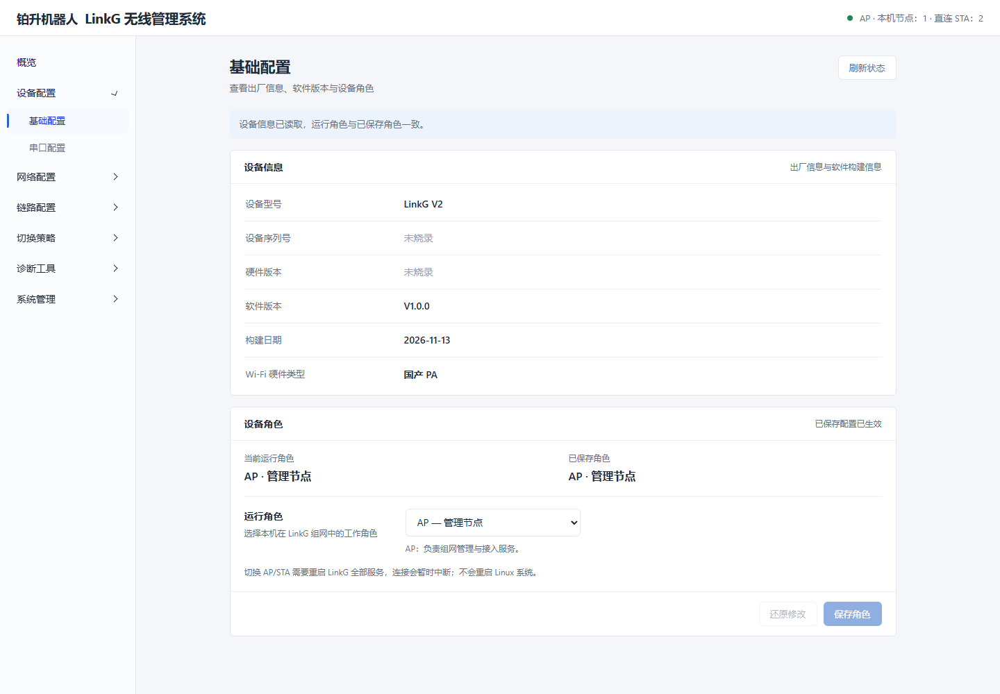
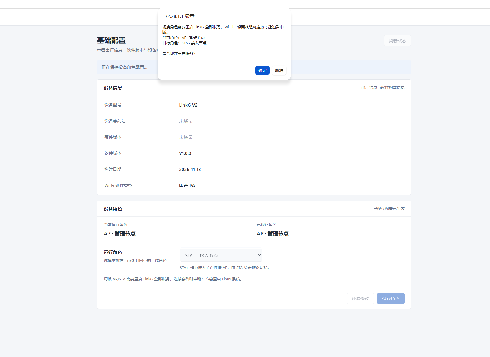

# 基础配置

基础配置用于查看设备信息和设置本机的 AP／STA 角色。打开 **“设备配置 → 基础配置”**。

## 1. 设备信息

| 字段 | 含义 |
|---|---|
| 设备型号 | 当前设备报告的产品型号 |
| 设备序列号 | 出厂设备标识，用于区分设备、登记和技术支持 |
| 硬件版本 | 设备记录的硬件版本信息 |
| 软件版本 | 当前设备程序的软件版本 |
| 构建日期 | 当前软件的构建日期，同一版本的不同构建可能有不同日期 |
| Wi-Fi 硬件类型 | 当前识别的无线硬件类型，如国产 PA、进口 PA 或未知 |

以上为只读信息。“未烧录”表示未提供对应出厂记录，“读取失败”表示未能正常读取；可点击“刷新状态”核对。

## 2. 设备角色

**AP — 管理节点**作为星型组网中心；**STA — 接入节点**连接 AP，并接入本地业务设备。

| 项目 | 含义 |
|---|---|
| 当前运行角色 | 当前服务实际使用的角色 |
| 已保存角色 | 已保存到设备、重启服务时将加载的角色 |
| 运行角色下拉框 | 选择准备保存的目标角色；进入页面或刷新后按已保存角色填入 |

角色与节点 ID 独立，切换角色不会自动改变节点编号。节点 ID 在 **“网络配置 → 基础网络”** 中设置，同组网内不能重复。

## 3. 保存与取消

选择目标角色，点击 **“保存角色”**。保存成功且需要切换角色时，会出现重启确认框：

| 按钮 | 结果 |
|---|---|
| **确定** | 立即发起 LinkG 全部服务重启，重新加载已保存角色；等待重新连接后核对当前运行角色 |
| **取消** | 保留已保存角色，本次不重启，继续按原角色运行；可稍后点击“重启服务”应用 |

以 AP 改为 STA 为例，保存后点击“取消”，页面应显示 **当前运行角色 AP、已保存角色 STA、下拉框 STA**。关闭确认框后可刷新核对，确认框背景可能仍停留在之前的画面。

**取消重启不撤销保存，刷新或关闭浏览器后保存值仍然保留，后续重启也会加载。** 若要撤销，将下拉框改回当前运行角色并重新保存。

角色切换会短暂中断 Wi-Fi、蜂窝、组网及串口等业务，只重启 LinkG 服务，不重启 Linux 系统。

## 4. 页面按钮

| 按钮 | 作用 |
|---|---|
| 刷新状态 | 重新读取设备信息和角色；有未保存选择时提示是否放弃 |
| 还原修改 | 放弃尚未保存的选择，恢复到最近已保存角色；不会撤销已保存配置 |
| 保存角色 | 保存下拉框中的角色；正常情况下没有修改时置灰 |
| 重启服务 | 已保存角色尚未生效时显示，用于稍后应用保存值 |

保存或重启后，以“当前运行角色”和“已保存角色”核对结果。若提示结果未确认，先刷新查看，避免连续重复提交。
