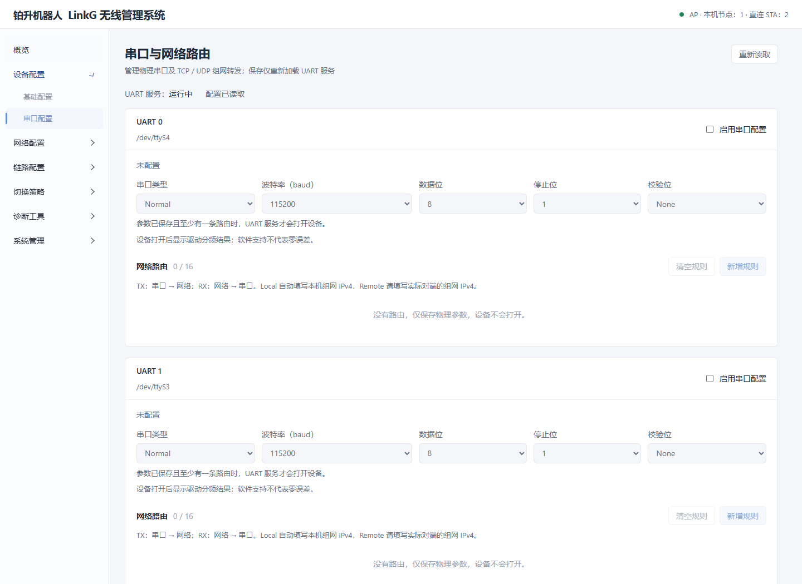
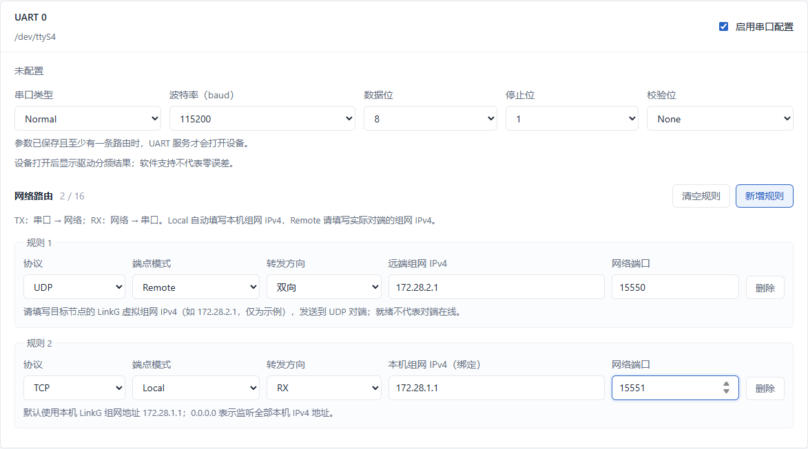
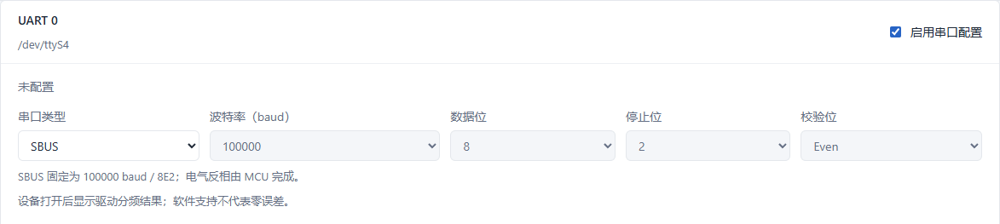

# 串口配置

串口配置用于设置 UART0～UART2 的物理参数，以及串口与 TCP／UDP 网络之间的转发规则。本文介绍 Web 字段和按钮，接线说明见[硬件与接口](../../01-产品介绍与规格/03-硬件与接口.md)。

## 1. 页面入口与串口启用

打开 **“设备配置 → 串口配置”**，页面标题为“串口与网络路由”。每个 UART 使用独立卡片，卡片标题下方显示设备路径，用于识别系统中的串口设备。

勾选对应卡片的 **“启用串口配置”** 后可编辑。**启用且至少配置一条网络路由，保存应用后才会打开串口。** 没有路由时只保存物理参数；取消勾选并保存后，移除该串口配置并停止其转发。

顶部“UART 服务”表示服务状态，各串口是否打开、各路由是否连接，分别看卡片中的状态。服务“运行中”时，仍可以有未配置的串口。

## 2. 串口物理参数

| 字段 | 含义与设置 |
|---|---|
| 串口类型 | **Normal** 为普通串口数据转发；**SBUS** 按 SBUS 帧处理，仅 UART0 支持 |
| 波特率（baud） | 串口通信速率，按外部设备要求从下拉框选择；Normal 默认 115200 |
| 数据位 | 每个字符的数据位数，可选 7 或 8；Normal 默认 8 |
| 停止位 | 可选 1 或 2；Normal 默认 1 |
| 校验位 | **None**：无校验；**Even**：偶校验；**Odd**：奇校验。Normal 默认 None |

物理参数应与所连接设备一致。切换串口类型会重新填入该类型的默认或固定参数，切回 Normal 后应重新检查。

## 3. 网络路由

每个串口最多配置 **16 条规则**，每条规则独立指定协议、端点、方向和地址。以下截图为未保存的字段演示，IP 和端口需要按实际对端填写。

### 3.1 规则字段

| 字段 | 含义与设置 |
|---|---|
| 协议 | 选择 TCP 或 UDP，应与对端程序使用的网络协议一致 |
| 端点模式 | **Remote** 指定远端目标；**Local** 在本机绑定或监听。具体行为见下表 |
| 转发方向 | 选择双向、TX 或 RX，定义见第 3.2 节 |
| 远端组网 IPv4 | Remote 使用的目标地址，填写实际对端的组网 IPv4 |
| 本机组网 IPv4（绑定） | Local 使用的本机地址，切换为 Local 时自动填入本机组网 IP；也可填 `0.0.0.0` 绑定全部本机 IPv4 地址 |
| 网络端口 | 1～65535 的整数；Remote 为目标端口，Local 为本地绑定或监听端口 |

协议和端点组合决定连接方式，与转发方向分别设置：

| 组合 | 行为 |
|---|---|
| TCP ＋ Remote | 本机作为 TCP 客户端，主动连接填写的远端 IP 和端口 |
| TCP ＋ Local | 本机作为 TCP 服务端，在填写的本机 IP 和端口监听，等待客户端连接 |
| UDP ＋ Remote | 指定固定 UDP 对端，向填写的远端 IP 和端口发送，并从该对端接收 |
| UDP ＋ Local | 绑定本机 IP 和端口接收数据；串口数据的回传目标由最近收到的 UDP 数据报来源确定 |

UDP Local 需要先收到对端数据，才能确定回传目标。TCP Local 每条规则只保持一个当前客户端，新连接会替换原连接。

地址应为有效 IPv4 单播地址，只有 Local 允许 `0.0.0.0`。Local 不能占用 LinkG 保留端口；相同协议、相同端口的本地绑定地址不能冲突，`0.0.0.0` 也会与该端口的具体地址绑定冲突。填写错误时，页面在规则下方提示。

### 3.2 双向、TX 和 RX

**转发方向以当前 LinkG 为参照，按“串口 ↔ 网络”定义。**

| 选择 | 数据方向 | 含义 |
|---|---|---|
| **双向** | 串口 → 网络，同时网络 → 串口 | 同一条规则允许两个方向的数据转发 |
| **TX** | 串口 → 网络 | 只把串口收到的数据发往网络 |
| **RX** | 网络 → 串口 | 只把网络收到的数据写到串口 |

同一个串口有多条规则时，串口输入会送往允许 TX 的各条规则；允许 RX 的规则可向该串口写入数据，配置时应避免把不应混合的输入同时送入同一串口。

## 4. SBUS 模式

在 **UART0** 勾选“启用串口配置”，将“串口类型”选择为 **SBUS**。

SBUS 自动固定为 **100000 baud、8E2**，即 8 数据位、偶校验、2 停止位，这些字段会置灰。电气反相由设备 MCU 处理，页面无需单独配置。

网络协议、端点和转发方向仍在“网络路由”中设置，至少有一条规则并保存应用后才启用。UART1、UART2 的类型选项只有 Normal。

## 5. 按钮与保存方式

设置物理参数后，点击“新增规则”，填写网络参数，再点击 **“保存并应用”**。该操作会短暂中断串口业务并重载 UART 服务，Wi-Fi、蜂窝和 Web 保持运行。

| 按钮 | 作用 |
|---|---|
| 重新读取 | 从设备重新获取配置；有未保存修改时，先询问是否覆盖当前草稿 |
| 新增规则 | 在当前 UART 下增加一条规则，达到 16 条后不可继续添加 |
| 删除 | 删除所在规则，保存后生效 |
| 清空规则 | 清除当前 UART 的全部规则；确认后先修改表单，保存应用后该串口不再打开 |
| 放弃修改 | 确认后恢复到最后一次成功读取的配置，丢弃未保存的表单修改 |
| 保存并应用 | 提交页面中全部 UART 的配置，并立即执行 UART 重载；参数错误时先提示修正 |

**本页没有“保存后稍后应用”的步骤。** “放弃修改”用于提交前的草稿；点击“保存并应用”后，等待页面确认结果。成功时会提示配置已提交并回读确认；提示失败或结果未确认时，先按提示核对或重新读取。

## 6. 状态与统计信息

各卡片显示串口及每条路由的运行状态，填写草稿不会提前改变这些运行状态。

| 显示 | 含义 |
|---|---|
| 未配置 | 该 UART 没有已保存配置 |
| 仅保存参数／没有活动路由／设备未打开 | 已保存物理参数，但没有网络规则，串口未打开 |
| 设备已打开 | 串口已打开；网络是否就绪还要看每条规则的状态 |
| 正在连接／等待重试 | TCP Remote 正在连接，或路由发生错误后等待重试 |
| 正在监听 | TCP Local 已监听，等待客户端连接 |
| 已连接 | TCP 连接已建立 |
| UDP 等待对端 | UDP Local 尚未收到来源数据，回传目标尚未确定 |
| UDP 已就绪 | UDP 套接字已就绪；UDP 不建立连接，该状态不能单独证明对端在线 |

串口打开后，还会显示以下信息：

| 项目 | 含义 |
|---|---|
| 实时 UART RX／TX | 串口接收／发送速率；RX 是从外部设备读入，TX 是向外部设备写出 |
| 实时网络 RX／TX | 网络接收／发送速率，单位随数值显示 B/s、KB/s 或 MB/s |
| UART、网络累计 RX／TX | 相应方向的累计字节数，单位 B |
| 错误／丢弃 | 当前运行中的错误和丢弃计数 |
| 波特率分频信息 | 驱动分频计算出的实际波特率和误差，不含晶振误差，属于计算参考值 |

注意区分：**规则中的 TX 是“串口 → 网络”，状态中的 UART TX 是“向串口写出”**。两者分别描述转发规则方向和串口收发方向。
