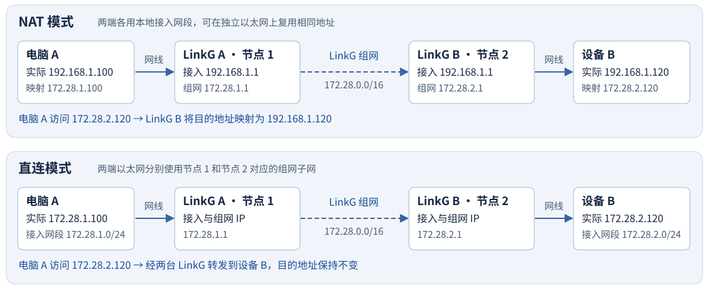
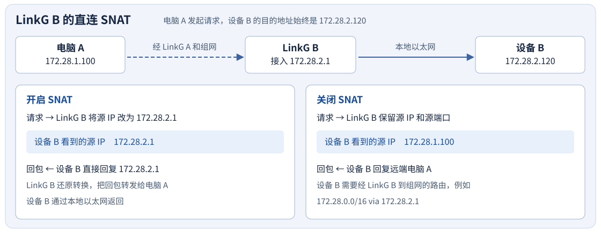

# 基础网络

打开 **网络配置 → 基础网络**。这里配置 LinkG 的节点编号、组网网段和本地以太网接入方式，也决定本机给以太网客户端下发哪些 DHCP 配置。

## 1. 网络拓扑与访问地址

LinkG 组网共用一个 `/16` 网段。每个节点按节点 ID 占用其中一个 `/24`，该子网的 `.1` 是 LinkG 的组网 IP。每台 LinkG 还有一个本地接入网段，供接在本机以太网口上的设备使用。

下面以组网网段 `172.28.0.0/16`、节点 ID 为 `1` 和 `2` 的两台 LinkG 为例。电脑 A 在左侧，设备 B 在右侧。

| 模式 | 本地接入网段 | 电脑 A 怎样访问设备 B |
|---|---|---|
| **NAT** | 使用独立的本地 `/24`，例如 `192.168.1.0/24` | 访问 B 的**组网映射地址** `172.28.2.120`。LinkG B 将目的地址映射为设备 B 的实际 IP `192.168.1.120` |
| **直连** | 使用本节点的组网子网。节点 1 为 `172.28.1.0/24`，节点 2 为 `172.28.2.0/24` | 访问 B 的**实际 IP** `172.28.2.120`。报文经两台 LinkG 转发，设备 B 的目的 IP 保持不变 |

NAT 模式按网段映射，保留地址最后一段。以图中电脑 A 主动向设备 B 发起一次新的 TCP 连接为例，沿途地址如下。

| 请求所在位置 | 源 IP | 目的 IP |
|---|---|---|
| 电脑 A 到 LinkG A 的以太网 | `192.168.1.100` | `172.28.2.120` |
| LinkG A 到 LinkG B 的组网 | `172.28.1.100` | `172.28.2.120` |
| LinkG B 到设备 B 的以太网 | `192.168.1.1`（LinkG B 接入 IP） | `192.168.1.120` |

最后一段由 LinkG B 执行目的地址映射和 NAT 模式自己的源地址转换。设备 B 将回包发给本地 LinkG B，再由 LinkG 还原转换。两端以太网各自独立时可以复用 `192.168.1.0/24`。同一个交换网络内应为各台设备设置不同的接入 IP，并统一规划 DHCP 服务。

已有摄像头、工控机等设备使用固定地址时，可用 NAT 保留原本的接入网段。需要按设备实际 IP 管理时，可用直连，并将客户端地址配置到所在节点的子网。

## 2. 直连源地址转换（SNAT）

**直连源地址转换（SNAT）**只在本机处于直连模式时生效。它控制远端主动访问本地以太网设备时，接收这次请求的 LinkG 是否转换源地址。图中由 **LinkG B** 的开关决定设备 B 看到哪个源 IP，两种设置的目的 IP 都是 `172.28.2.120`。

| 设置 | 设备 B 看到的来源 | B 怎样回包 |
|---|---|---|
| **开启（默认）** | LinkG B 的接入 IP `172.28.2.1`。源端口在转换时也可能改变 | 设备 B 在本地以太网上回给 `172.28.2.1`，再由 LinkG B 还原转换并转发给电脑 A。适合难以配置回程路由的设备 |
| **关闭** | 电脑 A 的实际 IP `172.28.1.100` 和原始源端口 | 设备 B 需要经 `172.28.2.1` 返回组网，例如使用 `172.28.0.0/16 via 172.28.2.1`。适合需要记录或识别远端实际来源的场景 |

## 3. 配置节点与网段

上方 **当前网络信息** 显示正在使用的节点 ID、**本机组网 IP** 和 **本机接入 IP**。下方 **网络配置** 显示已保存值，保存后等待重启期间，两处地址可能不同。

| 配置项 | 怎么设置 |
|---|---|
| **本机节点 ID** | 填 `1～254`，同一组网内每台设备的 ID 必须唯一。AP／STA 角色独立设置 |
| **组网网段** | 固定为 `/16`，可修改前两段。组网中的所有节点使用同一网段 |
| **本地接入网段** | 固定为 `/24`，可修改前三段。LinkG 以太网口使用该网段的 `.1`，客户端使用该网段内的其他可用地址 |

设置 **NAT** 时，选择与组网网段分开的本地接入网段。设置 **直连** 时，填好节点 ID 和组网网段，点击 **设为直连网段**，页面会将本地接入网段填为该节点的 `/24`。确认 SNAT 选项后保存。

请使用私有网段，避开设备内部固定网络和客户端其他网卡占用的网段。接入网段与组网网段重叠时，页面只接受本节点对应的完整 `/24`。

旧版页面位置参考

下图用于定位当前网络信息和配置区。当前界面使用“本机组网 IP”和“本机接入 IP”，直连及 SNAT 选项见上文。

## 4. DHCP 与默认网关

默认开启 **DHCP 服务**，关闭 **下发默认网关**。DHCP 地址池是本地接入网段的 `.2～.254`，`.1` 留给 LinkG。

| 选项 | 开启时 | 关闭时 |
|---|---|---|
| **DHCP 服务** | 给以太网客户端分配 IP、子网掩码和指向本机接入 IP 的组网路由 | 通过手动静态配置或其他 DHCP 服务提供地址和组网路由 |
| **下发默认网关** | 额外下发指向 LinkG 的 Internet 默认路由及 DNS，本机蜂窝网络可用时客户端可经 LinkG 上网 | DHCP 继续下发组网路由，客户端沿用自己的上网路径 |

例如，图中电脑 A 去往 `172.28.0.0/16` 的路由，NAT 模式下经 `192.168.1.1`，直连模式下经 `172.28.1.1`。客户端需要支持 DHCP 下发的组网路由，或手动添加这条路由。

下发默认网关只能在 DHCP 开启时编辑。关闭 DHCP 会保留该选项的保存值。通过蜂窝网络上网的配置见[以太网设备通过蜂窝网络上网](../../04-业务场景与应用案例/05-以太网设备通过蜂窝网络上网.md)。

## 5. 保存与生效

修改后点击 **保存配置**。

| 修改内容 | 怎样生效 |
|---|---|
| 仅修改 DHCP 服务或默认网关 | 保存后动态应用。让客户端重新获取 DHCP 租约，更新地址、路由和 DNS |
| 修改节点 ID、组网网段、本地接入网段或直连 SNAT | 保存后确认重启 LinkG 服务。服务重启期间通信会短暂中断 |

取消本次重启会保留已保存值，页面提示 **已保存 · 尚待重启生效**。准备好后点击 **重启服务**。如果此时单独修改 DHCP 选项，DHCP 仍按当前运行地址应用。

**刷新状态**重新读取运行状态和保存值，有未保存修改时先确认是否放弃。**还原修改**将表单恢复到最近一次已保存的内容。

重启后对照当前网络信息确认地址。接入 IP 变更后，用新的接入 IP 打开管理页，并更新电脑的 DHCP 租约或静态地址。组网网段改变后，同步更新客户端组网路由。

## 6. 客户端接入与验证

展开 **Windows / Linux 客户端接入与验证**，选择 **自动获取 IP（DHCP）** 或 **手动静态 IP**。帮助区根据当前运行配置生成命令，需要在客户端上执行。

| 接入方式 | 操作 |
|---|---|
| **自动获取 IP（DHCP）** | 填写连接 LinkG 的网卡名称。网卡已使用 DHCP 时，选择**重新获取 DHCP 租约** |
| **手动静态 IP** | 填写当前接入网段内未被占用的地址，选择临时或永久配置。静态地址也在 DHCP 地址池内，部署时要避免地址被重复使用 |

Windows 命令在管理员命令提示符中执行，网卡名称以系统实际显示为准，例如“以太网”。切回 DHCP 后，如果仍有旧的手工路由，核对后按页面提示清理。

Linux 命令适用于 NetworkManager。网卡名称和连接配置名称分别填写，可用 `ip link` 和 `nmcli connection show` 查找。启用 DHCP 会清除指定连接的静态 IPv4 地址、网关和手工路由。

按以下顺序验证，可判断问题出在哪一段。

1. 检查客户端地址与本机接入 IP 是否处于同一 `/24`，再 Ping 本机接入 IP，确认本地以太网通信。
2. 检查客户端到组网 `/16` 的路由是否指向本机接入 IP，再 Ping 对端 LinkG 的组网 IP，例如 `172.28.2.1`。
3. 按对端的接入模式访问设备。若能访问对端 LinkG，但接在其以太网口的设备无响应，检查目标 IP、设备的回程路由以及直连 SNAT 设置。

组网操作见[一对一配置](../../02-快速入门/01-一对一配置.md)和[一对多配置](../../02-快速入门/02-一对多配置.md)。
