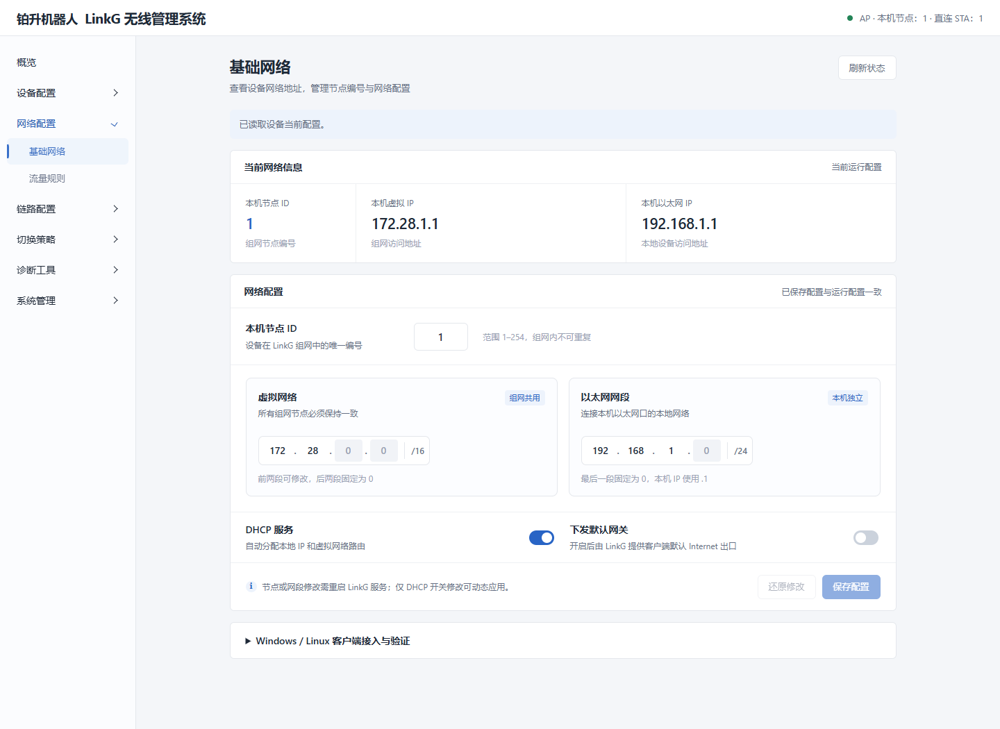
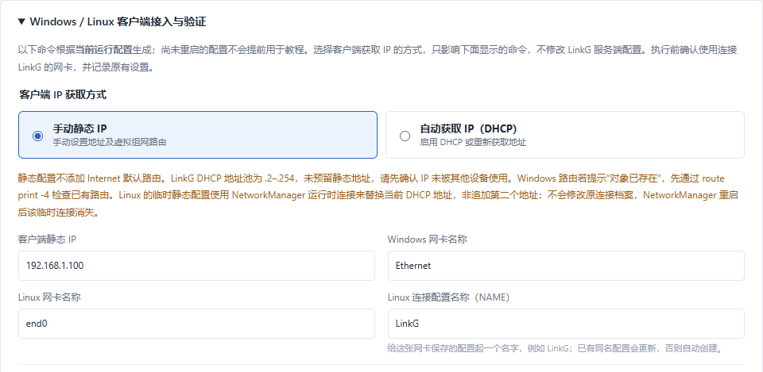
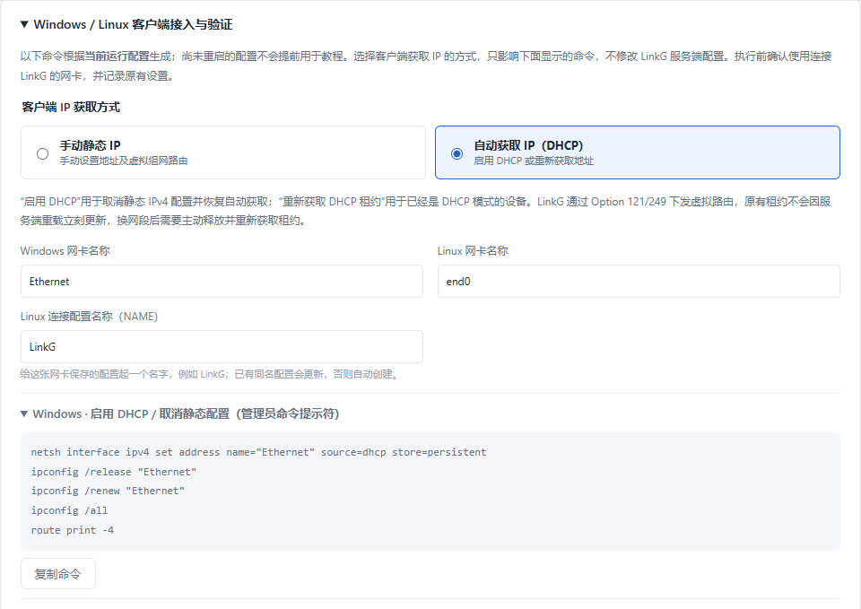

# 基础网络

基础网络用于设置本机节点 ID、虚拟网络、以太网网段，以及向以太网客户端提供的 DHCP 服务。打开 **“网络配置 → 基础网络”**。

## 1. 当前网络信息

上方“当前网络信息”显示**当前运行配置**，下方“网络配置”编辑区显示**已保存配置**。保存但尚未重启时，两处可能不同。

| 字段 | 含义 |
|---|---|
| 本机节点 ID | 本机在 LinkG 组网中的编号，同一组网内不可重复 |
| 本机虚拟 IP | 通过 LinkG 组网访问本机的地址，由虚拟网络和节点 ID 自动生成 |
| 本机以太网 IP | 电脑或其他设备通过本机以太网口访问 LinkG 的地址，由以太网网段自动生成 |

例如，虚拟网络为 `172.28.0.0/16` 时，节点 1 的本机虚拟 IP 为 `172.28.1.1`，节点 2 为 `172.28.2.1`。以太网网段为 `192.168.1.0/24` 时，本机以太网 IP 为 `192.168.1.1`。

## 2. 节点与网段

| 配置项 | 含义与设置 |
|---|---|
| 本机节点 ID | 范围 **1～254**；修改后本机虚拟 IP 随之改变。节点编号与 AP／STA 角色独立设置 |
| 虚拟网络 | 所有组网节点必须一致；固定为 **/16**，前两段可编辑，后两段为 `0.0` |
| 以太网网段 | 本机以太网口使用的本地网络，固定为 **/24**；前三段可编辑，末段为 `0`，本机使用该网段的 `.1` 地址 |

虚拟网络与以太网网段应使用私有网段，彼此不能重叠，也不能与设备内部固定网络冲突；页面及后端会校验填写值。还应避开电脑其他网卡正在使用的网段。

各节点的以太网网段按本机独立配置，分处独立以太网网络时可以相同。**不要把使用相同本机以太网 IP、同时开启 DHCP 的多台 LinkG 接到同一个交换机网络。**

## 3. DHCP 与默认网关

| 选项 | 开启后的作用 | 关闭后的作用 |
|---|---|---|
| **DHCP 服务** | 为本机以太网客户端分配 IP、子网掩码和虚拟网络路由 | 不再提供自动分配，客户端需自行配置静态地址和路由，或使用其他 DHCP 服务 |
| **下发默认网关** | 向 DHCP 客户端下发经 LinkG 的默认路由及 DNS，用于通过 LinkG 上网 | 仍下发虚拟网络路由，但不下发 Internet 默认网关及 DNS |

DHCP 地址池为当前以太网网段的 **`.2～.254`**，本机 `.1` 不参与分配。默认配置为 **DHCP 开启、下发默认网关关闭**；客户端即使没有从 LinkG 获取默认网关，也可以通过下发的虚拟网络路由访问组网。

“下发默认网关”仅在 DHCP 开启时可编辑，关闭 DHCP 不会清除已保存的网关选项。开启默认网关下发后，仍需本机蜂窝网络可用，客户端才具备经 LinkG 访问 Internet 的条件；仅打开此选项不会自动开启 5G。

**修改 DHCP 配置后，已有客户端需重新获取租约，才能更新地址、路由和 DNS。** 支持 DHCP 路由选项的客户端可自动获得虚拟网络路由；不支持时仍需手动配置。

## 4. 修改、保存与生效

修改需要调整的字段，点击 **“保存配置”**。生效方式取决于本次修改：

| 修改内容 | 保存后的处理 |
|---|---|
| 仅修改 DHCP 服务或默认网关选项 | 动态应用 DHCP 配置，无需重启全部服务；客户端需重新获取租约 |
| 修改节点 ID、虚拟网络或以太网网段 | 保存后弹出重启确认框；点击“确定”重启 LinkG 全部服务，点击“取消”保留保存值、本次继续按原配置运行 |

取消重启后，页面提示 **“已保存 · 尚待重启生效”**，可稍后点击“重启服务”应用。若已有地址修改等待重启，仅调整 DHCP 选项不会提前应用那些地址。服务重启会短暂中断相关通信，不重启 Linux 系统。

| 按钮 | 作用 |
|---|---|
| 刷新状态 | 重新读取运行信息与已保存配置；有未保存修改时，先确认是否放弃 |
| 还原修改 | 将表单恢复到最近已保存配置，丢弃尚未保存的修改；不能撤销已经保存的值 |
| 保存配置 | 保存当前表单；没有修改或参数不合法时不可提交 |
| 重启服务 | 有待应用配置等情况时显示，用于确认应用保存值；存在未保存修改时需先处理表单 |

重启后核对上方地址与保存值是否一致。**节点 ID 改变时使用新的虚拟 IP；以太网网段改变时，电脑也要重新获取 IP 或修改静态配置，并使用新的管理地址。** 虚拟网络改变后，客户端路由也需更新。

## 5. Windows／Linux 客户端接入帮助

展开页面底部 **“Windows / Linux 客户端接入与验证”**，按客户端实际情况生成命令。这里的输入只调整帮助内容，**不会修改 LinkG 配置，也不会自动执行电脑上的命令**。

| 项目 | 怎样填写或选择 |
|---|---|
| 手动静态 IP | 生成客户端地址和虚拟网络路由的配置命令，可选择临时或永久配置；不添加 Internet 默认路由 |
| 自动获取 IP（DHCP） | 生成启用 DHCP 或重新获取租约的命令；已处于 DHCP 模式时选择“重新获取 DHCP 租约” |
| 客户端静态 IP | 当前以太网网段内的 `.2～.254` 地址，例如 `192.168.1.100`；仅静态模式显示，使用前确认未被占用，DHCP 地址池未另行预留静态地址 |
| Windows 网卡名称 | 填连接 LinkG 的实际网卡名称，例如“以太网”；`Ethernet` 是页面示例值 |
| Linux 网卡名称 | 填实际接口名，例如 `end0`、`eth0`，可用 `ip link` 查看 |
| Linux 连接配置名称（NAME） | NetworkManager 中保存网络设置的连接名称，与网卡名称不同；已有同名配置会更新，不存在时按对应操作创建 |
| 复制命令 | 展开所需系统和操作，复制生成的命令，在对应客户端终端执行 |

命令根据**当前运行配置**生成，尚待重启的保存值不会提前用于命令。Windows 命令在管理员命令提示符执行；Linux 命令适用于由 **NetworkManager** 管理的网卡，其他网络管理方式需使用对应配置方法。

执行前确认目标网卡和连接名称，记录原有设置。Linux“启用 DHCP”会清空指定连接的静态 IPv4 地址、网关和手工路由；Windows 切回 DHCP 不会自动删除此前手动添加的路由，需核对后使用页面提供的可选清理命令。

配置完成后，检查客户端地址及虚拟网络路由，并 Ping 本机虚拟 IP。首次配对与两端通信验证见[一对一配置](../../02-快速入门/01-一对一配置.md)和[一对多配置](../../02-快速入门/02-一对多配置.md)。
