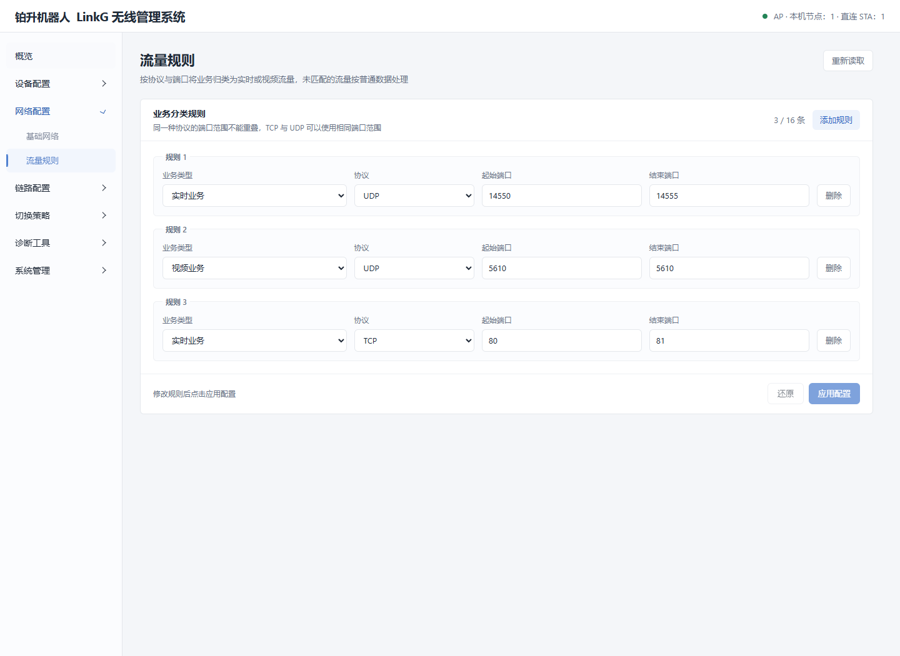
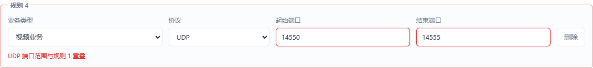

# 流量规则

流量规则用于按 TCP／UDP 协议和端口，对经 LinkG 组网传输的业务进行分类。打开 **“网络配置 → 流量规则”**。

## 1. 业务分类

| 分类 | 含义与设置 |
|---|---|
| **实时业务** | 用于控制指令、遥测等业务，按实际程序使用的协议和端口添加规则 |
| **视频业务** | 用于视频传输业务，按视频程序实际使用的协议和端口添加规则 |
| **普通数据** | 其他未匹配分类规则的业务自动归入此类，无需单独添加规则 |

页面“业务类型”只需选择实时或视频，分类后的发送路径可在 **“切换策略 → 运行状态”** 查看。

系统已将 **ICMP（如 Ping）和 TCP 22 端口的 SSH 流量固定归为实时业务**，无需添加，这两项内置分类优先于自定义规则。

## 2. 规则字段

每条规则包含四个字段，最多配置 **16 条**。右上角显示当前表单的规则数量，例如 `3 / 16 条`。

| 字段 | 含义与填写方法 |
|---|---|
| 业务类型 | 选择“实时业务”或“视频业务” |
| 协议 | 选择 TCP 或 UDP，必须与业务程序实际使用的协议一致 |
| 起始端口 | 范围的起点，填写 **1～65535** 的整数 |
| 结束端口 | 范围的终点，同样为 **1～65535**；不能小于起始端口 |

端口范围**包含起始和结束端口**。只配置一个端口时，两处填写相同值。例如，截图中的 UDP `5610～5610` 表示 UDP 5610 单端口；UDP `14550～14555` 包含 14550、14551，直至 14555。

## 3. 怎样匹配与检查规则

协议相同，并且报文的**源端口或目标端口**落入范围，即可匹配该条规则。例如，UDP 5610 被配置为视频业务后，发往该端口或从该端口发出的报文均可匹配。

| 填写情况 | 是否允许 |
|---|---|
| 同为 UDP，范围 `14550～14555` 与 `14555～14560` | 不允许，14555 重叠；即使业务类型相同也不能重复 |
| 同为 UDP，范围 `14550～14555` 与 `14556～14560` | 允许，两段不重叠 |
| TCP 与 UDP 都填写 `5610～5610` | 允许，协议不同，分别匹配 |
| 起始端口大于结束端口、留空或超出 1～65535 | 不允许，需修正后应用 |

同一报文的源、目标端口若分别命中不同规则，按列表中先匹配的规则归类。因此应按实际业务端口设置范围，避免把无关端口一并划入。

输入错误会在对应规则下方显示，并标出需要修改的字段。上图为未保存的校验演示，修正端口范围后再应用。

## 4. 按钮与应用方式

点击 **“添加规则”**，选择业务类型和协议，填写端口范围；修改已有规则可直接编辑对应行。完成后点击 **“应用配置”**。

| 按钮 | 作用 |
|---|---|
| 重新读取 | 从设备重新获取整份规则，成功后覆盖当前表单；未应用的修改会被丢弃 |
| 添加规则 | 新增一条待填写规则，默认“实时业务＋UDP”；达到 16 条后不可继续添加 |
| 删除 | 从当前表单移除所在规则，点击“应用配置”后才会更新设备 |
| 还原 | 放弃未应用的修改，恢复到最近读取或应用成功后的配置；不恢复出厂规则 |
| 应用配置 | 校验并保存页面中的全部规则，动态应用，无需重启 LinkG 服务 |

**本页没有“保存后取消重启”的步骤。** 有修改时可应用；参数有误会先提示修正。成功后显示 **“配置已应用，新的流量分类规则已生效”**。

删除全部规则后仍可应用，未命中内置分类的业务将按普通数据处理。已经应用的修改不能用“还原”撤销，需要改回原值并再次应用。

## 5. 应用后怎样核对

应用成功后，页面会重新读取并确认规则。需要再次检查时，点击“重新读取”，核对业务类型、协议和端口范围。

规则只更新**当前这台 LinkG**，不会自动同步到其他节点。需要两端一致分类时，应分别核对两端的实际业务端口和规则；随后到 **“切换策略 → 运行状态”** 查看各类业务的发送计划及链路状态。

若提示“回读确认失败”或“无法确认设备状态”，先点击“重新读取”核对设备上的规则，再继续修改，避免按未确认的旧内容重复提交。
