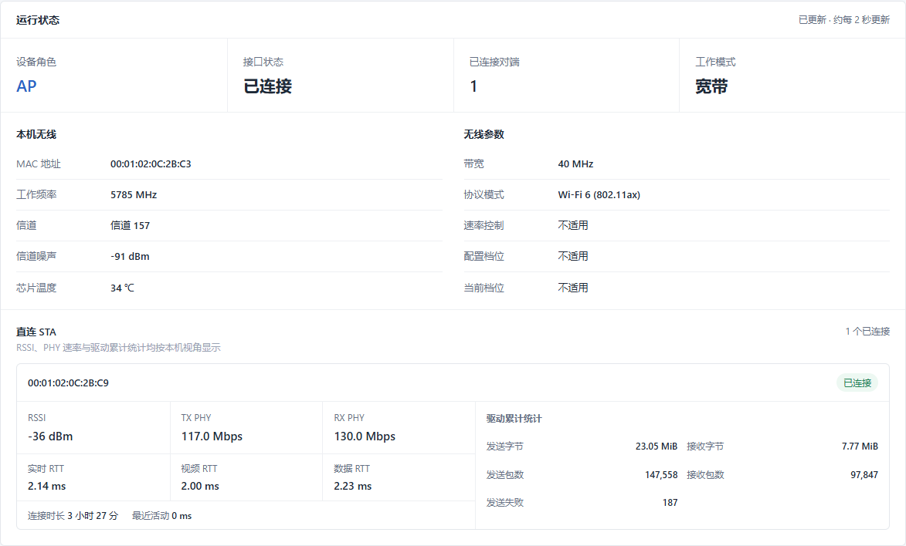
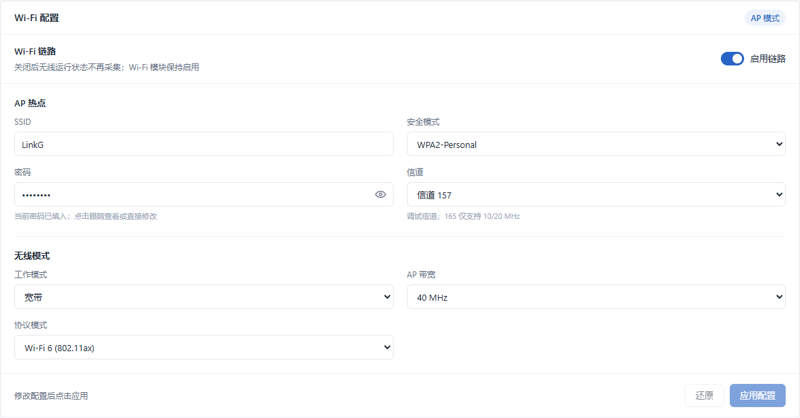

# Wi-Fi

Wi-Fi 页面用于查看本机无线和直连对端状态，并配置当前角色的无线参数。打开 **“链路配置 → Wi-Fi”**。AP／STA 角色在“设备配置 → 基础配置”中设置。

## 1. 运行状态

运行状态约每 **2 秒**自动更新，也可点击页面右上角“刷新”。AP 显示“直连 STA”，STA 显示“关联 AP”。

| 字段 | 含义 |
|---|---|
| 设备角色 | 当前运行的 AP 或 STA 角色 |
| 接口状态 | “已连接”表示存在无线连接；“等待连接”表示接口已就绪、尚无连接；“未运行”表示接口未处于就绪状态 |
| 已连接对端 | AP 显示直连 STA 数量；STA 为 0 或 1 |
| 工作模式 | 当前使用宽带或窄带 |
| MAC 地址 | 本机无线接口地址；对端卡片标题则是对端 MAC |
| 工作频率／信道 | 当前工作的频率和信道，例如 5785 MHz 对应信道 157 |
| 信道噪声 | 本机测得的噪声，单位 dBm；数值越负，测得噪声越低 |
| 芯片温度 | 无线芯片报告的温度 |
| 带宽／协议模式 | 当前带宽；宽带 AP 显示协议模式，STA 显示自动协商；窄带协议栏显示“不适用” |
| 速率控制／配置档位／当前档位 | 窄带的速率模式、保存的固定档位参数及驱动当前上报档位；宽带显示“不适用” |

对端信息均以**当前这台 LinkG**为观察点：

| 对端项目 | 含义 |
|---|---|
| 已连接／未连接 | 该无线对端的连接状态 |
| RSSI | 本机收到对端信号的强度；越接近 0 越强，例如 −50 dBm 强于 −80 dBm |
| TX PHY／RX PHY | 本机向对端发送／从对端接收时的物理层速率；业务吞吐可通过“诊断工具 → 链路性能测试”测量 |
| 实时／视频／数据 RTT | 本机到该 LinkG 对端、经 Wi-Fi 路径的三类业务探测往返时间；“不可达”表示探测判定不通 |
| 连接时长／最近活动 | 已连接持续时间，以及驱动报告的最近活动距今时间 |
| 驱动累计统计 | 本机视角的发送／接收字节、包数和发送失败次数；累计值可能随连接或模块重启重置 |

`--` 表示没有有效数据。无线“已连接”后，还应结合 RTT 和“概览”中的组网节点状态确认组网通信。

## 2. AP 与 STA 配置

### AP：设置本机热点

AP 页面显示“AP 热点”，设置本机提供给 STA 连接的参数。

### STA：填写目标 AP

STA 页面显示“目标 AP”，填写要连接的 AP 参数。**SSID、安全模式、密码应与目标 AP 一致。** STA 不单独选择信道和 AP 带宽；宽带协议显示“自动协商”，不可手动修改。

| 配置项 | 含义与填写方法 |
|---|---|
| Wi-Fi 链路／启用链路 | 控制 Wi-Fi 业务路径是否启用；关闭并应用后不再采集和显示无线运行状态，Wi-Fi 模块本身保持启用 |
| SSID | AP 的热点名称，或 STA 要连接的热点名称；长度 1～32 个允许的 ASCII 字符 |
| 安全模式 | **WPA2-Personal** 使用密码；**开放网络**无需密码，密码框置灰 |
| 密码 | WPA2 使用 8～63 个允许的 ASCII 字符；当前密码已填入，点击眼睛按钮可显示或隐藏 |
| 信道（AP） | 选择本机热点的主信道，可选项随工作模式和带宽变化 |

SSID 和密码支持英文字母、数字及 `!@#$%^&*()_=+.,:;?-`，不支持中文或空格。修改 AP 名称或认证参数后，相关 STA 也需调整为一致值。

## 3. 宽带与窄带

| 配置项 | 设置方法 |
|---|---|
| 工作模式 | 选择“宽带”或“窄带 · 10 MHz”；组网两端应使用相同工作模式 |
| AP 带宽 | 宽带 AP 可选 **20／40／80 MHz**；STA 连接时协商实际带宽 |
| 协议模式 | 宽带 AP 可选 **Wi-Fi 4（802.11n）／Wi-Fi 5（802.11ac）／Wi-Fi 6（802.11ax）**；80 MHz 时只提供 Wi-Fi 5／6 |
| 速率控制 | 窄带可选“固定档位”或“驱动自适应” |
| 固定速率档位 | 固定模式下选择 **0～5**；选择驱动自适应后此项隐藏，当前档位可在运行状态查看 |

宽带支持一对一、一对多。窄带默认一对一，**驱动自适应仅支持一对一**；固定档位下尝试一对多需自行实测，不属于默认支持范围，不承诺接入数量。

发布版本按 **149、153、157、161、165** 选择信道，165 仅支持宽带 20 MHz 或窄带 10 MHz，**不支持 40／80 MHz**。切换带宽后若原信道不可用，需重新选择。本文 AP 截图取自调试构建，显示“调试信道”，其扩展选项可能多于发布版本。

需要评估环境时，可使用“诊断工具 → 信道扫描”。40 MHz 应共同查看 149＋153 或 157＋161；80 MHz 共同占用 149～161 的信道范围。

## 4. 按钮与生效方式

修改当前角色的参数，点击 **“应用配置”**。本页直接保存并申请应用，没有“保存后稍后重启”的确认步骤。

| 按钮 | 作用 |
|---|---|
| 刷新 | 更新运行状态；正常读取配置后，不会覆盖正在编辑的表单。需要重新读取设备配置时，可重新进入页面 |
| 眼睛按钮 | 显示／隐藏密码，不修改密码内容 |
| 还原 | 丢弃未应用的修改，恢复到最近读取或成功应用后的配置；不能撤销已经应用的设置 |
| 应用配置 | 校验、保存并应用当前配置；没有修改时置灰，参数错误时在底部提示 |

| 修改内容 | 应用方式 |
|---|---|
| 已处于窄带，仅修改速率控制方式或固定档位 | 动态更新速率参数，页面提示“速率参数已动态更新” |
| SSID、认证、信道、宽窄带、宽带参数、链路开关等其他修改 | 请求重启 Wi-Fi，页面提示“Wi-Fi 正在重启”；无线通信会短暂中断 |

修改 Wi-Fi 时建议通过本机以太网访问，便于无线断开期间继续管理。切换宽窄带或更改 AP 参数时，需安排对端同步配置；本页不会自动修改其他节点。

“Wi-Fi 正在重启”表示应用请求已提交，**对端是否重新连上，应回到运行状态核对**：接口已连接、对端 MAC 正确，并有有效的业务探测结果。应用失败或访问中断后，重新进入页面核对保存值和运行状态，再继续修改。
