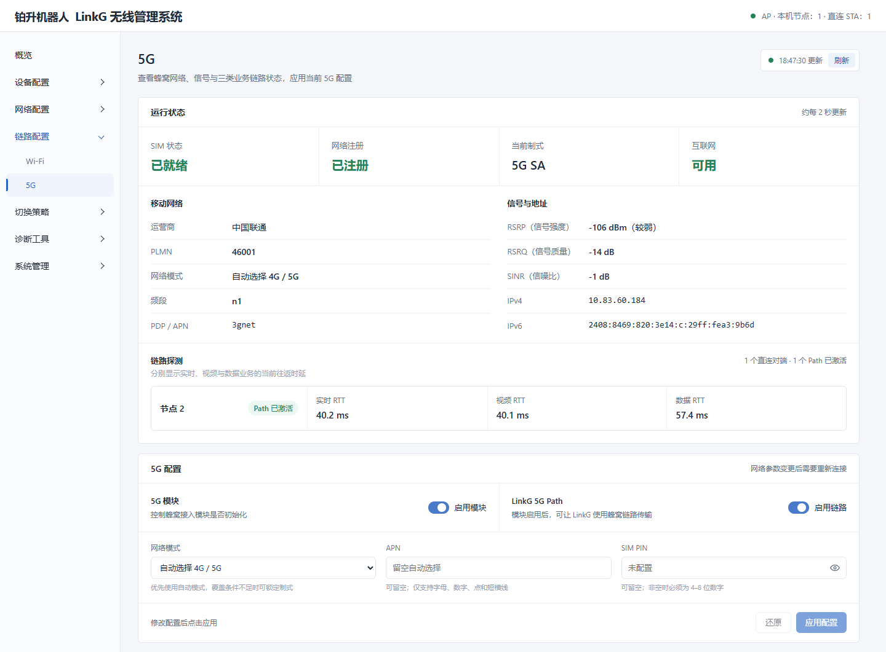

# 蜂窝网络

蜂窝网络用于通过 **4G LTE 或 5G NR SA** 接入移动网络，并为 LinkG 组网和以太网设备上网提供蜂窝通道。当前 Web 入口为 **“链路配置 → 5G”**，本章对应此页面。

## 1. 运行状态

使用前按接口说明安装 SIM 卡并连接对应天线，确认 SIM 已开通所需数据业务。页面约每 **2 秒**更新状态，也可点击“刷新”。

| 字段 | 含义 |
|---|---|
| SIM 状态 | “已就绪”表示 SIM 可用；也可能显示未检测到、需要 PIN、需要 PUK 等状态 |
| 网络注册 | 查看是否已注册到运营商；正在注册时需等待，注册被拒绝时检查 SIM 和网络条件 |
| 当前制式 | 实际连接的 4G LTE 或 5G SA；自动模式下连接到 4G 属于正常结果 |
| 互联网 | 设备当前的互联网可用性判定；与 SIM 就绪、网络注册分别显示 |
| 运营商／PLMN | 运营商名称及其移动网络标识 |
| 网络模式／频段 | 配置的选网方式，以及当前连接的 LTE 频段 B 或 NR 频段 n |
| PDP / APN | 当前数据连接实际使用的 APN |
| RSRP | 接收信号强度，单位 dBm，数值越接近 0 越强 |
| RSRQ／SINR | 信号质量和信噪比，单位 dB；相同条件下数值越高通常越好 |
| IPv4／IPv6 | 蜂窝网络分配的地址，不能仅凭获得地址判断对端一定可达 |
| 链路探测 | 按直连节点显示 Path 是否激活，以及实时、视频、数据三类业务 RTT；`--` 表示无有效结果，“不可达”表示探测不通 |

“模块未启用”时不显示运行详情；启用后的初始化和重新连接期间，状态可能暂时不可用。

## 2. 配置项

| 配置项 | 含义与设置 |
|---|---|
| **5G 模块** | 控制蜂窝接入模块是否初始化，用于注册网络、建立数据连接和获取地址 |
| **LinkG 5G Path** | 允许 LinkG 组网使用蜂窝路径；关闭此项与关闭模块是两个不同操作。关闭模块时，页面会同时取消链路开关 |
| 网络模式 | 可选自动选择 4G／5G、仅 4G LTE、仅 5G NR SA；锁定制式后须有对应网络覆盖 |
| APN | 按 SIM 或专网服务提供的参数填写，可留空；最多 100 个字符，允许字母、数字、点和短横线 |
| SIM PIN | 无需 PIN 时留空；需要时填写实际的 4～8 位数字 PIN，眼睛按钮用于显示／隐藏。需要 PUK 时应按运营商流程处理 |

## 3. 修改与应用

调整需要的选项后点击 **“应用配置”**。模块、链路、网络模式、APN 或 PIN 改变时，会保存并请求蜂窝网络重新连接；本页不需要重启 Linux 整机。

| 按钮 | 作用 |
|---|---|
| 刷新 | 更新运行状态；配置正常读取后，不覆盖正在编辑的表单 |
| 还原 | 丢弃未应用的修改，恢复到最近读取或成功应用后的配置 |
| 应用配置 | 校验、保存并应用；没有修改时置灰，填写错误时提示修正 |

“正在重新连接”表示请求已提交。随后核对 **SIM 已就绪 → 网络已注册 → 获得地址 → 互联网及对端探测状态**，判断接入和组网是否分别正常。

## 4. 上网与蜂窝组网的区别

| 用途 | 还需满足的条件 |
|---|---|
| 以太网接入设备上网 | 本机蜂窝互联网可用；客户端默认网关指向本机 LinkG 以太网 IP，并有可用 DNS。DHCP 客户端可在[基础网络](../03-网络配置/01-基础网络.md)开启“下发默认网关”后重新获取租约 |
| LinkG 之间蜂窝组网 | 两端启用蜂窝接入及 LinkG 蜂窝 Path，具备可互通的全局 IPv6 地址；再核对对端 Path、业务探测和发送计划 |

本机能上网不代表设备之间的蜂窝路径已打通。发送路径查看[运行状态](../05-切换策略/01-运行状态.md)。蜂窝传输和性能测试都会使用 SIM 数据流量。
