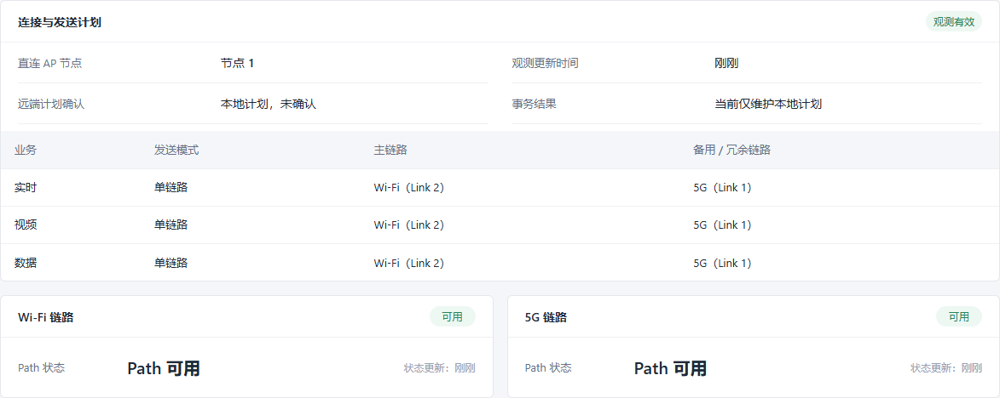
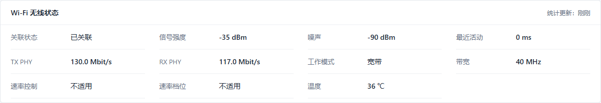
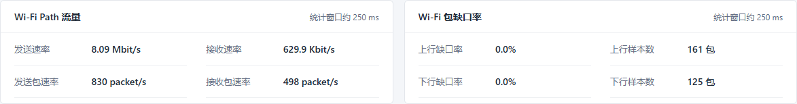

# 运行状态

打开 **“切换策略 → 运行状态”**，页面标题为“切换状态”。这里主要查看**各类业务当前使用哪条链路，以及链路质量和维护状态**。页面约每 1 秒更新，点击右上角“立即刷新”可主动读取状态。

页面内容随本机 AP／STA 角色变化，下面按实际页面顺序介绍。

## 1. 运行概况与本机维护状态

AP 和 STA 均显示这两个区域。

| 运行概况 | 含义 |
|---|---|
| 设备角色 | 本机当前运行的 AP 或 STA 角色 |
| 运行状态 | 对当前连接、计划和维护情况的概括；例如“本地计划运行中”表示已有本地发送计划，远端确认情况需继续看下方对应字段 |
| 直连节点 | STA 显示直连的 AP 节点；AP 显示直连 STA 数量 |
| 当前发送计划 | 三类业务计划相同时合并显示，例如“全部 · 单链路 · Wi-Fi”；不同时提示按业务配置，应查看下方明细 |

“本机维护状态”用于查看本机是否正在执行影响接入链路的维护事务：

| 字段 | 含义 |
|---|---|
| 状态 | 无维护时显示“正常”，右上角标记“未维护”；有任务时显示维护状态 |
| 维护接入 | 本次维护影响的 Wi-Fi 或蜂窝接入 |
| 事务编号 | 用于区分本次维护事务 |
| 持续时间 | 该维护事务已持续的时间 |

未维护时，接入、编号和持续时间显示 `--`，不需要额外设置。

## 2. STA 页面

### 2.1 连接与发送计划、链路可用性

| 字段 | 含义 |
|---|---|
| 直连 AP 节点 | 当前连接的组网 AP 节点编号 |
| 观测更新时间 | 最近一次有效链路观测距今多久；“等待观测”表示尚未形成有效观测 |
| 远端计划确认 | 查看当前计划是否已由 AP 确认，可能显示本地计划未确认、正在同步、AP 已确认、被拒绝或远端结果未确认 |
| 事务结果 | 对最近一次计划确认结果的补充，如等待 AP 应答、确认成功或结果未知 |
| 业务 | 实时、视频、数据三类，每一类分别显示发送计划；分类设置见[流量规则](../03-网络配置/02-流量规则.md) |
| 发送模式 | **单链路**使用主链路；**双链路冗余**经主、冗余链路同时发送；**无可用链路**表示当前没有可用发送路径 |
| 主链路 | 该类业务当前的主要发送路径，如 Wi-Fi 或 5G |
| 备用／冗余链路 | 单链路时是备用路径；双链路冗余时是同时参与发送的另一条路径。括号内 Link 数字是本次运行的路径标识，以页面实际显示为准 |
| Wi-Fi／5G 链路 | 分别显示对应 Path 是否可用及状态更新时间；页面中的 5G 包含蜂窝接入路径 |

例如，发送模式为“单链路”、主链路为 Wi-Fi、备用为 5G 时，业务当前经 Wi-Fi 发送，5G 是备用项。判断当前承载路径应看该类业务的发送计划，不能只看两个 Path 都显示“可用”。

### 2.2 Wi-Fi 无线状态

| 字段 | 含义 |
|---|---|
| 关联状态 | 本机 STA 是否已与 AP 建立无线关联 |
| 信号强度 | 本机收到 AP 信号的 RSSI，单位 dBm；例如 −50 dBm 强于 −80 dBm |
| 噪声 | 本机测得的信道噪声，单位 dBm，数值越负表示测得噪声越低 |
| 最近活动 | 驱动报告的最近一次对端无线活动距今时间 |
| TX PHY／RX PHY | 本机发送／接收的物理层速率；实际业务吞吐通过[链路性能测试](../06-诊断工具/02-链路性能测试.md)测量 |
| 工作模式／带宽 | 当前宽带或窄带模式，以及实际工作带宽 |
| 速率控制／速率档位 | 窄带显示固定或自适应及当前档位；宽带显示“不适用” |
| 温度 | 无线芯片报告的温度 |

右上角显示统计更新时间。`--` 表示当前没有有效值，不能按 0 理解；配置方法见[Wi-Fi](../04-链路配置/01-Wi-Fi.md)。

### 2.3 Wi-Fi Path 流量与包缺口率

| 字段 | 含义 |
|---|---|
| 发送／接收速率 | 本机 Wi-Fi Path 的发送／接收比特率，页面按数值显示相应单位 |
| 发送／接收包速率 | 对应方向每秒的包数，单位 packet/s |
| 上行缺口率／样本数 | **STA → AP** 方向的包缺口比例及参与统计的包数 |
| 下行缺口率／样本数 | **AP → STA** 方向的包缺口比例及参与统计的包数 |

这两块使用约 **250 ms** 的统计窗口。样本少时应结合多次更新观察；0% 只表示当前有效窗口未统计到缺口。包缺口率属于 LinkG 路径统计，不直接等同于无线 PHY 错包率或应用端到端丢包率。

### 2.4 Wi-Fi 业务探测与对端维护状态

| 业务探测字段 | 含义 |
|---|---|
| 业务类别 | 实时业务、视频业务、普通数据，分别探测 |
| 可达状态 | 该类业务经 Wi-Fi 到直连 AP 的探测结果；“可达”表示最近有效探测成功，“不可达”表示探测未通过，`--` 表示无有效结果 |
| 往返时延 | 对应探测的 RTT，数值按大小显示为 µs、ms 或秒；各类约每秒探测一次 |

此处显示 **Wi-Fi 路径**的探测。蜂窝路径各类业务的 RTT 在[蜂窝网络](../04-链路配置/02-蜂窝网络.md)页面查看。

下方“对端维护状态”对应直连 AP，字段与本机维护状态相同：**状态、维护接入、事务编号、持续时间**。对端“未维护”时，其余维护字段显示 `--`；显示维护中时，应结合对端任务进度判断该接入的暂时变化。

## 3. AP 页面：直连 STA 状态

AP 在公共概况和本机维护状态下方，按节点列出“直连 STA 状态”。

| 列 | 含义 |
|---|---|
| 节点 | 直连 STA 的节点 ID |
| 发送计划 | 该节点对应的实时、视频、数据计划；单链路中的“备”表示备用路径 |
| Wi-Fi Path／5G Path | 该节点对应路径的可用性，无有效状态时显示 `--` |
| Wi-Fi 上行缺口 | 该 STA → AP 的缺口率及样本包数，统计窗口约 250 ms |
| 对端维护 | 该 STA 当前是否维护，以及受影响的接入和事务编号；维护中可悬停查看持续时间 |
| 状态更新时间 | 该节点路径状态距今多久 |

一对多组网时逐行检查各 STA。查看后需要修改参数，可进入 Wi-Fi、蜂窝网络或流量规则页面；本页的“立即刷新”只读取状态。
