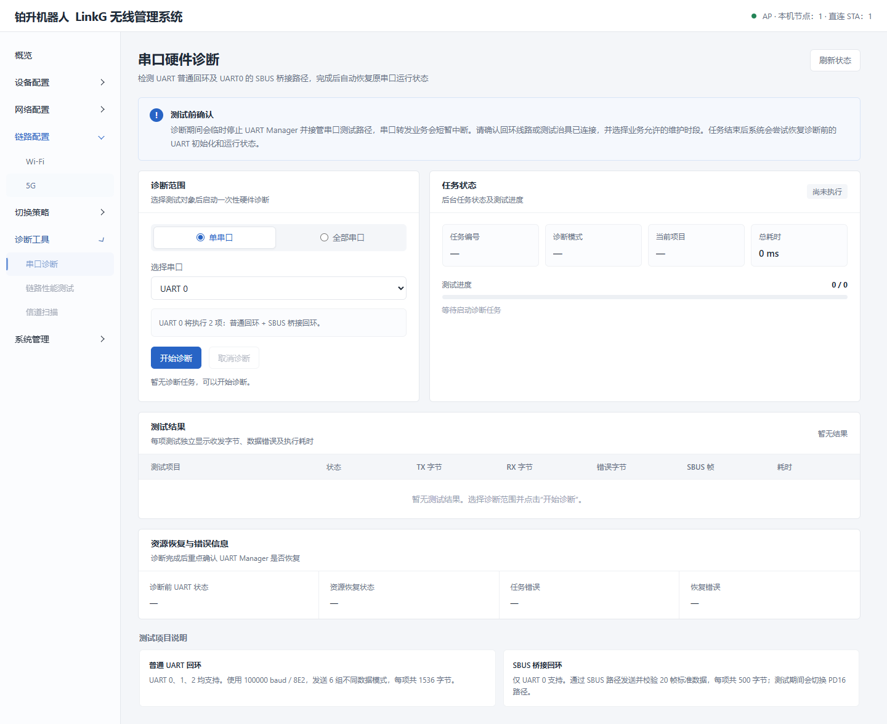

# 串口诊断

打开 **“诊断工具 → 串口诊断”**，页面标题为“串口硬件诊断”。它检查 UART 普通回环和 UART0 的 SBUS 桥接路径，测试结束后恢复诊断前的串口服务状态。

## 1. 测试前准备与范围

诊断会临时接管串口，**串口转发业务会中断**。先断开原业务设备，按[硬件与接口](../../01-产品介绍与规格/03-硬件与接口.md)连接回环线路或对应测试治具，再在允许中断业务时启动。没有正确回环接线时，收不到返回数据不能直接判为设备硬件损坏。

| 选择 | 执行内容 |
|---|---|
| 单串口 · UART0 | 普通回环和 SBUS 桥接回环，共 2 项 |
| 单串口 · UART1／UART2 | 所选串口的普通回环，共 1 项 |
| 全部串口 | UART0、UART1、UART2 普通回环，以及 UART0 SBUS 桥接，共 4 项 |

普通回环使用 **100000 baud、8E2**，发送 6 组数据，共 1536 字节；SBUS 桥接校验 20 帧，共 500 字节。测试使用诊断参数，不要求先把正常串口转发配置改成这些值。

## 2. 按钮与执行过程

选择范围和串口，点击“开始诊断”，在确认框中确认业务中断后启动。任务在设备后台执行，离开页面不会代替取消操作。

| 按钮 | 作用 |
|---|---|
| 开始诊断 | 提交一次诊断；正在测试或恢复资源时不能重复启动 |
| 取消诊断 | 确认后请求取消，仍需等待资源恢复，不会直接跳过清理 |
| 刷新状态 | 重新读取当前或最近一次任务，执行期间页面也会自动更新 |

任务依次显示准备、测试、恢复资源和结束状态。任务编号用于区分测试；“当前项目”和进度表示正在执行哪一项，“总耗时”包含任务过程。

## 3. 怎样看结果

| 字段 | 含义 |
|---|---|
| 测试项目／状态 | 所测串口及普通或 SBUS 路径；逐项显示通过、失败、取消或跳过 |
| TX／RX 字节 | 本次诊断实际发送和接收的字节数 |
| 错误字节 | 返回数据校验错误的字节数 |
| SBUS 帧 | SBUS 项目的帧校验结果，普通回环不适用 |
| 耗时 | 单项测试的执行时间 |
| 诊断前 UART 状态 | 诊断前未初始化、已停止或运行中，用于核对恢复目标 |
| 资源恢复状态 | 是否恢复到诊断前的 UART 状态，是任务结束后的重点检查项 |
| 任务错误／恢复错误 | 分别表示诊断流程和资源恢复中的错误；保留提示供排查 |

**“已完成”表示流程结束，还要看是否全部通过，以及资源是否已恢复。** 某项失败时先检查所选串口、回环接线和治具；恢复失败时先处理错误，再恢复业务设备并核对串口转发。

诊断不替代正常业务配置。串口参数、方向和网络路由的设置见[串口配置](../02-设备配置/02-串口配置.md)。
