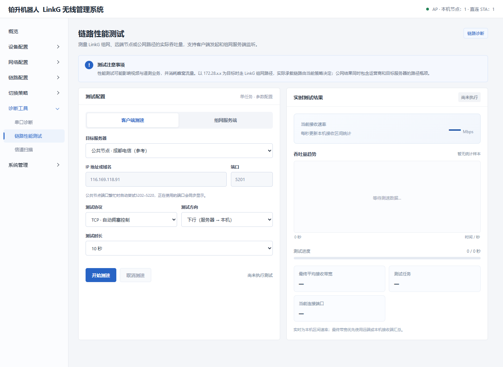
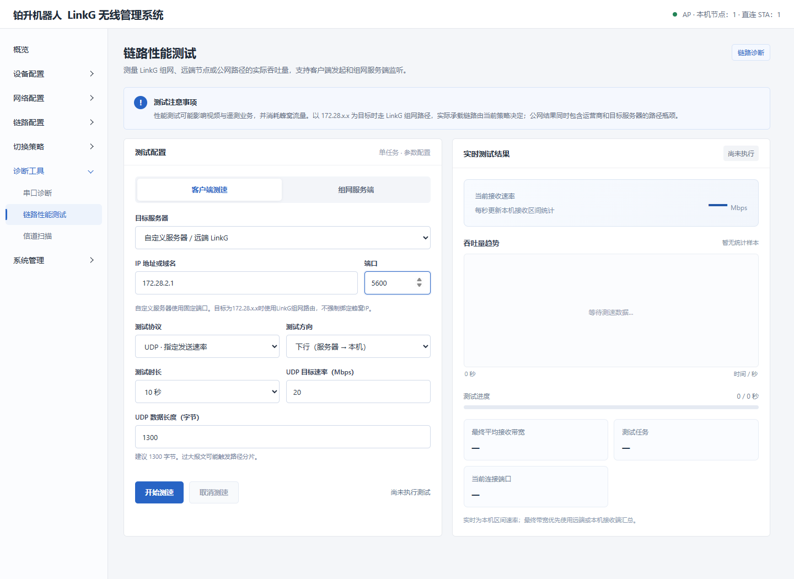
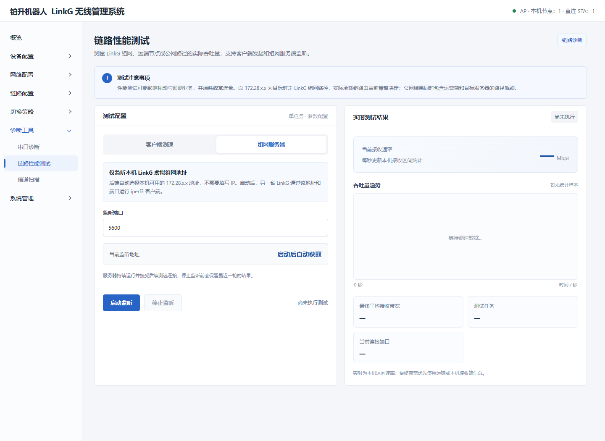

# 链路性能测试

打开 **“诊断工具 → 链路性能测试”**，可以由本机发起测速，也可以让本机作为组网服务端等待连接。测试会占用带宽并可能影响视频、遥测等业务，经蜂窝传输时还会消耗数据流量。

## 1. 客户端测速

| 字段 | 含义与设置 |
|---|---|
| 目标服务器 | 内置公共节点用于参考；选择“自定义服务器／远端 LinkG”后可填写实际服务器 |
| IP 地址或域名 | 对端须运行兼容的 iperf3 服务；组网测试填写对端 LinkG 的虚拟 IP |
| 端口 | 与服务端一致，范围 1～65535；公共节点默认 5201，端口忙时自动尝试 5202～5220，自定义目标使用固定端口 |
| 测试协议 | **TCP** 使用拥塞控制测量吞吐；**UDP** 按指定目标速率发送并统计接收结果 |
| 测试方向 | **下行**为服务器 → 本机，**上行**为本机 → 服务器，均以发起测试的 LinkG 为参照 |
| 测试时长 | 页面可选 5、10、20、30、60 秒，不包含全部连接和收尾等待时间 |
| UDP 目标速率 | UDP 时显示，可填 0.1～200 Mbps；这是请求发送速率，实际发送和接收值见结果 |
| UDP 数据长度 | UDP 时显示，200～1472 字节，页面建议 1300 字节；较大报文可能触发路径分片 |

填好参数后点击“开始测速”。以 `172.28.x.x` 为目标时，使用 LinkG 组网路径，实际由 Wi-Fi 还是蜂窝承载需结合当前发送计划查看；公网测速还受到运营商、公共网络和服务器负载影响。

## 2. 组网服务端

选择“组网服务端”，填写监听端口，点击 **“启动监听”**。后端自动选取本机可用的 `172.28.x.x` 虚拟组网地址，并显示“地址:端口”；此模式只监听该组网地址。

另一台 LinkG 选择客户端测速，使用“自定义服务器／远端 LinkG”，填入上述地址和端口后启动。协议、上下行和时长由客户端选择。

服务端持续等待后续连接；每次会话结束保留最近一轮结果，直到点击“停止监听”。同一台设备同时只运行一个测速任务，运行期间参数和模式会锁定。

## 3. 按钮与结果

| 按钮 | 作用 |
|---|---|
| 开始测速／取消测速 | 启动或请求停止客户端测试，停止后等待任务收尾 |
| 启动监听／停止监听 | 启动或结束本机组网服务端；等待连接也属于运行中的任务 |
| 链路诊断 | 跳转到切换运行状态，查看当前业务承载路径 |

| 结果项 | 怎样理解 |
|---|---|
| 当前发送／接收速率 | 本机每秒区间统计；发送统计描述本机发出量，远端接收情况看最终汇总 |
| 吞吐量趋势 | 各区间样本绘成的曲线，用于看变化；区间波动需结合平均值判断 |
| 最终平均接收带宽 | 客户端优先展示接收端最终汇总，是本轮测试实际接收吞吐的主要参考 |
| 最近会话平均值 | 服务端按当前会话的接收或发送方向显示，注意对应标签 |
| UDP 端到端未接收率 | 包含端点处理、队列和传输路径等影响，不能直接等同于无线空口丢包率 |
| 测试任务／服务会话 | 区分本次任务和服务端最近一次连接 |
| 当前连接端口 | 实际使用的端口，公共节点自动换端口时会随之更新 |

没有完整接收端统计时，平均值或丢包项可能显示 `—`，应结合错误提示核对。目标速率较高但实际发送不足时，先比较页面的实际发送总速率与接收带宽；对比终端结果时，还需统一协议、方向、目标、时长、UDP 长度和速率等参数。

任务在设备端运行，关闭页面不会代替“取消测速”或“停止监听”。完成后可回到[运行状态](../05-切换策略/01-运行状态.md)确认正常业务链路。
