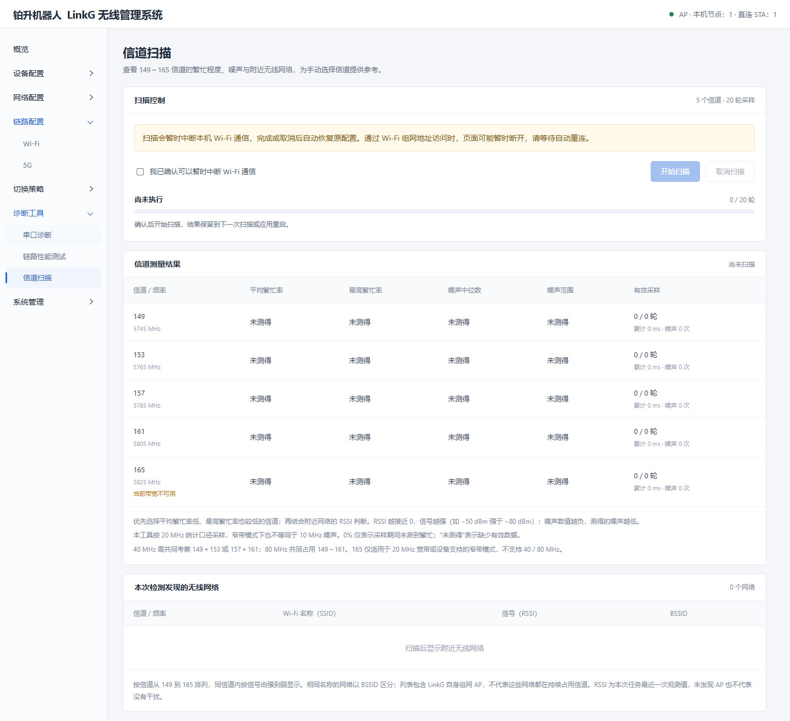
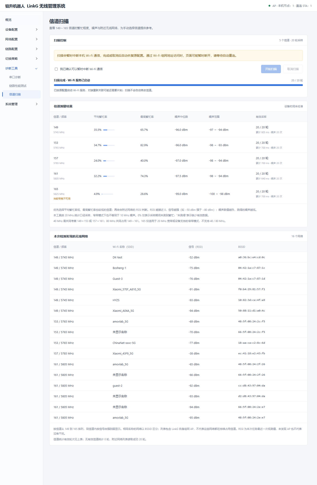

# 信道扫描

打开 **“诊断工具 → 信道扫描”**，测量 149、153、157、161、165 五个信道的繁忙率、噪声和附近 AP，为手动选信道提供参考。扫描固定 **20 轮**，不会自动排序推荐或修改工作信道。

## 1. 开始与取消

扫描会暂时停止本机正常 Wi-Fi，结束后按原配置恢复。建议通过本地以太网访问，并在允许无线业务中断的时间执行。

| 控件／状态 | 作用 |
|---|---|
| 中断确认复选框 | 确认本次可以暂停 Wi-Fi；勾选且设备就绪后，才能开始 |
| 开始扫描 | 提交后台扫描任务；运行时不能重复启动 |
| 取消扫描 | 请求提前停止采样，仍会清理扫描资源并恢复 Wi-Fi |
| 轮数与进度 | 显示已完成轮数／20 轮；轮数不是秒数，总耗时还包含准备和恢复 |
| 正在恢复 Wi-Fi | 测量结束后正在清理并启动原 Wi-Fi 服务，应继续等待 |

离开页面不会停止后台扫描。通过无线组网访问时可能短暂断开，等待恢复后再查看；“Wi-Fi 服务已启动”后，对端重新关联仍可能需要片刻。恢复失败时按页面提示通过网线检查设备。

## 2. 信道测量结果

下图为 **2026 年 11 月 13 日既有实板测试结果**，用于说明读表方法，数值随环境变化。

| 字段 | 含义 |
|---|---|
| 信道／频率 | 149／5745、153／5765、157／5785、161／5805、165／5825 MHz |
| 平均繁忙率 | 有效测量中信道忙碌时间所占比例，越低表示本次采样中越空闲 |
| 最高繁忙率 | 单次有效采样的最高忙碌比例，用于观察短时拥挤 |
| 噪声中位数／范围 | 噪声的典型值及最低、最高值；数值越负，测得噪声越低 |
| 有效采样 | 该信道的有效轮数、累计测量时间及噪声样本数；缺失轮次不能按 0% 处理 |
| 开始时间 | 设备记录的任务时间；显示“设备时间未校准”时，应先按任务结果理解，不据此判断实际日期 |

本工具按 **20 MHz 统计口径**采样，窄带下也不能把该噪声直接当作 10 MHz 测量值。0% 表示采样期间未测到繁忙，“未测得”表示缺少有效数据。

## 3. 附近无线网络与选信道

“本次检测发现的无线网络”只显示目标信道中的网络，按 **149 → 165** 排列，同信道按 RSSI 由强到弱显示。

| 字段 | 含义 |
|---|---|
| Wi-Fi 名称（SSID） | 网络名称；未提供名称时显示“未显示名称” |
| 信道／频率 | 发现该 AP 的主信道和频率 |
| RSSI | 最近一次观测的接收信号强度，例如 −50 dBm 强于 −80 dBm |
| BSSID | AP 的无线地址，用于区分同名网络 |

列表包含 LinkG 自身组网 AP；发现 AP 不等于它持续占用信道。没有发现 AP 的信道也可能繁忙，繁忙统计还可能受到未解码信号、邻近宽带传输或其他能量影响。

选信道时先比较**平均繁忙率和最高繁忙率**，再结合附近强信号 AP 与噪声判断，不只看 AP 数量。40 MHz 需共同考察 **149＋153** 或 **157＋161**；80 MHz 共同占用 **149～161**。165 仅支持宽带 20 MHz 或窄带 10 MHz，不支持 40／80 MHz。

确定后到[Wi-Fi 配置](../04-链路配置/01-Wi-Fi.md)手动调整 AP 信道。附近网络过多出现截断提示时，列表可能不完整；扫描失败但已取得部分数据时，仍应先检查有效采样及 Wi-Fi 恢复状态。
