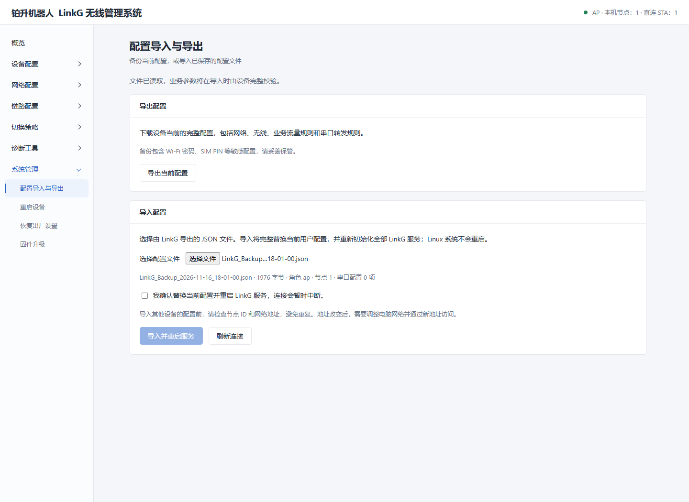

# 配置导入与导出

打开 **“系统管理 → 配置导入与导出”**，可备份当前配置，或通过 JSON 文件恢复整套用户配置，包括角色、网络、无线、业务分类和串口规则。



## 1. 导出配置

点击 **“导出当前配置”**，浏览器下载 JSON 文件。命名格式为：

```text
LinkG_Backup_年-月-日_时-分-秒.json
```

例如 `LinkG_Backup_2026-11-16_18-00-00.json`，时间使用**北京时间（UTC+8）**，由浏览器所在电脑的当前时间生成。

导出的是设备当前保存的完整配置。若某些页面已经保存但尚未应用，例如角色修改后取消了重启，备份中也会包含这些保存值；未提交的浏览器表单修改不在其中。

备份包含 Wi-Fi 密码、SIM PIN 等配置，应妥善保管。导出本身不会重启服务。

## 2. 选择文件与导入

| 操作 | 页面处理 |
|---|---|
| 选择配置文件 | 选择 LinkG 导出的 `.json`，文件须非空且不超过 **64 KiB** |
| 文件摘要 | 显示文件名、字节数、角色、节点 ID 及串口配置项数，先核对是否为目标文件 |
| 确认复选框 | 确认完整替换用户配置并重启 LinkG 服务；未勾选不能导入 |
| 导入并重启服务 | 由设备校验完整配置及业务参数，通过后保存并重新初始化全部 LinkG 服务 |
| 刷新连接 | 重新检查设备连接状态；不替代导入操作 |

导入是**完整替换**，不会只合并某个串口或无线字段。文件应保留完整配置结构；跨版本文件能否使用，以当前固件校验结果为准。选择文件成功只表示浏览器完成初步读取，尚未完成设备业务校验。

导入其他设备的备份前，核对节点 ID、网段和角色，避免组网编号或本地地址重复。确认后点击“导入并重启服务”，服务和通信会暂时中断，**Linux 系统不重启**。

## 3. 导入后核对

页面会等待服务恢复并回读配置。出现 **“LinkG 服务已重新连接，导入配置回读一致”** 后，再核对概览和对应业务状态。

若管理地址改变，先让电脑重新获取 DHCP 配置，或修改静态 IP 和路由，再使用页面给出的新管理地址访问。连不上旧地址并不等于导入失败。

文件格式或业务参数校验不通过时，按提示修正后重新选择；若提示导入结果未确认、服务无法重连，先检查当前管理地址和设备状态，避免连续重复导入。建议在导入前先导出一次现有配置，便于需要时恢复。
