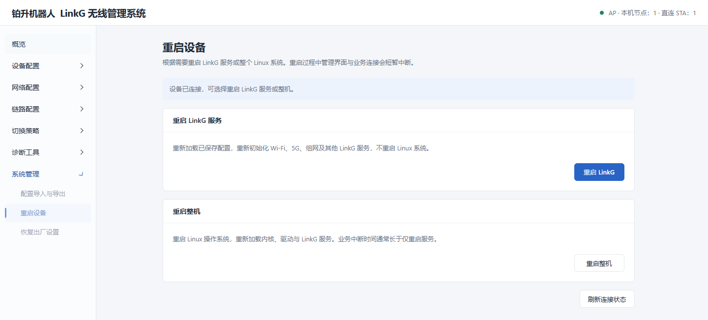

# 重启设备

打开 **“系统管理 → 重启设备”**，根据需要选择重启 LinkG 服务或 Linux 整机。

## 1. 两种重启的区别

| 按钮 | 作用 | 适用情况 |
|---|---|---|
| **重启 LinkG** | 重新加载已保存配置，重启 Wi-Fi、蜂窝、组网、串口等 LinkG 服务；不重启 Linux 系统 | 应用等待重启生效的配置，或重新初始化 LinkG 业务 |
| **重启整机** | 重启 Linux 系统、内核、驱动和 LinkG 服务 | 需要完整系统重启时使用，业务中断通常更久 |
| 刷新连接状态 | 重新查询设备是否可连接 | 手动核对连接恢复情况 |

两种重启均保留已保存的用户配置，并会中断相关业务。浏览器中尚未保存的表单不会随重启自动保存，操作前先处理这些修改。

## 2. 操作与恢复

点击所需按钮后会出现确认框：**“确定”提交对应重启，“取消”不执行本次重启**。此处取消不会改变设备已保存的配置。

提交后等待页面自动重连，不要连续点击。页面检测到新的 LinkG 服务实例后提示管理连接恢复，再到概览检查角色、节点和对端状态。

若此前保存了新节点 ID 或网段，重启后管理地址可能改变，应同步调整电脑地址或路由，再通过新地址访问。页面超时未确认时，先检查供电、指示灯及网络连接，然后点击“刷新连接状态”；超时本身不能证明设备没有重启。
