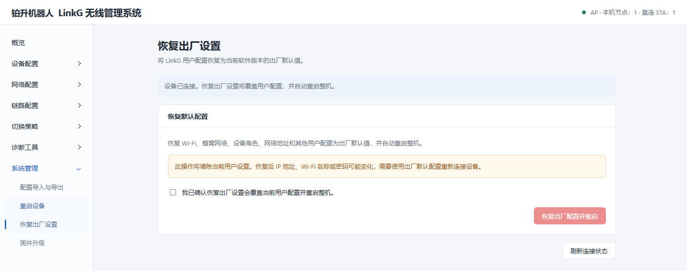

# 恢复出厂设置

打开 **“系统管理 → 恢复出厂设置”**，将用户配置恢复为**当前软件版本的出厂默认值**，随后自动重启整机。

## 1. 会恢复哪些设置

| 项目 | 处理结果 |
|---|---|
| 角色和网络 | 设备角色、节点 ID、虚拟网络、以太网网段及 DHCP 等恢复默认 |
| 无线与蜂窝 | Wi-Fi 名称、密码、模式，以及蜂窝接入和链路设置恢复默认 |
| 业务与串口 | 流量分类和串口转发等用户设置由默认配置覆盖 |
| 软件版本 | 使用当前版本的默认配置，不执行固件降级 |

需要保留现有设置时，先到[配置导入与导出](01-配置导入与导出.md)导出备份。恢复后不能通过本页撤销，重新导入备份需通过当前固件校验。

## 2. 操作按钮

| 操作 | 作用 |
|---|---|
| 勾选确认框 | 确认覆盖当前用户配置并重启整机，勾选后才可提交 |
| 恢复出厂配置并重启 | 弹出最终确认框；点击“确定”执行，点击“取消”不执行本次恢复 |
| 刷新连接状态 | 重新检查设备连接，不执行恢复 |

提交后等待设备重启。管理地址和 Wi-Fi 凭据可能改变，页面无法在旧地址重新连接时，按出厂参数重新接入，不要连续提交恢复请求。

## 3. 恢复后怎样访问

本手册标准出厂配置使用 **STA、节点 2**，虚拟地址为 `172.28.2.1`；本地以太网地址为 `192.168.1.1`，DHCP 开启。

电脑通过网线逐台连接设备，重新获取 DHCP 配置后，可访问本地以太网地址，再按[一对一配置](../../02-快速入门/01-一对一配置.md)或[一对多配置](../../02-快速入门/02-一对多配置.md)重新组网。静态 IP 用户需同步检查地址和路由。

多台设备恢复默认后可能具有相同节点 ID 和以太网地址，应逐台配置，避免直接接入同一个以太网网络。Reset 按键的位置和使用说明见[硬件与接口](../../01-产品介绍与规格/03-硬件与接口.md)。
