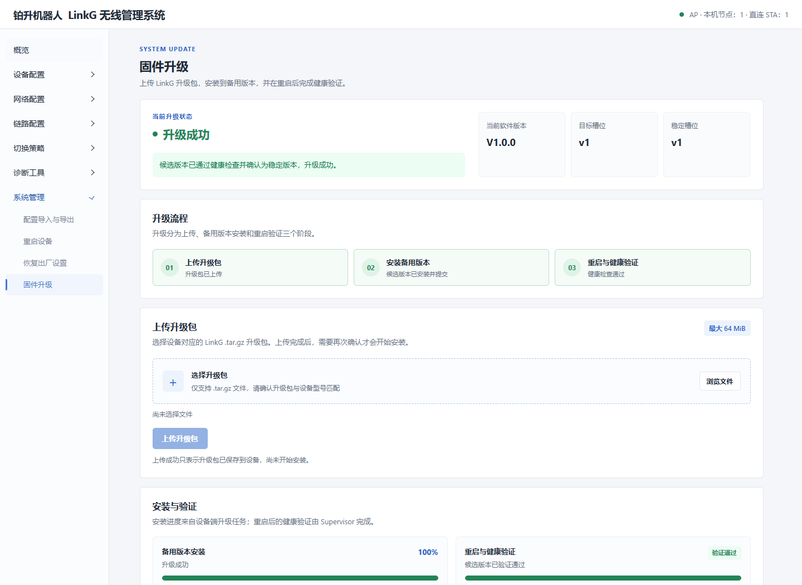

# 固件升级

打开 **“系统管理 → 固件升级”**，选择与设备匹配的 LinkG 升级包。升级分为**上传 → 安装备用版本 → 重启和健康验证**三个阶段。

## 1. 升级前准备

准备对应设备和目标版本的 **`.tar.gz` 升级包**，非空且不超过 **64 MiB**，并查看随包提供的版本与兼容说明。先[导出当前配置](01-配置导入与导出.md)，安排业务可中断的时间，保持设备稳定供电，建议通过本地以太网操作。

本页没有配置迁移选项。升级后的配置兼容性按目标版本说明处理；完成后核对角色、网络和串口等设置，旧备份能否直接导入需通过新版本校验。

| 状态字段 | 含义 |
|---|---|
| 当前软件版本 | 当前运行程序的软件版本，完成后可到“设备配置 → 基础配置”再次核对 |
| 目标槽位 | 本次版本任务涉及的安装位置 |
| 稳定槽位 | 当前已确认可用的版本位置；槽位名 v0／v1 用于区分安装位置，与软件版本号不同 |
| 当前升级状态 | 当前或最近一次升级任务状态，重新进入页面仍可能显示历史结果 |

## 2. 上传与确认安装

| 步骤／按钮 | 页面处理 |
|---|---|
| 选择升级包／浏览文件 | 在电脑选择匹配的 `.tar.gz`，页面检查扩展名及大小并显示文件名 |
| 上传升级包 | 将文件传到设备，进度条显示上传字节和百分比 |
| 上传完成 | 表示设备已收到文件，**尚未开始安装**；之后会显示安装确认区域 |
| 勾选“我已确认开始安装” | 确认设备可以开始升级，勾选后才能提交安装 |
| 确认并开始升级 | 请求设备校验升级包、安装备用版本并提交候选版本 |

上传后仍可停在待确认阶段。真正开始安装后，不要断电、重复提交或同时执行其他维护操作；候选版本提交后设备会自动重启，Web 暂时断开。

## 3. 安装与健康验证

| 页面阶段 | 含义与接下来操作 |
|---|---|
| 校验升级包／安装备用版本 | 设备正在处理文件和安装内容，继续等待设备端进度 |
| 写入备用内核 | 本次升级涉及备用内核写入，保持供电，等待完成 |
| 设备正在重启 | 候选版本已提交，等待管理连接恢复 |
| 新版本健康验证 | 设备正在验证候选版本，重新连上 Web 仍不等于已经确认升级成功 |
| **升级成功** | 候选版本已通过健康检查并确认为稳定版本 |
| 正在恢复／已恢复稳定版本 | 候选版本未通过验证，设备正在回退或已回退；检查失败信息后再处理 |
| 升级失败 | 安装或提交出现错误，保留页面提示和日志，确认设备状态后再决定是否重试 |

上传进度与安装进度分别统计；安装到 100% 后还需等待重启及健康验证。最终以 **升级成功** 提示和目标软件版本核对结果。

## 4. 断线与异常提示

升级页会自动查询状态并在断线后尝试重连。无法连接时先检查供电、电脑地址和设备管理地址，不要仅凭浏览器断线判定失败或立即断电。

包格式、大小或设备匹配校验失败时，更换正确文件后重新上传；设备提示升级、试运行或回滚仍在进行时，等待当前任务结束。若恢复到了稳定版本，先检查失败原因，再决定下一次升级。

升级完成后，到基础配置核对软件版本，再检查概览、无线、蜂窝及所用串口业务。截图中的成功状态属于既有设备记录，本章页面展示未执行新的上传或升级。
