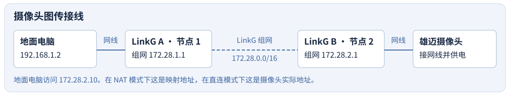
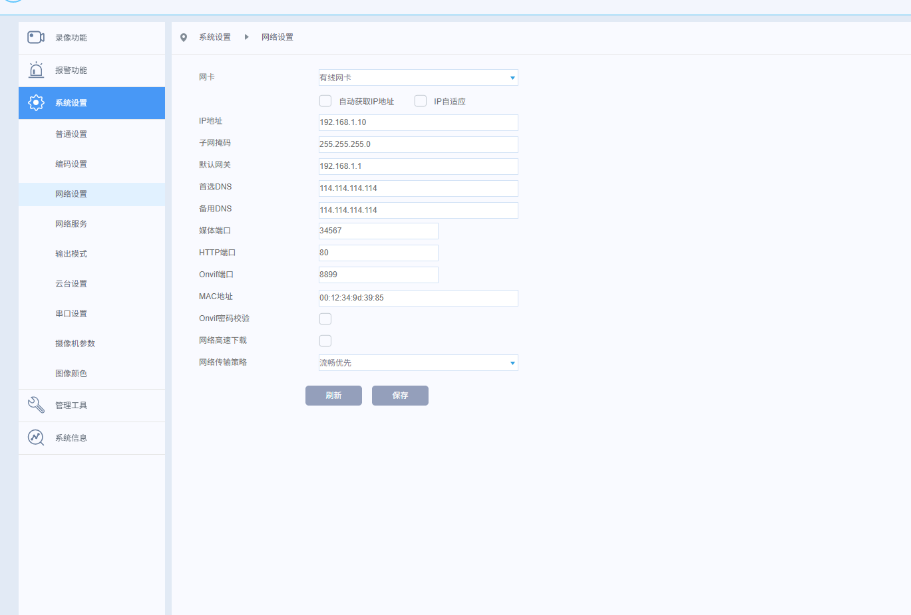
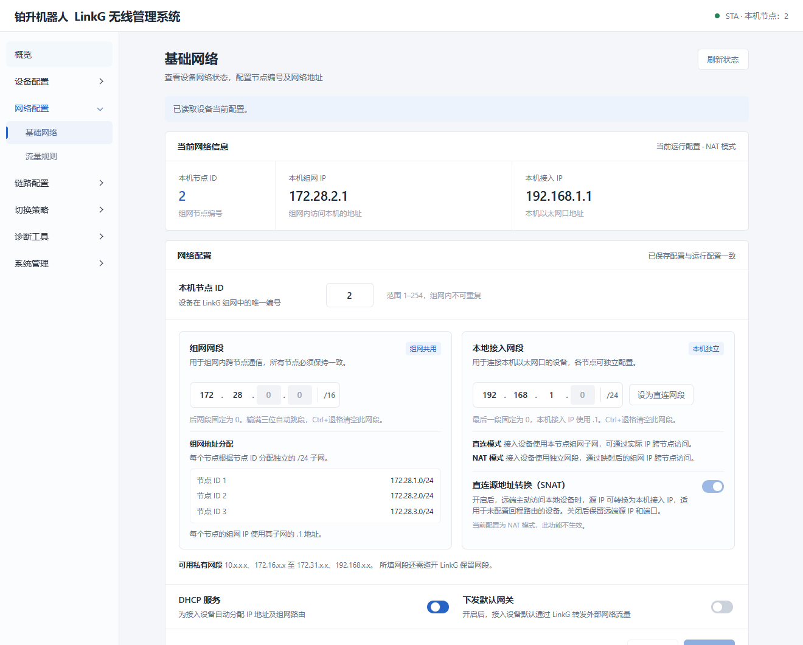
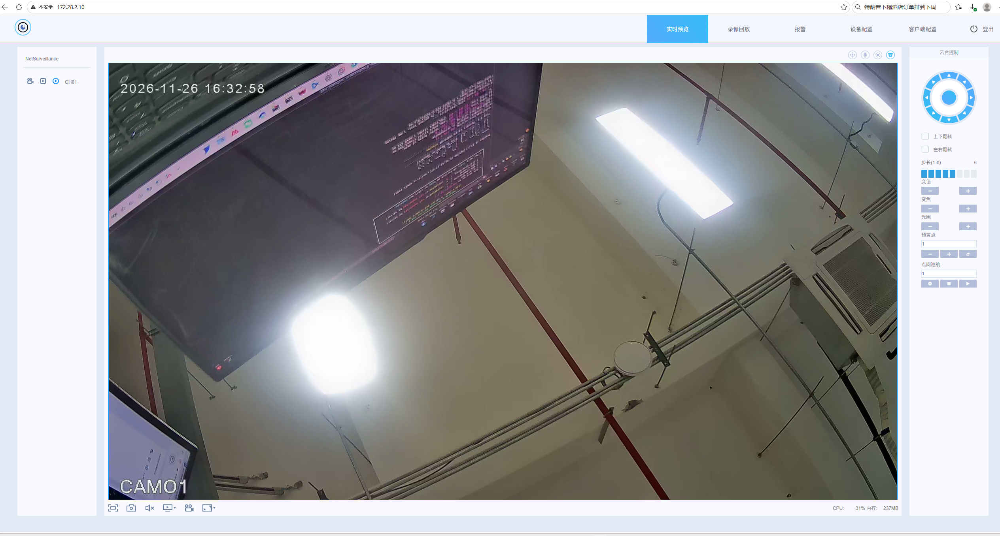
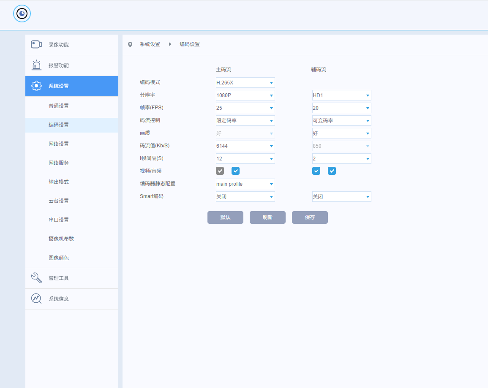
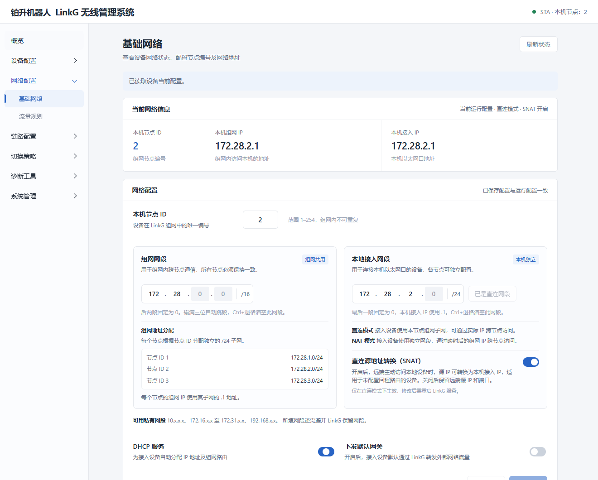

# 网络摄像头图传

用一台雄迈摄像头验证三种取流配置。地面端 LinkG A 保持 NAT 模式，摄像头端 LinkG B 在案例 1 使用 NAT，在案例 2 和 3 使用直连。地面电脑三次都访问 `172.28.2.10`。

## 1. 连接设备



给摄像头供电，用网线连接摄像头和 LinkG B。地面电脑用网线接 LinkG A。两台 LinkG 按[一对一配置](../02-快速入门/01-一对一配置.md)完成组网。

本次地面电脑地址为 `192.168.1.2/24`，组网侧对应 `172.28.1.2`。到 `172.28.0.0/16` 的下一跳为 LinkG A 的接入 IP `192.168.1.1`。开始之前，从地面电脑确认可以访问 LinkG B 的组网管理地址 `172.28.2.1`。

| 案例 | LinkG B 模式 | 摄像头 IP | 摄像头默认网关 | 直连 SNAT |
|---|---|---|---|---|
| 1. Web 实时预览 | NAT | `192.168.1.10/24` | `192.168.1.1` | 此模式使用 NAT 自身的地址转换 |
| 2. RTSP 拉流，有可用网关 | 直连 | `172.28.2.10/24` | `172.28.2.1` | 关闭 |
| 3. RTSP 拉流，无可用网关 | 直连 | `172.28.2.10/24` | 本次用 `172.28.2.254` 模拟 | 先关闭，再开启 |

## 2. 案例 1 · NAT 模式下用摄像头 Web 预览

### 第一步，设置摄像头的网络

进入摄像头的 **设备配置 → 系统设置 → 网络设置**。关闭 **自动获取 IP 地址** 和 **IP 自适应**，配置 IP `192.168.1.10`、掩码 `255.255.255.0`、默认网关 `192.168.1.1`。本机 HTTP 端口显示为 `80`，媒体端口显示为 `34567`。



### 第二步，设置 LinkG B 的 NAT 接入网段

进入 LinkG B 的 **网络配置 → 基础网络**，设置本地接入网段为 `192.168.1.0/24`。保存并重启服务，确认上方当前运行配置显示 **NAT 模式**。节点 2 的接入 IP 为 `192.168.1.1`，组网 IP 为 `172.28.2.1`。



### 第三步，从地面浏览器打开实时画面

打开 `http://172.28.2.10/`，登录摄像头，进入 **实时预览**，打开 `CH01`。`172.28.2.10` 是摄像头的组网映射地址，LinkG B 把请求转发到摄像头实际 IP `192.168.1.10`。摄像头端可沿用本地网段。



上图是现场提供的 Web 预览截图。NAT 模式的固定端口 TCP 路径另外用 GStreamer 对 `172.28.2.10:554` 执行了 RTSP over TCP 解码验证。`554` 是该次 RTSP 检查的端口，网页预览按摄像头网页自身的方式建立会话。[本轮 NAT 模式 TCP 解码帧](../../assets/04-业务场景与应用案例/01-网络摄像头图传/09-nat-tcp-frame.jpg)

## 3. 案例 2 · 直连，有网关，关闭 SNAT

### 第一步，配置摄像头的直连地址和码流

把摄像头改为 `172.28.2.10`、掩码 `255.255.255.0`、默认网关 `172.28.2.1`。改地址可能中断当前管理会话，保存后从新地址重新进入。能在摄像头侧管理时，可将电脑临时设为同一 `/24` 的另一个可用地址。

在 **设备配置 → 系统设置 → 编码设置** 查看主码流。本次界面显示 **H.265X**，RTSP 实际协商值为 `encoding-name=H265`，解码画面为 `1920×1080`、`25 fps`。应以 RTSP 协商的编码为准选择解码器。



### 第二步，设置 LinkG B 为直连并关闭 SNAT

在 LinkG B 的 **基础网络** 点击 **设为直连网段**，确认本地接入网段为 `172.28.2.0/24`，关闭 **直连源地址转换（SNAT）**。保存并重启服务。页面上方应显示 **直连模式 · SNAT 关闭**。


### 第三步，在地面终端拉流

以下 PowerShell 命令使用 Windows 上的 GStreamer、NVIDIA H.265 解码器和 D3D11 视频输出。将 `CAM_USER`、`CAM_PASSWORD` 换为设备实际账号与密码。设备使用空密码时，保留 `password=`。`protocols=udp` 让 RTP 媒体走 UDP，RTSP 控制仍连接 TCP `554`。[GStreamer rtspsrc 文档](https://gstreamer.freedesktop.org/documentation/rtsp/rtspsrc.html)

```powershell
$uri = 'rtsp://172.28.2.10:554/user=CAM_USER&password=CAM_PASSWORD&channel=1&stream=0.sdp?real_stream'
gst-launch-1.0 -v rtspsrc "location=$uri" protocols=udp latency=50 drop-on-latency=true do-retransmission=false name=src `
  src. ! 'application/x-rtp,media=video,encoding-name=H265' ! rtph265depay ! h265parse ! nvh265dec max-display-delay=0 ! d3d11videosink sync=false async=false processing-deadline=0 `
  src. ! 'application/x-rtp,media=audio' ! fakesink sync=false async=false
```

如果电脑没有 NVIDIA 解码器，可把 `nvh265dec max-display-delay=0` 替换为 `avdec_h265`。本次 NVIDIA 解码与 D3D11 视频输出链路收到 51 帧。带音频分支时，GStreamer 同时提示 `Delayed linking failed`。只验证图传时，可删去最后一行音频分支及其前一行的续行符。若摄像头实际协商 H.264，使用 `encoding-name=H264`、`rtph264depay`、`h264parse` 和相应的 H.264 解码器。

SNAT 关闭时，摄像头看到的请求来源是地面端组网地址 `172.28.1.2`。摄像头通过网关 `172.28.2.1` 回包。**实测结果为 UDP 视频正常解码。**


## 4. 案例 3 · 直连，无可用网关，对比 SNAT

### 第一步，保留相同地址，移除有效回程

摄像头仍使用 `172.28.2.10/24`。如果设备允许省略网关，可以留空。本次摄像头固件没有保留空网关的设置，因此将网关临时改成同网段内未响应的 `172.28.2.254`，并读回确认。实际使用时，摄像头可以保留其无法修改的网关值。

### 第二步，关闭 SNAT 拉流

保持 LinkG B 为直连，确认 **SNAT 关闭**。运行案例 2 的同一条 UDP 拉流命令。现场测试在 RTSP 连接阶段超时，未收到画面。

```text
Failed to connect. (Timeout while waiting for server response)
```

此时摄像头需要回到 `172.28.1.2`，而设置的网关无法把流量交给 LinkG B。

### 第三步，仅开启摄像头侧 SNAT，再拉一次

在 **LinkG B → 基础网络** 打开 **直连源地址转换（SNAT）**，保存并重启服务。确认运行状态显示 **直连模式 · SNAT 开启**。摄像头 IP、网关和地面端命令都沿用上一步。



LinkG B 将发往摄像头的请求源 IP 改为自己的接入 IP `172.28.2.1`。摄像头可以直接回给同一网段内的 `172.28.2.1`，再由 LinkG B 恢复地址与会话映射并将响应转给地面端。对本次 RTSP 会话，LinkG 也根据协商的端口转发了 UDP 媒体。

本次保持摄像头网关为 `172.28.2.254`，仅开启 LinkG B 的 SNAT 后重新连接，GStreamer 收到并解码了 H.265 画面。


地址和保存生效方式见[基础网络](../03-功能与配置指南/03-网络配置/01-基础网络.md)。
