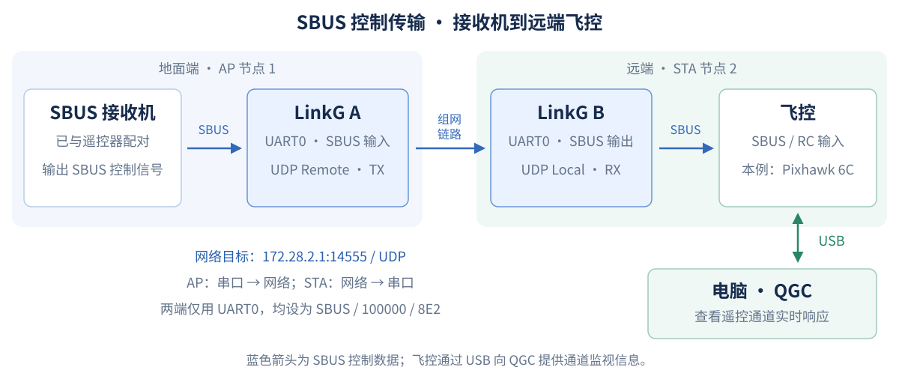
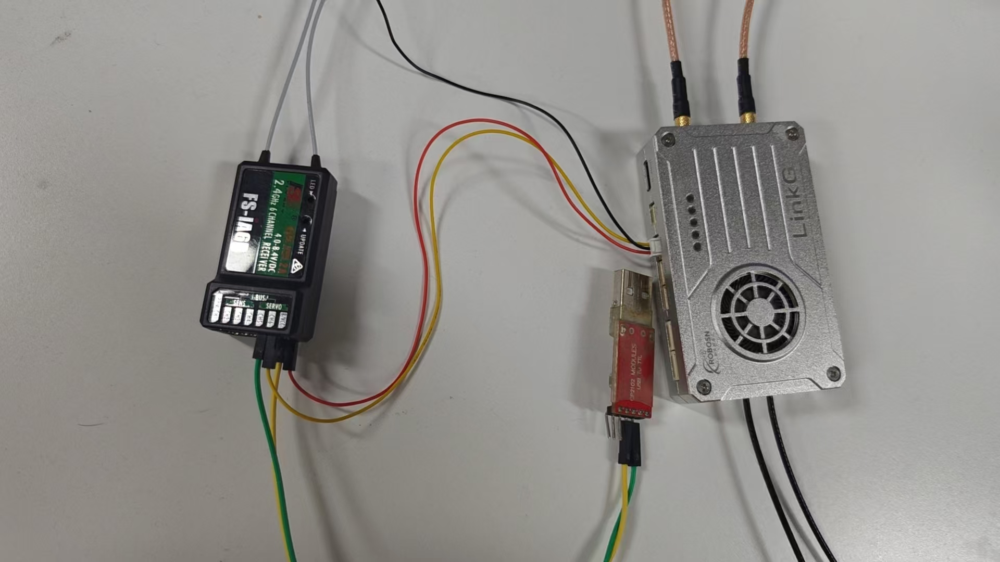
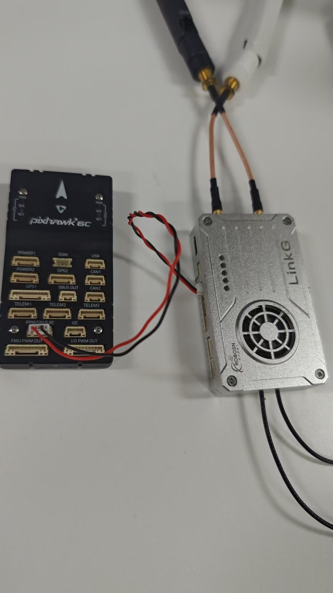
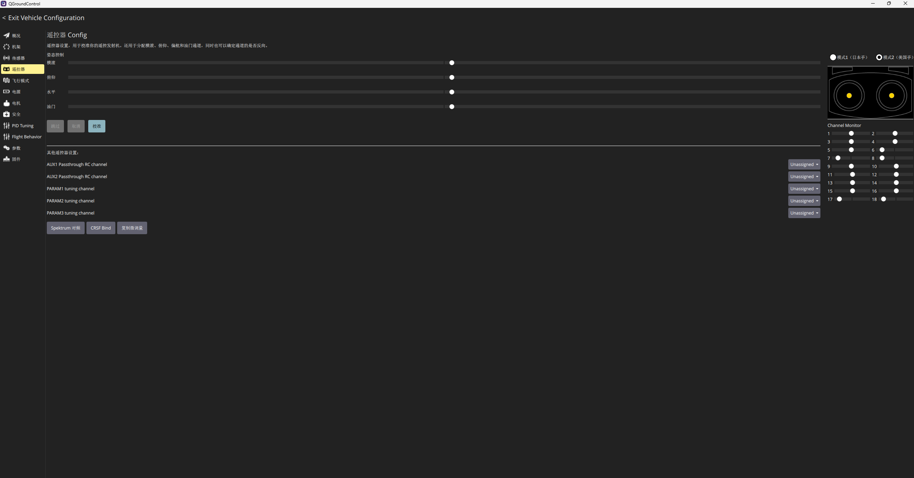
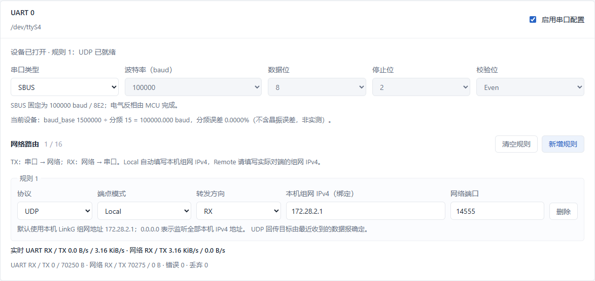
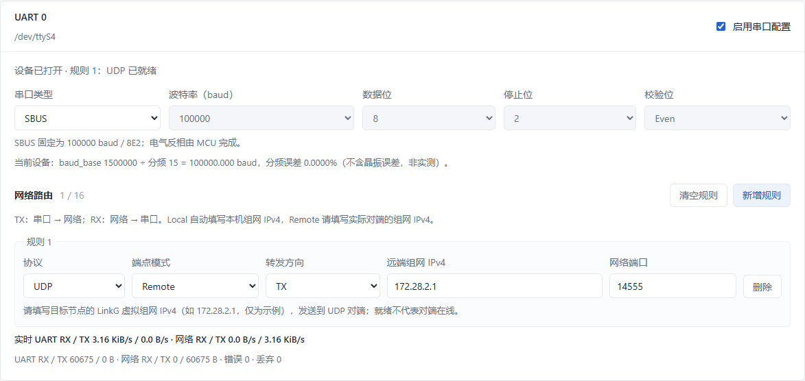
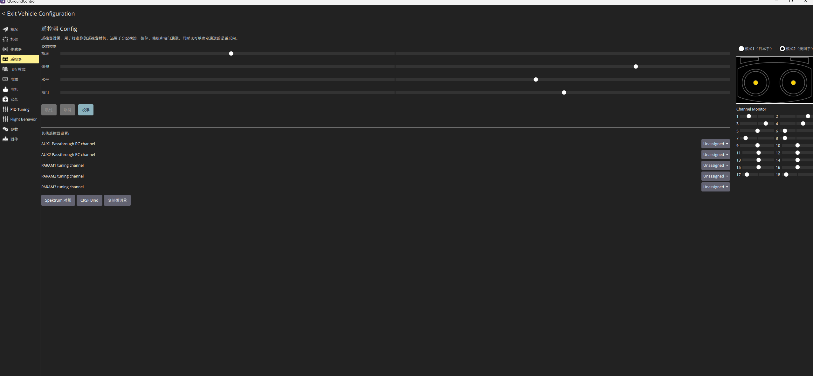

# SBUS 控制传输

本案例将遥控器接收机输出的 SBUS 数据，经两台 LinkG 传输到远端飞控，再通过 QGroundControl（QGC）的遥控器页面查看通道响应。

## 1. 连接示意与实物接线

| 连接位置 | 本例接法 |
|---|---|
| 地面端 | 遥控器已与接收机配对，接收机的 **SBUS 输出接 AP 的 UART0** |
| 远端 | **STA 的 UART0 接飞控的 SBUS／RC 输入口**；图中 Pixhawk 6C 使用标有 `PPM/SBUS RC` 的输入口 |
| QGC 监视 | 飞控通过 **USB** 连接运行 QGC 的电脑 |
| Web 配置 | 电脑通过以太网连接本地 AP，配置完成后也可通过组网地址访问远端 STA |

**两端都只能使用 UART0，并将串口类型设为 SBUS。** UART1、UART2 不支持本案例的 SBUS 模式。信号、地线及供电按各设备接口定义连接，飞控应接 SBUS 输入口。

地面端接收机与 AP 的实物连接：

远端 STA 与飞控的实物连接：

## 2. 准备组网与 QGC

1. 两台 LinkG 按[一对一配置](../02-快速入门/01-一对一配置.md)建立组网：AP 为节点 **1**，地址 `172.28.1.1`；STA 为节点 **2**，地址 `172.28.2.1`。
2. 在概览中确认对端节点在线、Wi-Fi 可用。节点地址不同的设备，后续按实际地址填写。
3. 用 USB 将飞控连接电脑，在 QGC 中连接该飞控，等待参数读取完成后打开 **“飞控设置 → 遥控器（Radio）”**。

下面是本例尚未配置串口网络路由时的现场画面，上方主要控制滑条处于中间位置：

静态的居中位置不能单独判断是否收到 SBUS；配置完成后，应以**操作遥控器时，对应通道能否实时跟随变化**为准。

## 3. 配置两端 UART0

本例采用一条 **UDP 单向转发**：AP 从接收机读入 SBUS 并发往 STA，STA 接收网络数据后输出给飞控。两端配置如下：

| 字段 | AP：接收机侧 | STA：飞控侧 |
|---|---|---|
| 串口 | UART0，勾选“启用串口配置” | UART0，勾选“启用串口配置” |
| 串口类型 | **SBUS** | **SBUS** |
| 物理参数 | 自动固定 **100000 baud、8E2** | 自动固定 **100000 baud、8E2** |
| 网络协议 | UDP | UDP |
| 端点模式 | **Remote**，发送到远端 STA | **Local**，在本机绑定接收 |
| 转发方向 | **TX：串口 → 网络** | **RX：网络 → 串口** |
| 组网 IPv4 | 远端 STA 地址 **`172.28.2.1`** | 本机 STA 地址 **`172.28.2.1`** |
| 网络端口 | **14555** | **14555** |

`8E2` 表示 8 数据位、偶校验、2 停止位。选择 SBUS 后，这些参数自动固定并置灰，无需手动设置反相。端口可按业务规划调整，但 **AP 的目标端口必须与 STA 的本地端口一致**。

### 3.1 先配置远端 STA

打开 [STA 的串口配置](http://172.28.2.1/?v=LinkG-v1.0.0#/device/serial)：

1. 在 **UART0** 卡片勾选“启用串口配置”。
2. 将“串口类型”选择为 **SBUS**，检查固定参数为 `100000 / 8 / 2 / Even`。
3. 点击“新增规则”，填写 **UDP、Local、RX、`172.28.2.1`、`14555`**。
4. 点击页面底部的 **“保存并应用”**，等待配置回读确认。

这里的 Local 地址是 **STA 自己的组网地址**，不是 AP 地址；RX 表示网络数据收到后写到 UART0，交给飞控。

### 3.2 再配置地面 AP

打开 [AP 的串口配置](http://172.28.1.1/?v=LinkG-v1.0.0#/device/serial)：

1. 在 **UART0** 卡片勾选“启用串口配置”。
2. 将“串口类型”选择为 **SBUS**，检查固定物理参数。
3. 点击“新增规则”，填写 **UDP、Remote、TX、`172.28.2.1`、`14555`**。
4. 点击 **“保存并应用”**，等待配置回读确认。

这里的 Remote 地址填写 **目标 STA 的组网地址**；TX 表示将 UART0 从接收机读到的数据发往网络。

两台设备需要分别保存。“保存并应用”会重载 UART 服务并短暂中断串口业务，完成后检查提示及运行状态。完整字段含义见[串口配置](../03-功能与配置指南/02-设备配置/02-串口配置.md)。

## 4. 检查 Web 收发状态

接收机输出 SBUS 后，两端 UART0 应显示 **“设备已打开”**，路由显示 **“UDP 已就绪”**。继续查看各自卡片底部的字节统计：

| 设备 | 应持续增长的统计 | 对应的数据方向 |
|---|---|---|
| AP | **UART RX、网络 TX** | 从接收机读入，再发往远端 STA |
| STA | **网络 RX、UART TX** | 从 AP 收到，再输出给飞控 |

上面的两张配置截图已包含本次实际收发速率和累计字节数。连续采样确认相关计数持续增长，两端当前错误和丢弃计数均为 **0**。

注意区分规则与统计：**规则中的 AP“TX”表示串口向网络转发，此时增加的是 UART RX 和网络 TX。** UDP“已就绪”只表示套接字就绪，仍需结合字节增长和下一步 QGC 的实际通道响应确认。

## 5. 在 QGC 验证遥控响应

保持飞控通过 USB 连接电脑，进入 QGC 的 **“遥控器（Radio）”** 页面：

1. 分别拨动遥控器的横滚、俯仰、偏航和油门摇杆。
2. 观察上方对应的控制滑条是否随动作变化；也可查看右侧 **Channel Monitor**。
3. 将摇杆移到其他位置并回中，确认显示能够跟随，而不是一直停留在某个值。

下图为本例现场配置完成并操作遥控器后的结果：上方多个控制滑条已经偏离中间位置，右侧通道监视器也显示对应值；现场已确认遥控动作能够带动通道变化。

结合两端 Web 的收发统计与 QGC 的实时响应，即可确认 **接收机 → AP → LinkG 组网 → STA → 飞控** 的 SBUS 控制传输已经连通。USB 用于飞控与 QGC 的监视通信；本章配置的 LinkG 路由只传输接收机到飞控的单向 SBUS 数据。

## 6. 常见检查项

| 现象 | 优先检查 |
|---|---|
| UART0 没有打开 | 是否勾选启用、选择 SBUS、添加至少一条规则，并保存应用成功 |
| AP 的 UART RX 不增长 | 接收机是否输出 SBUS、遥控器是否已配对、接线是否接到 UART0 |
| AP 网络 TX 增长，STA 网络 RX 不增长 | LinkG 组网是否正常，AP 目标 IP 与端口是否对应 STA 的 Local 地址与端口 |
| STA 网络 RX 增长，UART TX 不增长 | STA 是否配置 UART0 SBUS、方向是否为 RX、串口设备是否已打开及有无错误 |
| STA UART TX 增长，QGC 通道没有响应 | 飞控是否连接到正确的 SBUS／RC 输入口，信号及地线是否正确，QGC 是否连接当前飞控 |
