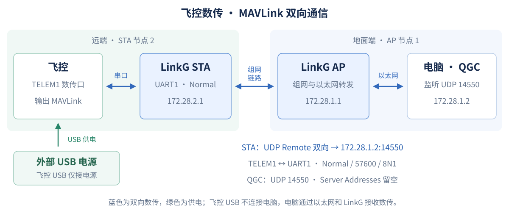
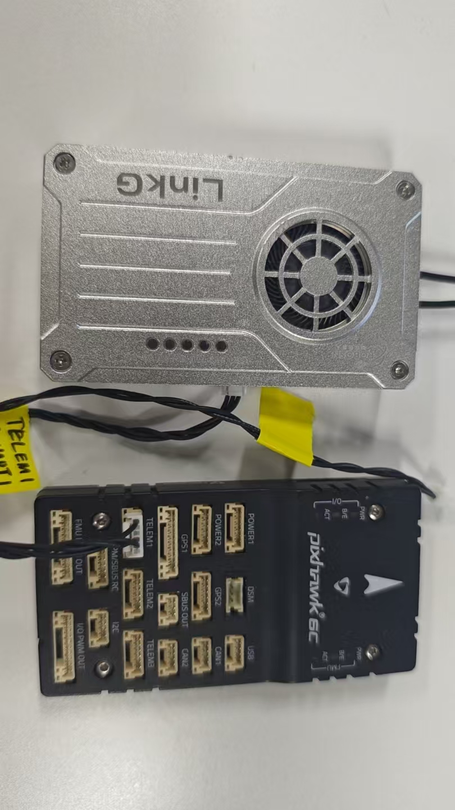
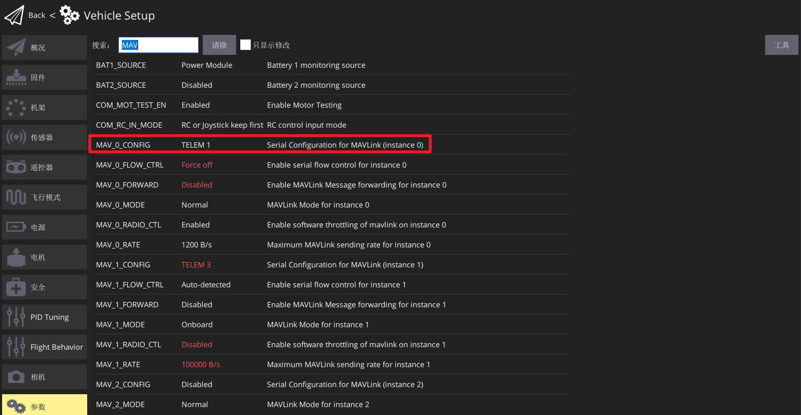
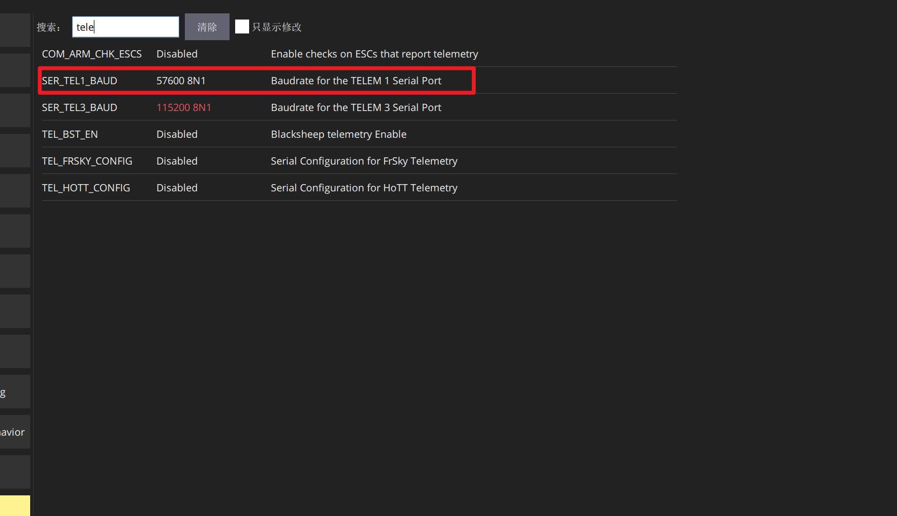
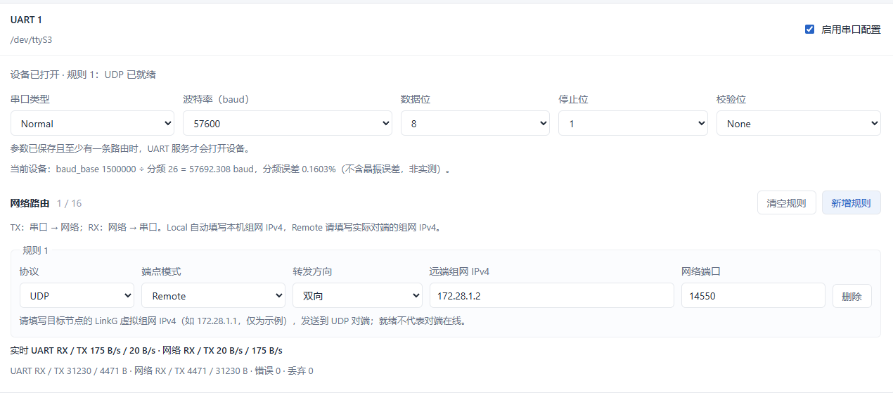
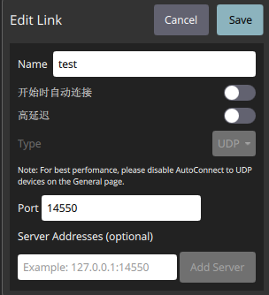
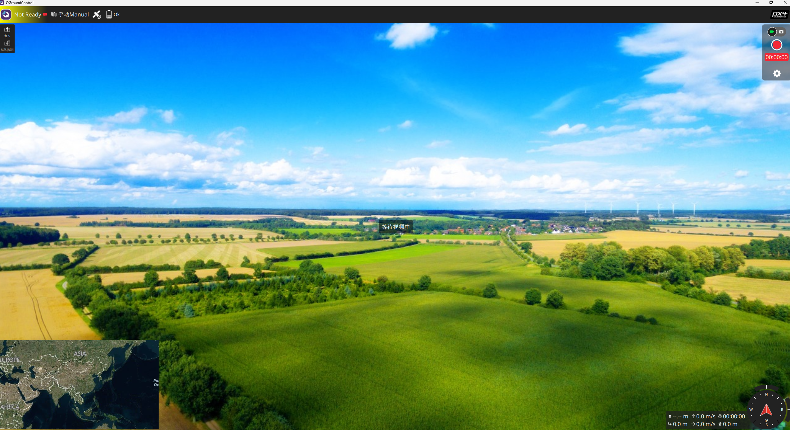

# 飞控数传与地面站

本案例将 Pixhawk 6C 飞控的 TELEM1 数传口连接 LinkG，通过串口路由把 MAVLink 数据发送到电脑上的 QGroundControl（QGC），同时将地面站请求回传给飞控。

## 1. 连接示意与实物接线

| 位置 | 本例接法 |
|---|---|
| 飞控数传 | **TELEM1 ↔ STA 的 UART1** |
| 串口信号 | 飞控 **TX → LinkG R**、飞控 **RX → LinkG T**、**GND → G**，按接口定义连接 |
| 飞控供电 | 飞控 USB 连接**外部 USB 电源**，例如适配的电源适配器或移动电源；数传验证时不接电脑 USB |
| 电脑接入 | 电脑通过以太网连接 AP |
| LinkG 组网 | AP 为节点 **1**，STA 为节点 **2**，已按[一对一配置](../02-快速入门/01-一对一配置.md)连通 |

本例飞控与 STA 的实物接线如下：

本章使用 **Normal 普通串口传输 MAVLink**，飞控应接 TELEM1，不是 SBUS／RC 输入。UART0 如已用于[SBUS 控制传输](02-SBUS控制传输.md)，可保留原配置，数传使用 UART1。

## 2. 设置飞控 TELEM1 与波特率

首次配置参数时，可先通过 USB 将飞控连接 QGC，进入 **“飞控设置 → 参数”**。本例使用 PX4，按下面步骤设置；其他固件的参数名称以对应说明为准。

1. 搜索 `MAV_0_CONFIG`，将数传端口设为 **TELEM 1**；`MAV_0_MODE` 使用 **Normal**。本例只接 TX、RX、GND 三根信号线，`MAV_0_FLOW_CTRL` 设为 **Force off**，不使用 RTS／CTS 硬件流控。

2. 搜索 `SER_TEL1_BAUD`，将 TELEM1 波特率设为 **57600 8N1**。8N1 表示 8 数据位、无校验、1 停止位，须与 LinkG UART1 一致。

3. 保存参数，按 QGC 提示重启飞控并核对设置。随后**拔下飞控与电脑之间的 USB 数据连接，改接外部 USB 电源**，再通过 LinkG 验证数传。

以上两张参数参考图取自[LQ-10 飞控数传连接案例](https://gitee.com/amovlab1/amov-lq10-wiki/blob/master/products/LQ-10/V1/zh-cn/开发者专区/飞控数传连接案例.md)，用于说明 PX4 参数位置；LinkG 的地址、端口及串口路由按下文设置。

## 3. 配置 LinkG 串口路由

本例电脑接在 AP 后，本地以太网地址为 `192.168.1.2`，对应组网地址 **`172.28.1.2`**。STA 要把数据发给电脑，因此填写电脑地址，**不是 AP 的 `172.28.1.1`**。

电脑使用 DHCP 接入，或按[基础网络](../03-功能与配置指南/03-网络配置/01-基础网络.md)完成静态 IP 和组网路由配置。电脑地址或节点编号不同，目标地址也要对应调整。

打开 [STA 的串口配置](http://172.28.2.1/?v=LinkG-v1.0.0#/device/serial)，在 UART1 卡片勾选“启用串口配置”，新增一条规则：

| 字段 | 本例设置 |
|---|---|
| 串口类型 | **Normal** |
| 波特率 | **57600** |
| 数据位／停止位／校验位 | **8／1／None**，即 8N1 |
| 协议 | **UDP** |
| 端点模式 | **Remote** |
| 转发方向 | **双向** |
| 远端组网 IPv4 | **`172.28.1.2`**，电脑的组网地址 |
| 网络端口 | **`14550`**，QGC 的监听端口 |

点击页面底部的 **“保存并应用”**，等待配置回读确认。该操作会重载 UART 服务，短暂中断串口业务。地面 AP 负责组网与以太网转发，**无需再添加一条串口规则**。

双向转发同时承载飞控遥测和 QGC 的参数请求等数据，不要仅选择 TX。完整字段含义见[串口配置](../03-功能与配置指南/02-设备配置/02-串口配置.md)。

## 4. 设置 QGC 的 UDP 连接

在 QGC 打开 **“应用设置 → Comm Links（通信连接）”**，点击 **Add（添加）**，按下表填写；已有连接可通过 Edit（编辑）核对。

| 字段 | 填写方法 |
|---|---|
| Name | 自定义；本例为 `test`，也可命名为 `LinkG` |
| Type | **UDP** |
| Port | **`14550`**，电脑的本地监听端口 |
| Server Addresses（optional） | **留空，不添加服务器**；灰色 Example 是占位提示，不是已添加的地址 |
| 开始时自动连接 | 按需开启，首次配置可先手动连接 |
| 高延迟 | 本例保持关闭 |

点击 **Save（保存）**，在连接列表选中该连接并点击 **Connect（连接）**。若自动 UDP 连接已占用 14550，使用已有连接，或先关闭对应自动连接后再创建手动连接。

本方案由 STA 主动向电脑发送数据，QGC 从收到的数据学习实际来源 IP 和端口，再向该来源回传。STA 规则中的 14550 是**电脑的目标端口**，不是 STA 的固定监听端口，因此不要在 QGC 中直接添加 `172.28.2.1:14550`。

Windows 出现防火墙访问提示时，允许 QGC 在所用网络上接收数据。

## 5. 确认数传已经连通

飞控保持外部供电，USB 不连接电脑。连接 QGC 后，应能识别飞控并显示状态。下图为本例完成配置后的现场结果：

图中 **Not Ready** 是飞控的飞行就绪提示，不表示数传断开；**等待视频中** 属于视频显示，与本章 MAVLink 数传是否连通无关。

再查看 STA UART1 的收发统计，上面的本例 Web 截图记录了：

| 数据方向 | 截图中的累计字节数 | 含义 |
|---|---|---|
| UART RX → 网络 TX | **31230 B → 31230 B** | 从飞控串口读入，再发送到电脑 |
| 网络 RX → UART TX | **4471 B → 4471 B** | 收到地面站数据，再写回飞控串口 |
| 错误／丢弃 | **0／0** | 截图时未记录到错误或丢弃 |

QGC 已识别飞控，且串口与网络两个方向都有数据，是本例的连接结果。实际使用时继续观察遥测更新，并在 QGC 中读取参数，确认请求和应答能够完成；“UDP 已就绪”本身不能代替这些检查。

## 6. 常见检查项

| 现象 | 优先检查 |
|---|---|
| UART RX 一直为 0 | 飞控供电、TELEM1 是否启用 MAVLink，TX／RX／GND 接线及两端 57600 波特率 |
| UART RX 增长，QGC 没有发现飞控 | 目标是否为电脑的组网 IP，UDP 端口是否一致，QGC 是否监听，以及电脑路由与防火墙 |
| QGC 提示端口被占用 | 是否同时开启自动 UDP 和手动 14550 连接，或有其他软件占用端口 |
| 有遥测但参数读取异常 | 规则是否为双向，网络 RX／UART TX 是否增长，飞控 RX 接线和流控设置是否正确 |
| 拔下电脑 USB 后就掉线 | 原连接可能来自 USB；改用外部电源后检查 UDP 连接及 Web 收发计数 |
