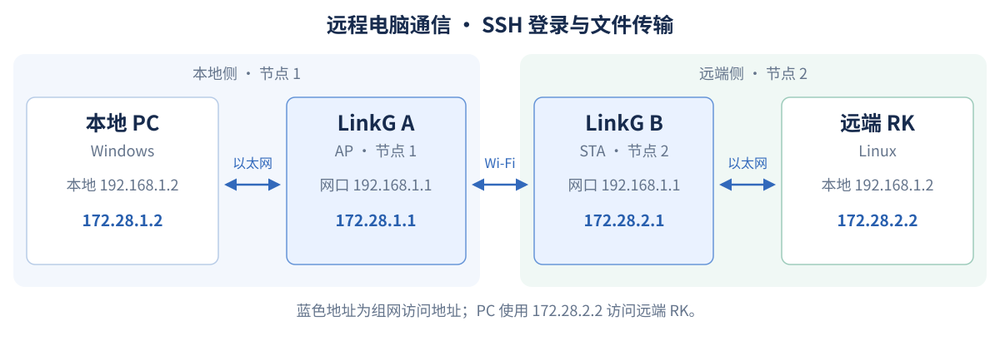
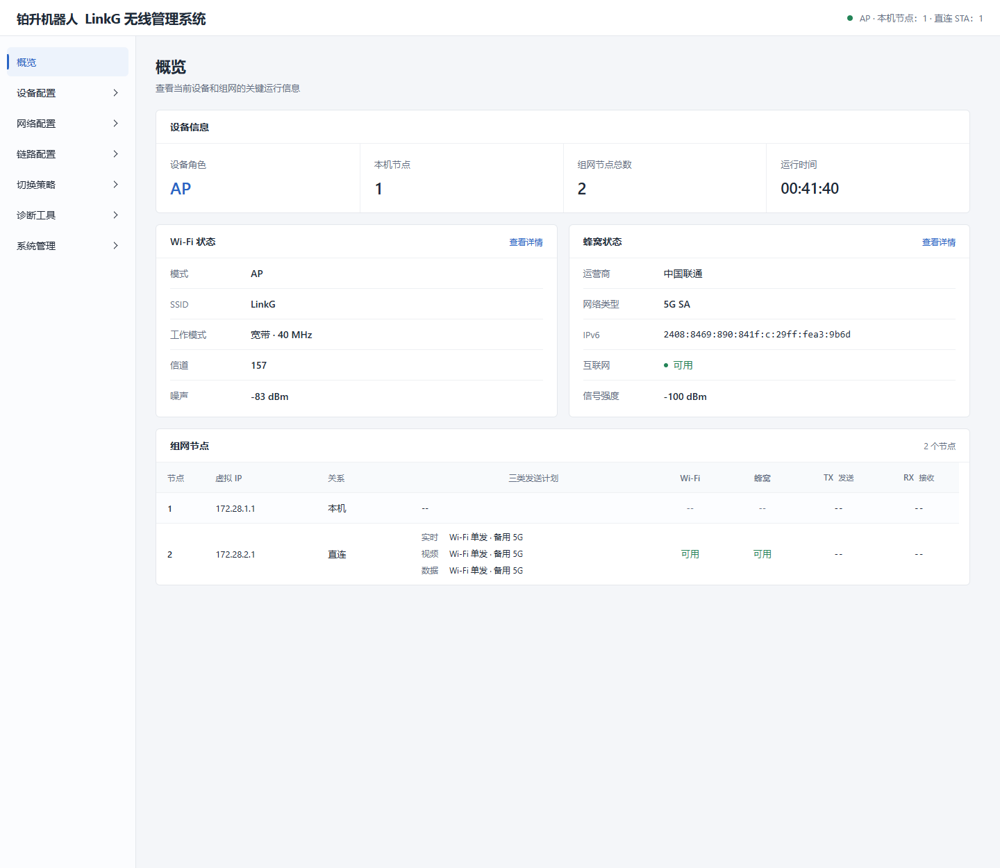
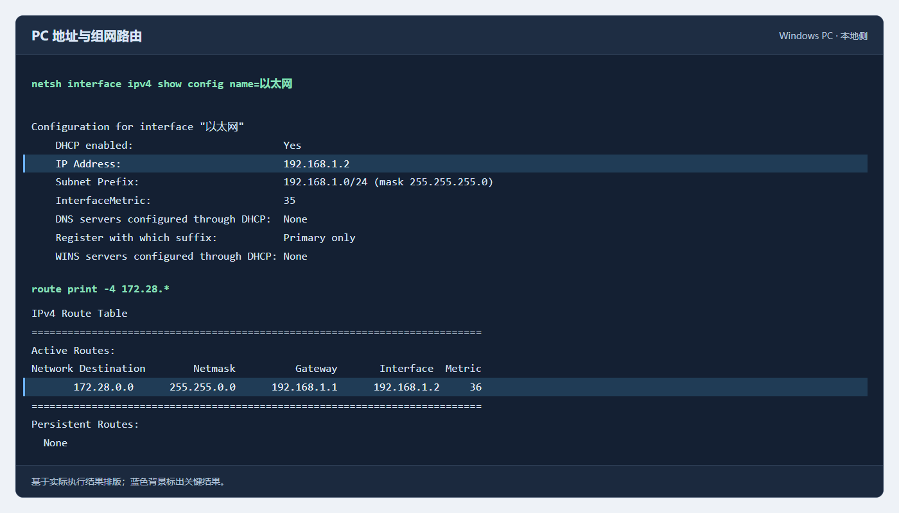
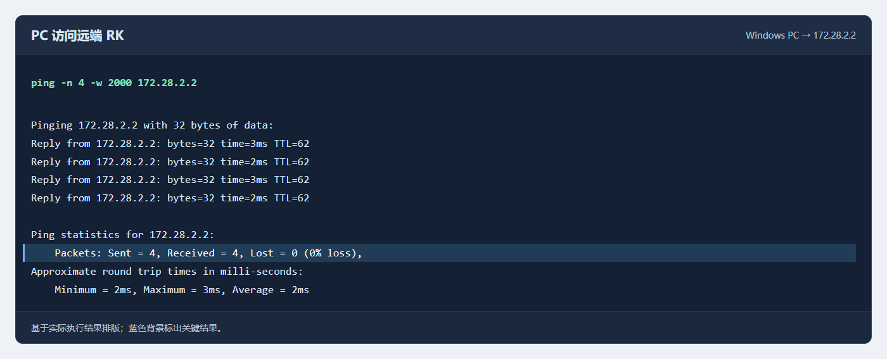
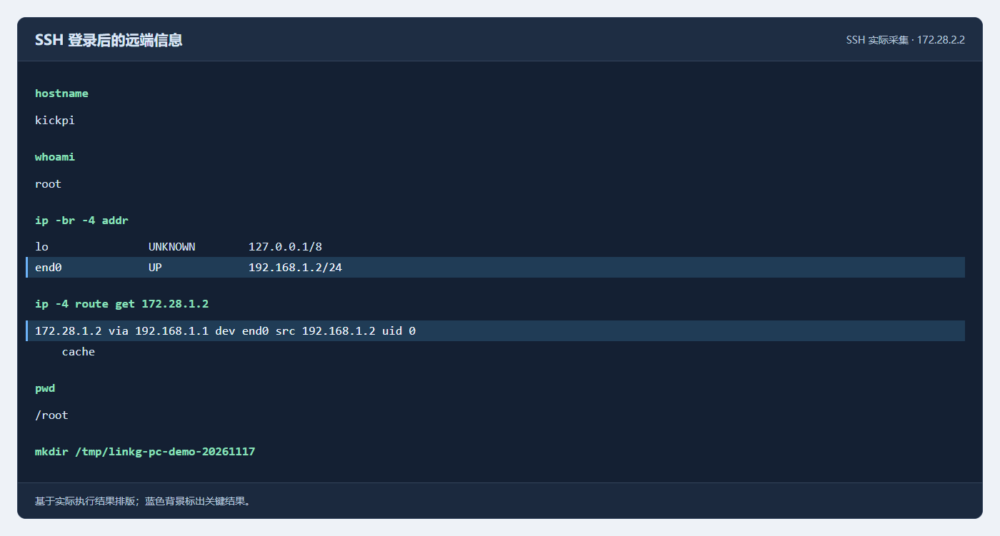
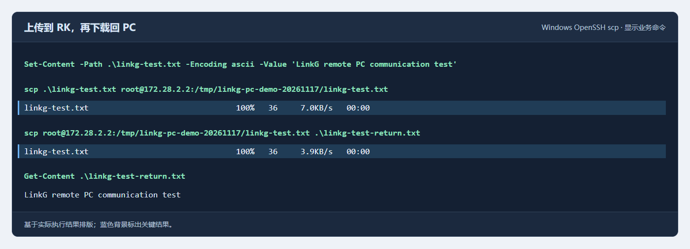
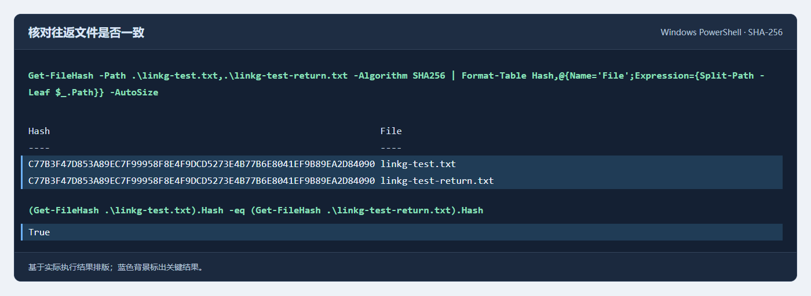

# 远程电脑通信

本案例使用 Windows PC 和 RK 开发板，分别通过以太网连接两台 LinkG。两台 LinkG 完成组网后，PC 使用 RK 的虚拟组网地址，进行 **SSH 远程登录、命令操作和双向文件传输**。RK 在这里作为远端 Linux 电脑使用。



## 1. 准备设备与软件

1. PC 通过以太网连接 **LinkG A：AP，节点 1**。
2. RK 通过以太网连接 **LinkG B：STA，节点 2**。
3. 两台 LinkG 已按[一对一配置](../02-快速入门/01-一对一配置.md)完成组网，两端 DHCP 服务开启。
4. PC 可以执行 `ssh`、`scp` 命令，RK 已启用 SSH 服务，并准备好 RK 的登录账号及密码。本例使用 `root`；其他设备按实际账号替换。

本例地址如下：

| 设备 | 本地以太网地址 | 虚拟组网地址 |
|---|---|---|
| 本地 PC | `192.168.1.2` | `172.28.1.2` |
| LinkG A：AP，节点 1 | `192.168.1.1` | `172.28.1.1` |
| LinkG B：STA，节点 2 | `192.168.1.1` | `172.28.2.1` |
| 远端 RK | `192.168.1.2` | **`172.28.2.2`** |

两侧是各自独立的本地网络，因此 PC 和 RK 可以使用相同的本地地址。**从 PC 访问远端 RK 时，使用 `172.28.2.2`，不能使用远端的 `192.168.1.2`。** 虚拟地址用于组网访问，无需再配置到电脑网卡上；DHCP 分配了其他地址时，应使用对应的实际虚拟地址。

## 2. 确认 LinkG 组网正常

在 PC 上打开 [AP 的概览页面](http://172.28.1.1/?v=LinkG-v1.0.0#/overview)，检查：

- 本机为 **AP、节点 1**。
- 组网节点中出现 **节点 2，地址 `172.28.2.1`**。
- 节点 2 的 **Wi-Fi 显示“可用”**，业务发送计划使用 Wi-Fi。



本次使用 Wi-Fi 组网，页面中蜂窝也可用并作为备用链路；无需为本章操作修改现有切换策略。尚未建立组网时，先完成快速入门中的配对，再继续下面的电脑通信步骤。

## 3. 检查 PC 网络并验证远端可达

### 3.1 推荐使用 DHCP 接入

将 PC 的以太网 IPv4 设置为自动获取地址，重新连接网线或更新 DHCP 租约。在 PowerShell 中执行：

```powershell
netsh interface ipv4 show config name="以太网"
route print -4 172.28.*
```

`以太网` 是本例网卡名称，其他电脑按实际名称替换。下图展示实际网卡配置和 IPv4 组网路由表部分：



重点检查两项：

| 项目 | 本例实际结果 |
|---|---|
| PC 以太网地址 | `192.168.1.2`，掩码 `255.255.255.0`，DHCP 为 `Yes` |
| 组网路由 | 目标 `172.28.0.0`，掩码 `255.255.0.0`，网关 `192.168.1.1`，本机接口 `192.168.1.2` |

**本章只要求组网路由，不要求将 PC 的 Internet 默认网关改成 LinkG。** LinkG 的“下发默认网关”可以保持关闭，PC 仍可通过其他网络上网。

静态 IP 接入时，应手动配置本地网段地址，并添加上述组网路由；客户端不支持 DHCP 路由选项时也需要手动添加。具体命令按[基础网络](../03-功能与配置指南/03-网络配置/01-基础网络.md)或 LinkG 基础网络页面生成的客户端命令操作。

RK 端也需要正确的本地地址及返回组网的路由。本例 RK 通过 DHCP 取得 `192.168.1.2/24` 和 `172.28.0.0/16 via 192.168.1.1`，第 4 节会展示其实际返回路由。

### 3.2 从 PC 验证通信

依次执行：

```powershell
ping -n 4 -w 2000 172.28.1.1
ping -n 4 -w 2000 172.28.2.1
ping -n 4 -w 2000 172.28.2.2
```

三条命令分别检查 **本地 AP → 远端 STA → 远端 RK**。本次均为 4 发 4 收、0 丢包；下图是最后一条访问 RK 的实际输出：



若前两项正常而 RK 不通，先检查 RK 的网口地址、回程路由及系统防火墙。某些系统禁止 ICMP 时，也应结合 SSH 是否可以连接判断。

## 4. 使用 SSH 登录远端 RK

在 **PC 的 PowerShell** 中执行：

```powershell
ssh root@172.28.2.2
```

首次连接时核对目标设备的主机指纹后确认，再输入 **RK 的 SSH 密码**；输入密码时终端通常不显示字符。成功登录后，在 RK 的远程终端执行：

```sh
hostname
whoami
ip -br -4 addr
ip -4 route get 172.28.1.2
pwd
mkdir /tmp/linkg-pc-demo-20261117
```

最后一条创建本案例上传文件使用的临时目录；若已有同名目录，可直接使用或另选目录，并对应修改后续路径。



图中主机名为 `kickpi`、用户为 `root`，说明已进入 RK。`172.28.1.2 via 192.168.1.1 dev end0` 表明 RK 返回 PC 组网地址时，也通过本地 LinkG 的以太网接口发送。

完成远程操作后执行 `exit`，**返回 PC 的 PowerShell**，再进行文件传输。

## 5. 上传文件并下载验证

### 5.1 在 PC 创建测试文件

在 PC 新建一个空文件夹，在该文件夹中打开 PowerShell，执行：

```powershell
Set-Content -Path .\linkg-test.txt -Encoding ascii -Value 'LinkG remote PC communication test'
```

该命令生成测试文件 `linkg-test.txt`。后续的 `scp` 和文件校验都在这个 PC 文件夹中执行。

### 5.2 上传到 RK，再下载回 PC

```powershell
scp .\linkg-test.txt root@172.28.2.2:/tmp/linkg-pc-demo-20261117/linkg-test.txt
scp root@172.28.2.2:/tmp/linkg-pc-demo-20261117/linkg-test.txt .\linkg-test-return.txt
Get-Content .\linkg-test-return.txt
```

按提示输入 RK 密码。第一条将文件上传到 RK，第二条使用另一个文件名下载回 PC，第三条查看下载文件内容。



本次两次传输均显示 **`100%`**，下载文件内容为 **`LinkG remote PC communication test`**。图中的小文件用于验证操作流程，吞吐量测试见[链路性能测试](../03-功能与配置指南/06-诊断工具/02-链路性能测试.md)。

### 5.3 比较文件 SHA-256

```powershell
Get-FileHash -Path .\linkg-test.txt,.\linkg-test-return.txt -Algorithm SHA256 | Format-Table Hash,@{Name='File';Expression={Split-Path -Leaf $_.Path}} -AutoSize
(Get-FileHash .\linkg-test.txt).Hash -eq (Get-FileHash .\linkg-test-return.txt).Hash
```



两个文件的 SHA-256 相同，比较结果为 **`True`**，确认上传、下载后内容一致。至此，本例已实际完成 **PC 访问远端 RK、SSH 命令操作和文件往返传输**。

实际业务可将测试文件替换成所需文件，上传到远端账号具有写入权限的目录；本例 `/tmp` 为临时目录，不用于长期保存业务文件。

## 6. 常见检查项

| 现象 | 优先检查 |
|---|---|
| 本地 LinkG 正常，远端 LinkG 不通 | 两台 LinkG 是否组网成功，节点 ID、虚拟网络及 Wi-Fi 参数是否匹配 |
| LinkG 都可达，RK 不可达 | RK 的网线、地址和组网回程路由；是否使用了正确的 RK 虚拟地址 |
| ping 正常，但 SSH 超时或拒绝连接 | RK 是否启动 SSH 服务、实际监听端口及终端防火墙；账号和密码由 RK 系统管理 |
| SSH 正常，文件上传失败 | 目标目录是否存在、账号是否有写入权限、磁盘空间，以及远端是否支持 scp 使用的文件传输服务 |
| PC 没有组网路由 | 更新 DHCP 租约；不支持 DHCP 路由选项时，按基础网络指南手动添加 |
