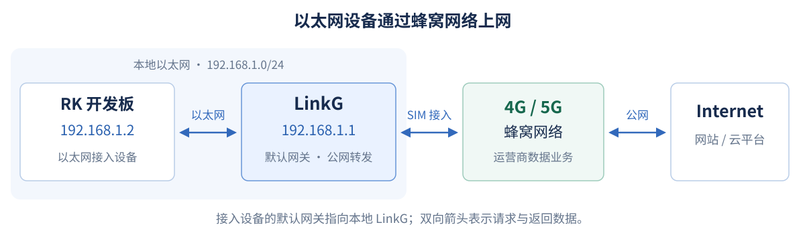
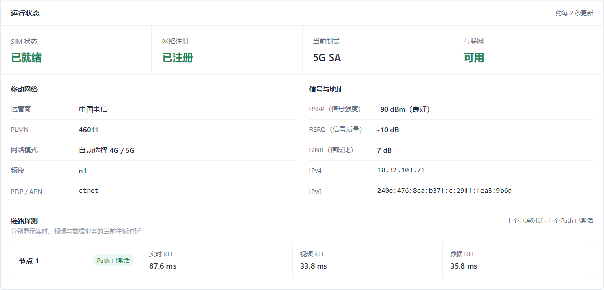
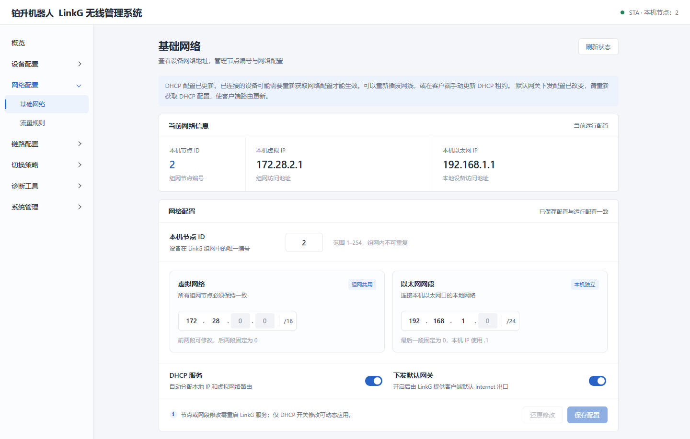
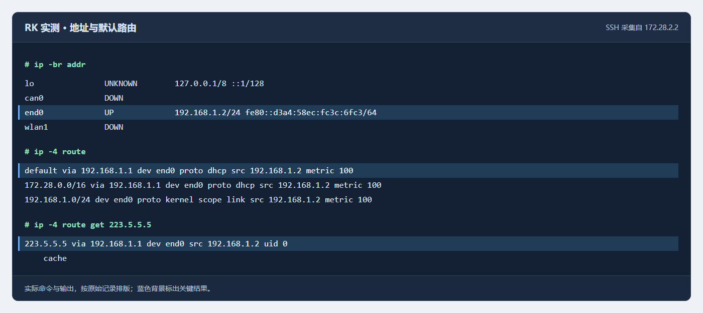
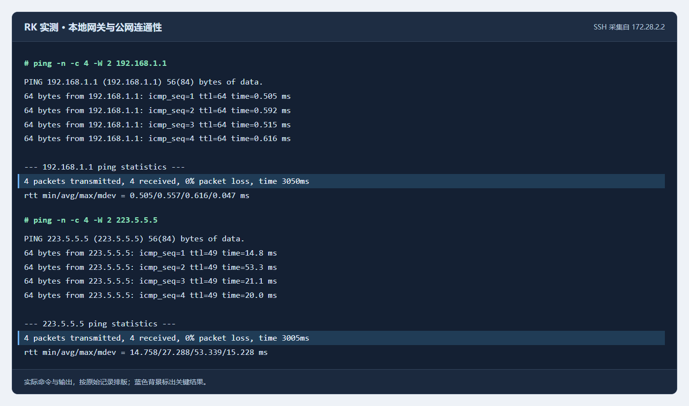
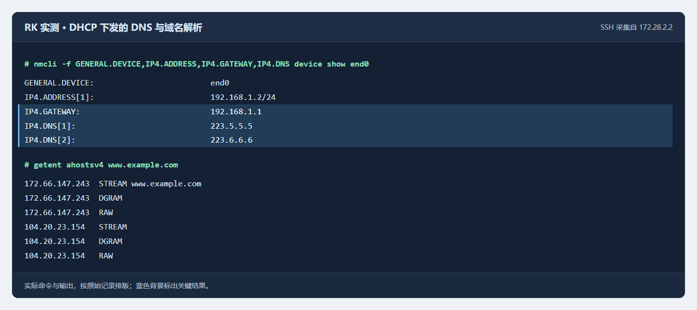
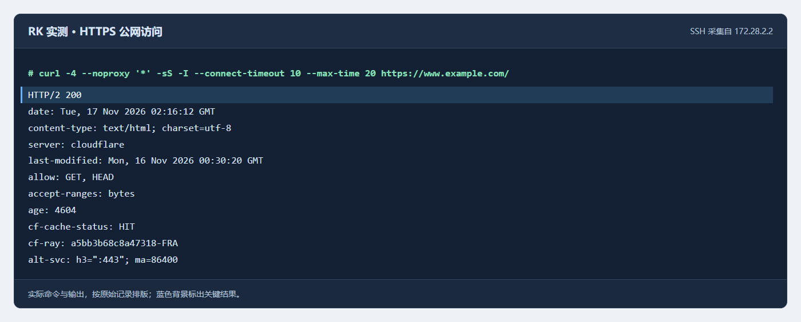

# 以太网设备通过蜂窝网络上网

本案例以 RK 开发板为以太网终端，通过一台 LinkG 的 4G／5G 蜂窝网络访问 Internet。电脑和其他具有以太网接口的设备，也可以按同样的方法配置。



## 1. 硬件连接与地址

按图连接 RK 与 LinkG 的以太网接口，安装已开通数据业务的 SIM 卡及对应天线，并为两台设备分别供电。图中的摄像头不参与本章上网配置。


本例 LinkG 为节点 2，使用以下地址：

| 地址 | 用途 |
|---|---|
| `192.168.1.0/24` | LinkG 与 RK 之间的本地以太网网段 |
| `192.168.1.1` | LinkG 本地以太网地址，也是 RK 应使用的默认网关 |
| `192.168.1.2` | 本例 RK 对应的本地以太网地址；DHCP 接入时以设备实际取得的地址为准 |
| `172.28.2.1` | LinkG 节点 2 的虚拟组网访问地址 |
| `172.28.2.2` | 本例 RK 的虚拟组网访问地址，用于从 LinkG 组网中访问 RK |

**本地网口地址与虚拟访问地址用途不同。** 配置 RK 的以太网接口和默认网关时，使用 `192.168.1.x` 本地地址；`172.28.2.2` 用于组网访问，不应直接填成 RK 的以太网默认网关。

## 2. 确认 LinkG 蜂窝网络可上网

进入本机 Web 的 **“链路配置 → 5G”**，按 SIM 要求设置网络模式、APN 和 PIN，启用蜂窝模块并应用。当前页面名为“5G”，同时管理 4G LTE 和 5G NR SA。



继续前确认：

- SIM 状态为**已就绪**，网络注册为**已注册**。
- 已取得蜂窝地址，互联网显示**可用**。
- 自动模式实际使用 4G 或 5G 均可，具体以当前网络覆盖为准。

“LinkG 5G Path”用于设备间的蜂窝组网，与以太网终端的默认网关设置分别管理。本案例的公网出口来自本地 LinkG 的蜂窝接入；参数含义见[蜂窝网络](../03-功能与配置指南/04-链路配置/02-蜂窝网络.md)。使用蜂窝网络会产生 SIM 数据流量。

## 3. 推荐方式：客户端自动获取 IP

进入 **“网络配置 → 基础网络”**，开启以下两项并点击“保存配置”：

| 选项 | 本案例设置 | 作用 |
|---|---|---|
| DHCP 服务 | **开启** | 自动给以太网客户端分配地址及网络参数 |
| 下发默认网关 | **开启** | 将本机 LinkG 设置为客户端的 Internet 默认出口，同时下发 DNS |



仅修改这两个选项时会动态应用，无需重启全部 LinkG 服务。**已经连接的客户端需要重新获取 DHCP 租约**，原有地址不会因为点击保存就自动获得新的网关和 DNS。

在 RK 或电脑中，将连接 LinkG 的以太网接口设为“自动获取 IPv4 地址和 DNS”，然后断开并重新启用该网络连接，或使用系统提供的租约更新操作。具体网卡名称以终端实际显示为准。

本例客户端应取得：

| 参数 | 应检查的内容 |
|---|---|
| IPv4 地址 | `192.168.1.2～192.168.1.254` 中的未冲突地址 |
| 子网掩码 | `255.255.255.0`，即 `/24` |
| 默认网关 | `192.168.1.1` |
| DNS | 当前 LinkG 下发 `223.5.5.5`、`223.6.6.6` |

LinkG 的“基础网络”页面底部可按实际 Windows 网卡名，或 Linux 网卡及 NetworkManager 连接名称生成 DHCP 操作命令。Linux 使用其他网络管理方式时，应通过对应工具配置，不能直接套用 NetworkManager 命令。

## 4. 另一种方式：手动设置静态 IP

不能使用 DHCP 的设备，可在其以太网设置中手动填写：

| 参数 | 示例 |
|---|---|
| IPv4 地址 | `192.168.1.2`，使用前确认没有其他设备占用 |
| 子网掩码／前缀 | `255.255.255.0`／`24` |
| 默认网关 | **`192.168.1.1`** |
| 首选／备用 DNS | `223.5.5.5`／`223.6.6.6` |

静态客户端不依赖 DHCP 下发，但必须自行配置默认网关和 DNS。**只设置同网段 IP，通常只能实现本地访问，不能据此判断公网已经可用。** 多台设备使用静态地址时，还需避免与 DHCP 地址池中的现有客户端冲突。

## 5. 验证接入设备可以上网

下面的命令均在 **RK 开发板上**执行。配图为通过 SSH 采集的实际命令与输出，蓝色背景标出了关键结果。本例网卡为 `end0`，其他设备以实际网卡名称为准。

### 5.1 查看地址与默认网关

```sh
ip -br addr
ip -4 route
ip -4 route get 223.5.5.5
```



重点对照以下结果：

| 实际输出 | 怎样判断 |
|---|---|
| `end0 UP 192.168.1.2/24` | 以太网接口已启用，取得本地网段地址 |
| `default via 192.168.1.1 dev end0` | **默认网关是本地 LinkG**；公网流量默认交给它转发 |
| `223.5.5.5 via 192.168.1.1 dev end0 src 192.168.1.2` | 查询公网目标时，实际选中的出口也是连接 LinkG 的网卡 |
| `172.28.0.0/16 via 192.168.1.1` | 这是 LinkG 组网路由，不能代替 Internet 的默认路由 |

本例默认路由带有 `proto dhcp`，说明通过 DHCP 取得。**如果没有 `default via 192.168.1.1`，先检查默认网关下发和客户端租约，或静态配置中的网关。** 设备同时有 Wi-Fi 等其他网络时，还要确认公网路由没有选到其他出口；图中 RK 的 `wlan1` 未连接。

### 5.2 测试本地网关与公网 IP

```sh
ping -n -c 4 -W 2 192.168.1.1
ping -n -c 4 -W 2 223.5.5.5
```



两项结果均为 **`4 packets transmitted, 4 received, 0% packet loss`**：第一项确认 RK 与本地 LinkG 连通，第二项确认经 LinkG 可以访问公网 IP。公网时延会随蜂窝网络变化；个别目标不响应 ICMP 时，继续用下面的实际应用访问检查。

### 5.3 查看 DNS 并验证域名解析

本例 RK 使用 NetworkManager，可查看网口取得的网关及 DNS，再测试域名解析：

```sh
nmcli -f GENERAL.DEVICE,IP4.ADDRESS,IP4.GATEWAY,IP4.DNS device show end0
getent ahostsv4 www.example.com
```



图中 `IP4.GATEWAY` 为 `192.168.1.1`，两个 `IP4.DNS` 分别为 `223.5.5.5`、`223.6.6.6`；`getent` 返回目标域名对应的 IPv4 地址，说明解析成功。域名返回的地址可能变化，不必与图中一致。

其他网络管理方式应使用系统对应工具查看 DNS。本例 `/etc/resolv.conf` 显示的 `127.0.0.53` 是系统本地 DNS 解析服务，实际使用的上游 DNS 应通过 `resolvectl status` 或上述 `nmcli` 命令查看。

### 5.4 验证 HTTPS 访问

```sh
curl -4 --noproxy '*' -sS -I --connect-timeout 10 --max-time 20 https://www.example.com/
```



本次返回 **`HTTP/2 200`**，说明已完成目标域名解析、连接和 HTTPS 请求。命令中的 `--noproxy '*'` 用于绕过代理，`-4` 指定 IPv4；也可通过浏览器或设备实际使用的云平台验证访问。

本例已确认默认出口为 `192.168.1.1`，公网 ping、DNS 和 HTTPS 均通过，**RK 已通过以太网借助 LinkG 的蜂窝网络上网**。仅能访问组网地址 `172.28.2.2`，还不能代替上述公网验证。

## 6. 常见检查项

| 现象 | 优先检查 |
|---|---|
| 没有取得本地地址 | 网线、接口连接状态、DHCP 是否开启，以及客户端是否处于自动获取模式 |
| 能访问 LinkG，公网不通 | LinkG 蜂窝互联网状态、客户端默认网关；修改网关下发后是否重新获取租约 |
| 公网 IP 可达，域名访问失败 | 客户端 DNS 是否取得或手动填写正确 |
| 组网地址可达，但不能上网 | 组网路由与 Internet 默认路由分别配置，检查客户端是否具有经 LinkG 的默认出口 |
| 设备已有其他默认路由 | 查看实际选用的网卡和下一跳，按终端网络管理方式调整出口优先级 |

更改 LinkG 以太网网段时，本文的客户端地址、默认网关及访问地址也需对应调整。完整字段与客户端命令说明见[基础网络](../03-功能与配置指南/03-网络配置/01-基础网络.md)。
